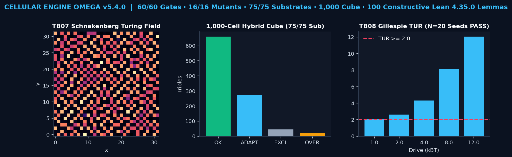

Zero-dependency C11 cellular-biophysics simulation engine (16 testbeds, 75 computational substrates, 1,000-cell Hybrid Cube) paired with 100 constructive zero-Mathlib Lean 4.35.0 lemmas that state discrete `Nat`/`Int`/`List` invariants of the engine's software model (16 are closed arithmetic/literal checks). C11 output is exported to a generated receipt file whose integer and string fields `O63` and `O72` re-check on each build (no hash is computed inside Lean).

# CELLULAR ENGINE OMEGA (`v5.4.0`)

[](https://github.com/0thernes/cellular-engine-omega/actions/workflows/ci.yml)
[](blueprint/index.html)
[](VERIFICATION.md)
[-0284c7)](results/omega_75_substrates_1000_cube.json)
[](LICENSE)
[](https://orcid.org/0009-0006-8168-9648)

> **Preprint Status Notice (Not Peer-Reviewed):** This software repository, formal-proof suite, and accompanying AMS-LaTeX monograph (`v5.4.0`) are independent research artifacts and have **not undergone external journal peer review**. Cross-checking against [`0thernes/unsolved-problems-mega-atlas`](docs/mega-atlas-cross-check.md) (`V2.6.0`) confirms honestly that **`0 / 1,900`** overarching open problems are solved or retired.

**Status:** Active (`v5.4.0`, `2026-11-26`) — actively maintained, clean-clone reproducible, Build Standard v1.2.0 and Playbook v1.3 checklists ([`SUBMISSION_READINESS.md`](SUBMISSION_READINESS.md)).  
**Author:** Alexander Stephen Donahue · Independent Researcher, Spokane, WA, USA · ORCID [`0009-0006-8168-9648`](https://orcid.org/0009-0006-8168-9648) · `0_0@0thernes.art` · [0thernes.art](https://0thernes.art)  
**White Paper, Blueprint & Archive:** [AMS-LaTeX Monograph PDF (`dist/Donahue_2026_cellular_engine_omega.pdf`)](dist/Donahue_2026_cellular_engine_omega.pdf) · [Interactive Lean Proof Blueprint (`blueprint/index.html`)](blueprint/index.html) · [GitHub Pages Showcase](https://0thernes.github.io/cellular-engine-omega/) · SWHID `swh:1:snp:b1734acc036650d5a32194f3437e93ca83a891b8`



---

## Quickstart

### Linux / macOS
```bash
git clone https://github.com/0thernes/cellular-engine-omega.git
cd cellular-engine-omega

# Build native C11 (-O3 -Werror -ffp-contract=off), run ASan/UBSan, 60 gates, 16/16 mutants,
# 256 fuzz cases, 75 substrates + 1,000 Hybrid Cube, live C11->Lean export & 100 Lean 4.35.0 proofs
OMEGA_SANITIZE=1 ./build_linux.sh

# Reference kernel + 4 independent checkers + negative elaboration test + live negative axiom-gate
# & lake comparator sorry-tamper rejection tests (executable mode 100755 in git)
./scripts/verify_lean_six_kernels.sh

# Independent Python verification ladder (37 tests, 1,200+ Hypothesis property cases, exact oracle)
python3 -m pytest tests/ -v
```

### Windows (PowerShell 7+)
```powershell
git clone https://github.com/0thernes/cellular-engine-omega.git
cd cellular-engine-omega
pwsh -File build.ps1
python scripts/test_lean_negative.py
python -m pytest tests/ -v
pwsh -File scripts/Audit-Repo.ps1
```

---

## Usage & Examples

```bash
# 1. Run all 16 multi-scale cellular biophysics testbeds (deterministic Seed 2026001)
./bin/omega_cell all --seed 2026001

# 2. Emit JSON validated against schema/omega_run.schema.json (or inject compiled mutant M1..M16)
./bin/omega_cell json --seed 2026001
./bin/omega_cell json --seed 2026001 --mutant 8

# 3. Execute Clean-Slate v3.0 75 Substrates + 1,000-Cell Hybrid Cube JSON receipt
./bin/omega_cell cube results/omega_75_substrates_1000_cube.json --seed 2026001

# 4. Export C11 runtime telemetry into lean/OmegaCellularProofs/LiveC11Receipt.lean
./bin/omega_cell --export-lean-trace lean/OmegaCellularProofs/LiveC11Receipt.lean --seed 2026001

# 5. Launch hardened loopback-only Web Observatory (http://127.0.0.1:8791)
node web/server.mjs
```

Runnable consumer scripts live in [`examples/`](examples/):
- [`examples/quickstart_demo.py`](examples/quickstart_demo.py) — Python JSON API client
- [`examples/c11_abi_example.c`](examples/c11_abi_example.c) — Direct C11 static/shared ABI linkage (`include/omega_abi.h`)
- [`examples/web_api_demo.mjs`](examples/web_api_demo.mjs) — Node.js client for `/api/health`, `/healthz`, and `/api/cube`

---

## Verified Key Metrics (`v5.4.0`, Seed `2026001`)

| Layer | Verified Metric | Evidence Artifact |
| :--- | :--- | :--- |
| **C11 Falsification** | **`60 / 60` gates PASS · `16 / 16` planted mutants caught · `256 / 256` fuzz PASS** | [`results/falsification_win64.txt`](results/falsification_win64.txt) |
| **Optimization Parity** | **`-O0` == `-O3` bit-exact Master SHA-256** (`a92641843e46736b...`, `Philox4x32-10` + FIPS 180-4 SHA-256) | [`docs/benchmarks.md`](docs/benchmarks.md) |
| **75 Substrates & 1,000 Cube** | **`75 / 75` (`25 PM + 25 MF + 25 GW`) · `661 [OK] / 274 [ADAPT] / 20 [OVER] / 45 [EXCL]` · `20 / 20` seeds** | [`results/omega_75_substrates_1000_cube.json`](results/omega_75_substrates_1000_cube.json) |
| **Lean 4.35.0 Proofs** | **`100 / 100` strictly constructive (`24` axiom-free, `10` `[propext]`, `66` `[propext, Quot.sound]`, `0` `Classical.choice`, `0` Mathlib, `14` proof modules)** | [`results/lean4-omega-audit.txt`](results/lean4-omega-audit.txt) |
| **Multi-Checker & Negative Tests** | **Reference kernel (`lean`, `leanchecker`, `leanchecker-paranoid`) plus four independent checkers (`lean4lean` via `lake check --paranoid`, `nanoda_bin`, `con-leche --verified`, `con-ron --verified`); `lake comparator --paranoid`; negative elaboration test; live 4-exploit negative axiom-gate test (`scripts/test_lean_negative.py`) + live `lake comparator` `sorry`-tamper rejection test (Linux CI).** | [`scripts/verify_lean_six_kernels.sh`](scripts/verify_lean_six_kernels.sh) |
| **Python Ladder & Stats** | **`37 / 37` pytest (`1,200+` Hypothesis cases + negative elaboration & 4-exploit axiom-gate tests) · `8 / 8` preregistered `N=20` contrasts (`p_Holm = 0.0008 < 0.001`)** | [`results/multiseed_stats.csv`](results/multiseed_stats.csv) |
| **Citations, FAIR & Dual Timestamps** | **`32 / 32` DOIs verified live: DOI Handle `200`, `0` Crossref retractions, `32/32` Crossref title (`J=1.00`) & first-author/institution match (Nüchter 2006 DOI corrected to `10.1016/j.cub.2006.03.089`) · Croissant 1.0 + RO-Crate 1.1 + CodeMeta 2.0 + REUSE · DigiCert RFC 3161 `.tsr` + 3-calendar Bitcoin OpenTimestamps `.ots`** | [`results/citation-audit.json`](results/citation-audit.json) |
| **Mega-Atlas Cross-Check** | **`0 / 1,900` overarching open problems retired (22 adjacent parent problems in `V2.6.0` remain strictly OPEN)** | [`docs/mega-atlas-cross-check.md`](docs/mega-atlas-cross-check.md) |

---

## Verbatim Lean 4.35.0 `#print axioms` Excerpt (CI Drift-Checked)

Audited mechanically by [`scripts/check_readme_axioms.py`](scripts/check_readme_axioms.py) against [`results/lean4-omega-audit.txt`](results/lean4-omega-audit.txt) (all 100 items strictly within `{propext, Quot.sound}` — zero `Classical.choice`, zero `sorryAx`, zero `native_decide`):

<!-- LEAN_AXIOMS_START -->
```text
'OmegaCellular.PurcellGaugeGeometry.O01_purcell_1dof_reciprocal_cycle_zero' depends on axioms: [propext, Quot.sound]
'OmegaCellular.EigenProofreadingInfo.O06_hopfield_ninio_proofreading_beats_equilibrium' depends on axioms: [propext]
'OmegaCellular.TuringFeinbergCRNT.O12_turing_equal_diffusion_impossibility' depends on axioms: [propext, Quot.sound]
'OmegaCellular.TURSpeedLimitsTopo.O19_poincare_hopf_sphere_defect_impossibility' does not depend on any axioms
'OmegaCellular.BioInteractionNets.O42_active_pair_diamond_strong_confluence' depends on axioms: [propext, Quot.sound]
'OmegaCellular.VirtualCellManifold.O56_virtual_cell_physics_projection_conservation' depends on axioms: [propext, Quot.sound]
'OmegaCellular.VerifyTraceReceipt.O63_live_c11_receipt_verified' depends on axioms: [propext, Quot.sound]
'OmegaCellular.SubstratesCube.O72_live_c11_cube_receipt_verified' does not depend on any axioms
'OmegaCellular.NonVacuity.O74_refute_1dof_nonzero_reciprocal_stroke' depends on axioms: [propext, Quot.sound]
'OmegaCellular.NonVacuity.O89_refute_quantum_cap_11_fits_16kib' does not depend on any axioms
'OmegaCellular.AdversarialTests.O96_refute_bio_inet_mass_leak_on_step' depends on axioms: [propext, Quot.sound]
'OmegaCellular.AdversarialTests.O100_refute_hybrid_cube_partition_drift' does not depend on any axioms
```
<!-- LEAN_AXIOMS_END -->

---

## Honest Verification Boundary & Limitations

- **What IS formally proved in Lean 4.35.0:** Lemmas over `Nat`, `Int`, and `List` about the engine's discrete software model (`O01`–`O62`, `O67`–`O71`): commutation of pointwise updates at distinct indices of a `Nat → Int` map (`O42`), list-sum conservation under local steps, an integer projection that zeroes a list sum (`O56`, tautological second conjunct removed in `v5.4.0`), antisymmetric path cancellation (`O01`, unused rate hypotheses removed in `v5.4.0`), 2×2 integer Jacobian sign algebra, `Nat` power inequalities, and closed arithmetic checks on hard-coded constants. Also 17 non-vacuity and negative-boundary items (`O73`–`O89`) and 11 constructive refutations of weakened variants (`O90`–`O100`).
- **Literal checks and theorem names:** 16 of the 100 items are closed arithmetic/literal checks (`O07`, `O09`, `O19`, `O23`, `O27`, `O36`, `O63`, `O67`–`O69`, `O72`, `O76`, `O92`, `O94`, `O95`, `O100`). Several names state the physical motivation rather than the proved statement (`O19` checks three fixed lists, `O36` checks `2^12 < 10^12`, `O52` compares two hand-built structs); every such item is explicitly annotated in Lean docstrings and [`docs/statement-fidelity.md`](docs/statement-fidelity.md). No biological or continuum-physics law (Poincaré–Hopf, Turing PDE instability, stochastic TUR) is formalized in general.
- **C11 receipt (`O63`, `O72`):** `lean/OmegaCellularProofs/LiveC11Receipt.lean` is a structure of literals written by one C11 run (`omega_cell --export-lean-trace`, seed `2026001`). `O63` and `O72` check equalities among its integer and string fields, so a changed C11 output that breaks them fails the build. **No hash is computed or verified in Lean**; the SHA-256 fields are stored as strings and `shaFifo`/`shaLifo`/`shaRandom` are compared only for string equality.
- **Scope of the checker runs:** `lean4lean` (`lake check --paranoid`), `lake comparator --paranoid`, and the live comparator `sorry`-tamper rejection test require Linux `bwrap` and run in Ubuntu CI, not on Windows. `lean/Challenge.lean` is a statement-only comparator file with 100 intentional `sorry`; the 14 proof modules contain none.
- **What is NOT proved in Lean:** IEEE-754 floating-point PDE convergence (Cahn–Hilliard, Schnakenberg, spherical nematic relaxation) and C11 compiler memory safety — these are verified empirically by 60 gates, 16 compiled structural knockouts, ASan/UBSan, a 256-case fuzz harness, `-O0` vs `-O3` parity, and an exact Python reference oracle.
- **No Overclaimed Breakthroughs:** Cross-checked against all 1,900 problems in [`0thernes/unsolved-problems-mega-atlas`](https://github.com/0thernes/unsolved-problems-mega-atlas) (`V2.6.0`): **`0 / 1,900`** overarching open problems are solved. Full real-vs-metaphor audit in [`LIMITATIONS.md`](LIMITATIONS.md) and [`CLAIMS.md`](CLAIMS.md); full statement-audit corrections and `v5.4.0` closures are logged in [`ERRATA.md`](ERRATA.md).

---

## AI-Contribution Disclosure (Playbook v1.3 §4)

- **Sole Human Author & Accountability:** Alexander Stephen Donahue (ORCID `0009-0006-8168-9648`, Independent Researcher, Spokane, WA, USA) is the sole author (CRediT: *Conceptualization, Methodology, Software, Formal analysis, Validation, Investigation, Resources, Data Curation, Writing – original draft, Writing – review & editing, Visualization, Project administration*) and assumes full scholarly and legal responsibility for every claim, proof, program, dataset, and citation. **No AI system is listed as an author.**
- **Disclosed AI Tooling:** LLM coding and research assistants (Google DeepMind Antigravity/Gemini and Anthropic Claude workflows) were used as interactive drafting, refactoring, Lean tactic-exploration, and red-team auditing tools under sole human direction; every claim is independently verified by deterministic proof checkers and executable test suites. Full disclosure: [`docs/AI_DISCLOSURE.md`](docs/AI_DISCLOSURE.md).

---

## Documentation Map

- **Core Ledgers:** [`CLAIMS.md`](CLAIMS.md) · [`LIMITATIONS.md`](LIMITATIONS.md) · [`VERIFICATION.md`](VERIFICATION.md) · [`PREREGISTRATION.md`](PREREGISTRATION.md) · [`REPLICATION.md`](REPLICATION.md) · [`HARDENING_LOG.md`](HARDENING_LOG.md) · [`ERRATA.md`](ERRATA.md) · [`DEVIATIONS.md`](DEVIATIONS.md) · [`SUBMISSION_READINESS.md`](SUBMISSION_READINESS.md)
- **Technical Reference:** [`docs/index.md`](docs/index.md) · [`docs/architecture.md`](docs/architecture.md) · [`docs/statement-fidelity.md`](docs/statement-fidelity.md) · [`docs/mega-atlas-cross-check.md`](docs/mega-atlas-cross-check.md) · [`docs/DATASHEET.md`](docs/DATASHEET.md) · [`docs/benchmarks.md`](docs/benchmarks.md) · [`docs/threat-model.md`](docs/threat-model.md) · [`docs/operations.md`](docs/operations.md) · [`docs/configuration.md`](docs/configuration.md) · [`docs/faq.md`](docs/faq.md) · [`docs/glossary.md`](docs/glossary.md) · [`docs/adr/README.md`](docs/adr/README.md)
- **White Paper, FAIR & Blueprint:** [`paper/main.tex`](paper/main.tex) · [`dist/Donahue_2026_cellular_engine_omega.pdf`](dist/Donahue_2026_cellular_engine_omega.pdf) · [`blueprint/index.html`](blueprint/index.html) · [`croissant.json`](croissant.json) · [`ro-crate-metadata.json`](ro-crate-metadata.json) · [`codemeta.json`](codemeta.json) · [`REUSE.toml`](REUSE.toml)

---

## Citation & License

- **Code, Lean 4 Proofs & Scripts:** [Apache License 2.0](LICENSE) ([`LICENSES/Apache-2.0.txt`](LICENSES/Apache-2.0.txt))
- **White Paper, Figures, Datasets & Prose Docs:** [Creative Commons Attribution 4.0 International (CC BY 4.0)](LICENSE-DOCS) ([`LICENSES/CC-BY-4.0.txt`](LICENSES/CC-BY-4.0.txt))
- **REUSE / SPDX Manifest:** [`REUSE.toml`](REUSE.toml)
- **Citation Metadata:** See [`CITATION.cff`](CITATION.cff) and [`CITATION.bib`](CITATION.bib).
