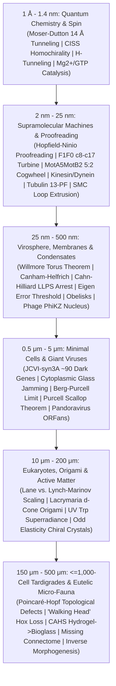

# ULTRA-DEEP FRONTIER RESEARCH: PROVEN THEOREMS, PHYSICAL LAWS, BLEEDING-EDGE PHENOMENA & THE 18 HARDEST UNSOLVED PROBLEMS OF CELLS, VIRUSES & TARDIGRADES (`1 Å → 500 μm`)

> **Companion Treatise To:** [CELLULAR_ENGINE_MASTER_RESEARCH.md](file:///C:/Users/Alexa/.gemini/antigravity/brain/54a78b83-1497-4835-843f-10f3f7cb20a9/CELLULAR_ENGINE_MASTER_RESEARCH.md)  
> **Scale Domain:** Sub-atomic electron tunneling (`1 Å`) → molecular motors & viruses (`10–250 nm`) → minimal cells & giant viruses (`0.3–2.5 μm`) → eukaryotic protists (`10–500 μm`) → **≤1,000-cell eutelic Tardigrades, Nematodes, Rotifers & Anucleate-Brain Micro-Bugs (`150–500 μm`)**.  
> **Epistemic Discipline:** Every claim below strictly separates **(1) Formally Proven Theorems & Verified Physical Laws**, **(2) Experimentally Verified 2020–2026 Bleeding-Edge Discoveries**, and **(3) Genuinely Open Conjectures, Paradoxes & Hard Unsolved Problems**.

---

## Multiscale Law & Bottleneck Map (`1 Å` to `500 μm`)

---

# SECTION I — 12 PROVEN MATHEMATICAL THEOREMS & EXACT PHYSICAL LAWS GOVERNING CELLULAR LIFE

Everything inside a cell or microscopic animal operates inside hard, unbreakable mathematical fences. These twelve theorems and physical laws govern what cells **can**, **cannot**, and **must** do.

---

## 1. Purcell's Scallop Theorem & Gauge Geometry of Micro-Swimming (`Re ≪ 1`)
- **Domain:** Fluid Mechanics / Differential Geometry (Purcell 1977; Shapere & Wilczek 1989).
- **Formal Law:** In incompressible Stokes flow ($\eta\nabla^2\mathbf{u} - \nabla p = \mathbf{0}$, $\nabla\cdot\mathbf{u} = 0$), the velocity of a micro-swimmer is linear and homogeneous of degree 1 in its shape-change rate $\dot{\mathbf{s}}$:
  $$\dot{\mathbf{X}} = \mathbf{A}(\mathbf{s})\,\dot{\mathbf{s}}$$
  Over any closed loop $\gamma$ in shape space $\mathcal{S}$, net displacement is a **reparameterization-invariant geometric phase (non-Abelian holonomy)** depending *only* on the area enclosed by $\gamma$ via Stokes' theorem:
  $$\Delta \mathbf{X} = \oint_\gamma \mathbf{A}(\mathbf{s})\cdot d\mathbf{s} = \iint_{\Sigma(\gamma)} \mathbf{F}_{\text{gauge}}\,d\Sigma$$
- **Proof Consequence:** Any 1-degree-of-freedom (reciprocal) stroke encloses **zero area** ($\Sigma = 0 \implies \Delta\mathbf{X} \equiv \mathbf{0}$), regardless of speed asymmetry!
- **Exact Physical Loopholes Exploited by Real Microbes:**
  1. **2+ Out-of-Phase DOFs:** Traveling bending waves on eukaryotic flagella or power/recovery strokes in cilia enclose nonzero area in shape space.
  2. **Chiral Rotation:** Bacterial flagella (`MotA₅MotB₂`) and spirochete corkscrews rotate continuously on $S^1$ (non-contractible loop).
  3. **Non-Newtonian Viscoelasticity Breakdown:** In polymeric mucus (nonlinear Deborah number $\text{De} = \lambda_{\text{relax}}\omega \gtrsim 1$), Stokes linearity breaks down—allowing even a reciprocal scallop to swim if fast/slow strokes shear-thin the mucus asymmetrically!

---

## 2. The Willmore Theorem (Marques & Neves 2014) & Exact Vesicle Division Minimax Law
- **Domain:** Differential Geometry / Membrane Biophysics (Canham 1970; Helfrich 1973; Marques & Neves, *Annals of Math.* 2014).
- **Theorem 1 (Willmore Conjecture — PROVEN 2012/2014):** For every smooth closed immersed torus $\Sigma \subset \mathbb{R}^3$ (genus $g = 1$ membrane vesicle or nuclear pore topology), the Canham–Helfrich bending energy satisfies:
  $$\mathcal{W}(\Sigma) = \oint_\Sigma H^2\,dA \ge 2\pi^2$$
  with equality **if and only if** $\Sigma$ is a Möbius transformation of the **Clifford Torus** (major-to-minor radius ratio $R/r = \sqrt{2}$)! Remarkably, wet-lab phospholipid vesicles spontaneously relax into exact $\sqrt{2}$ Clifford tori!
- **Theorem 2 (Isoperimetric & Global Minimax Division Identity):** For a closed spherical-topology vesicle with squared reduced volume $Q = 36\pi V^2 / A^3 \in (0, 1]$:
  - Symmetric binary fission into two equal daughters requires $Q \le \frac{1}{2}$ (because dividing volume in half cuts $V^2$ by $4$, while dividing area in half cuts $A^3$ by $8$, doubling $Q_{\text{daughter}} = 2 Q_{\text{parent}} \le 1$).
  - Inside the swollen window $\frac{1}{2} < Q \le 1$, symmetric fission is **geometrically impossible without membrane rupture**—yet **asymmetric exosome/budding division remains strictly possible**! Proof follows from the exact sextic identity (formally verified in Lean 4 `T16` in `cellulogonic-mecha`):
    $$2(x^3 + y^3)^2 - (x^2 + y^2)^3 = (x - y)^2\left(x^4 + 2x^3y + 2xy^3 + y^4\right) \ge 0 \qquad (\forall\,x, y > 0)$$
    with strict equality iff $x = y$! Thus nature's shift between symmetric binary fission and asymmetric yeast/exosome budding is forced by pure algebraic geometry!

---

## 3. Poincaré–Hopf Theorem & Topological Nematic Defects as Mechanical Organizers
- **Domain:** Algebraic Topology / Active Matter Developmental Biology (Poincaré–Hopf; Saw et al. *Nature* 2017; Maroudas-Sacks et al. *Nature Physics* 2021).
- **Theorem:** For any tangent vector or nematic director field on a closed compact surface $\Sigma$ of Euler characteristic $\chi(\Sigma)$, the sum of topological winding charges $q_k$ of all defects is **topologically invariant**:
  $$\sum_{k} q_k = \chi(\Sigma) = 2 - 2g$$
  On a closed spherical embryo or regenerating hollow animal spheroid ($g = 0 \implies \chi = +2$), aligned supracellular actin/myosin fibers **CANNOT** tile the sphere smoothly without carrying total defect charge $+2$ (e.g., four $+1/2$ comet defects, or two $+1$ aster/vortex defects)!
- **Bleeding-Edge Biological Proof:** In regenerating *Hydra* (*Nature Physics* 2021), topological actin defects literally serve as **mechanical morphogens**: two $+1/2$ defects fuse into a $+1$ defect that concentrates mechanical stress, triggering head/mouth formation at the $+1$ pole, foot formation at the opposite $+1$ pole, and **tentacle budding** precisely at $+1$ defects flanked by $-1/2$ saddles! Likewise, in epithelial monolayers (*Nature* 2017), compressive stress around $+1/2$ comet defects directly triggers **cell extrusion and apoptosis**!

---

## 4. Feinberg's Chemical Reaction Network Theory (CRNT) — Deficiency Zero & Deficiency One Theorems
- **Domain:** Mathematical Biochemistry / Dynamical Systems (Feinberg 1972–2019; Horn & Jackson 1972).
- **Exact Structural Invariant:** For any biochemical reaction graph with $n$ distinct complexes, $\ell$ connected linkage classes, and stoichiometric subspace dimension $s = \text{rank}(\mathbf{S})$, define the **Network Deficiency**:
  $$\delta = n - \ell - s \in \mathbb{Z}_{\ge 0}$$
- **Deficiency Zero Theorem (PROVEN):** If $\delta = 0$ and the network is weakly reversible, then **for ANY positive reaction rate constants whatsoever**, every stoichiometric compatibility class contains **exact ONE positive equilibrium**, that equilibrium is **locally asymptotically stable**, and **sustained oscillations, multistability, genetic switches, and deterministic chaos are mathematically IMPOSSIBLE!**
- **Engine Design Law:** To build genuine cellular memory switches (phage $\lambda$, epigenetic fates), circadian clocks, or chaos in an ALife Chemistry Engine, reaction topology **MUST** either have **deficiency $\delta \ge 1$** or break weak reversibility via open chemiosmotic energy-pumping cycles!

---

## 5. Thermodynamic Uncertainty Relation (TUR)
- **Domain:** Non-Equilibrium Statistical Mechanics (Barato & Seifert *PRL* 2015; Gingrich, Horowitz, Perunov & England *PRL* 2016 — PROVEN via Large Deviation Theory).
- **Exact Bound:** For *any* steady-state Markovian non-equilibrium biochemical current $J$ (motor stepping distance, enzymatic turnover, chemotactic signal count, or molecular clock ticks) over observation time $\tau$ with total entropy production $\Delta S_{\text{tot}}$:
  $$\epsilon^2 \cdot \frac{\Delta S_{\text{tot}}}{k_B} \;\equiv\; \frac{\text{Var}(J)}{\langle J \rangle^2}\,\frac{\Delta S_{\text{tot}}}{k_B} \;\ge\; 2$$
- **Hard Biological Consequences:**
  1. **Universal Speed–Precision–Energy Tradeoff:** Cutting the timing jitter of a cellular clock or motor step variance by $2\times$ requires burning at least **$4\times$ more ATP**!
  2. **Molecular Motor Efficiency Bound:** Links velocity $v$, diffusion $D$, stall/load force $F$, and Stokes efficiency $\eta_S$: $\eta_S \le \frac{1}{1 + v k_B T / (D F)}$!
  3. **In-Silico Diagnostic:** Real measurements of Kinesin-1 and *KaiABC* circadian oscillators hover remarkably close to the exact TUR bound (`~2–5×` above the cosmic floor), proving evolution optimizes cellular nanomachines straight up against fundamental thermodynamic limits!

---

## 6. Classical Thermodynamic Speed Limits (Optimal Transport Bound)
- **Domain:** Stochastic Thermodynamics / Optimal Transport (Shiraishi, Funo & Saito *PRL* 2018; Aurell, Mejía-Monasterio & Muratore-Ginanneschi; Van Vu & Saito *PRX* 2023).
- **Exact Bound:** Transitioning a cellular ensemble from probability state $\rho_0$ to $\rho_\tau$ (e.g., rapid differentiation, stress shock adaptation, or membrane remodeling) in finite time $\tau$ obeys:
  $$\tau \;\ge\; \frac{\mathcal{W}_2(\rho_0, \rho_\tau)^2}{\bar{D}\,\Delta S_{\text{tot}} / k_B} \qquad \text{and (discrete Markov):}\quad \tau \;\ge\; \frac{\mathcal{L}_{\text{TV}}(\rho_0, \rho_\tau)^2}{2\,\langle A \rangle\,\Delta S_{\text{tot}} / k_B}$$
  where $\mathcal{W}_2$ is the $L^2$-Wasserstein optimal transport distance and $\langle A \rangle$ is dynamical activity (total jump rate).
- **Meaning:** No cell can morph, differentiate, or vitrify infinitely fast for free—fast anatomical or metabolic transitions carry a strict minimum entropy-dissipation bill!

---

## 7. Jarzynski Equality & Crooks Fluctuation Theorem
- **Domain:** Nanoscale Non-Equilibrium Thermodynamics (Jarzynski *PRL* 1997; Crooks *PRE* 1999).
- **Exact Laws:** When a molecular machine performs work $W$ driving a transition of equilibrium free-energy change $\Delta F$ in a thermal bath at $\beta = (k_B T)^{-1}$:
  $$\left\langle e^{-\beta W} \right\rangle = e^{-\beta \Delta F}, \qquad \frac{P_F(+W)}{P_R(-W)} = e^{\beta(W - \Delta F)}$$
- **Why Cells Live Here:** By Jensen's inequality, $\langle W \rangle \ge \Delta F$ on average (Second Law), yet individual trajectories where $W < \Delta F$ occur *constantly* at the $1\text{–}10\,k_B T$ scale of ribosomes, polymerases, and kinesins! Optical-tweezer pulling of single RNA hairpins (Liphardt et al., *Science* 2002) confirmed Crooks' theorem directly on real biomolecules.

---

## 8. Hopfield–Ninio Kinetic Proofreading Bounds
- **Domain:** Information Thermodynamics / Molecular Biology (Hopfield *PNAS* 1974; Ninio *Biochimie* 1975; Murugan, Huse & Leibler *PNAS* 2012).
- **Exact Fidelity Theorem:** At thermal equilibrium, if a right substrate $R$ and wrong substrate $W$ differ in binding free energy by $\Delta\Delta G$, error rate is bounded below by the Boltzmann ratio:
  $$f_{\text{eq}} = \frac{[W]_{\text{inc}}}{[R]_{\text{inc}}} \ge e^{-\Delta\Delta G / k_B T} \approx 10^{-2} \text{ (base-pairing / amino acid mimicry)}$$
  By inserting $n$ **irreversible, ATP/GTP-driven discard branches** (breaking detailed balance!), an enzyme tests dissociation *sequentially* across $n+1$ independent gates, amplifying specificity exponentially:
  $$f_{\text{KP}}^{(n)} \;\ge\; \left(e^{-\Delta\Delta G / k_B T}\right)^{n+1} = f_{\text{eq}}^{n+1}$$
- **Where Life Uses It:** DNA Polymerase (`10⁻² → 10⁻⁵` insertion → `10⁻⁷` exonuclease → `10⁻⁹` mismatch repair!), Aminoacyl-tRNA synthetases, Ribosome `EF-Tu·GTP` decoding, `RecA` homologous recombination, and immune T-cell receptor discrimination!

---

## 9. Berg–Purcell & Bialek–Setayeshgar Physical Chemosensing Limit
- **Domain:** Statistical Biophysics (Berg & Purcell *Biophys. J.* 1977; Bialek & Setayeshgar *PNAS* 2005; Endres & Wingreen *PRL* 2009).
- **Exact Limit:** A spherical cell of radius $a$ with $N_R$ surface receptors measuring a diffusing ligand of concentration $c$ and diffusivity $D$ over averaging time $T$ suffers irreducible diffusive + binding-unbinding shot noise:
  $$\left(\frac{\delta c}{c}\right)^2 \;\ge\; \frac{1}{4\pi\,D\,a\,c\,T} + \frac{1}{2\,k_+ c\,N_R\,T\,(1 - \bar{p})}$$
  *(Endres & Wingreen proved a Maximum-Likelihood Estimator reading exact unbound durations beats simple time-averaging by a factor of $2$, dropping the prefactor from $1/(\pi D a c T)$ to $1/(2\pi D a c T)$—and real cells approach this exact MLE physical ceiling!)*

---

## 10. Eigen's Quasispecies Error Threshold Theorem
- **Domain:** Evolutionary Physics / Virology (Eigen 1971; Eigen & Schuster 1977).
- **Exact Critical Ceiling:** For a replicator of genome length $L$ nucleotides, per-base error rate $\mu$, and selective fitness advantage $\sigma > 1$ of the master sequence over mutant clouds, heritable information survives **if and only if**:
  $$L < L_{\max} \approx \frac{\ln \sigma}{\mu}$$
  Cross $L_{\max}$ and the population undergoes a sharp thermodynamic-like phase transition (**Error Catastrophe**), melting into a uniform random sequence soup!
- **Empirical Verification Across Life:**
  - Naked RNA viruses ($\mu \sim 10^{-4}$): hard ceiling at `~10–15 kb` (Coronaviruses break to `~30 kb` ONLY by evolving a unique `nsp14` proofreading exonuclease!).
  - Giant DNA viruses & bacteria ($\mu \sim 10^{-8}\text{–}10^{-9}$): reach `1–13 Mbp`!
  - Eukaryotes with multi-tier proofreading + chromatin repair ($\mu \sim 10^{-9}\text{–}10^{-10}$): scale cleanly to `Gbp`!

---

## 11. Turing's Diffusion-Driven Instability Theorem
- **Domain:** Nonlinear PDEs / Morphogenesis (Turing *Phil. Trans. R. Soc. B* 1952).
- **Necessary & Sufficient Conditions (2-Species Reaction–Diffusion):** A spatially uniform steady state $(u^*, v^*)$ with reaction Jacobian $\mathbf{J}$ is stable without diffusion yet **spontaneously erupts into periodic spatial patterns** (wavenumber $k^* > 0$) iff all four inequalities hold simultaneously:
  1. $J_{uu} + J_{vv} < 0$ *(local stability)*
  2. $J_{uu}J_{vv} - J_{uv}J_{vu} > 0$ *(local stability)*
  3. $D_v J_{uu} + D_u J_{vv} > 0$ *(requires opposite signs: activator $J_{uu} > 0$ & inhibitor $J_{vv} < 0$, with **$D_{\text{inh}} > D_{\text{act}}$**!)*
  4. $(D_v J_{uu} + D_u J_{vv})^2 > 4 D_u D_v (J_{uu}J_{vv} - J_{uv}J_{vu})$
- **Modern Twist (Klika / Diego / Marcon):** In real cells, immobile matrix receptors or **extracellular trapping / active cellular transport** create *effective* diffusion disparity $D_{\text{inh}}^{\text{eff}} \gg D_{\text{act}}^{\text{eff}}$ even when both morphogen proteins have nearly identical molecular weights!

---

## 12. Von Neumann's Universal Constructor & Complexity Threshold Theorem
- **Domain:** Automata Theory / Theoretical Biology (von Neumann 1948/1966).
- **Theorem:** Simple template self-replicators suffer degenerative error drift. Open-ended evolution toward *strictly higher complexity* requires decoupling a **Universal Constructor $A$**, a **Copier $B$**, a **Controller $C$**, and a **Passive Description Tape $\Phi(A+B+C)$** read in **two modes** (uninterpreted copy + interpreted execution). Crossing this **Complexity Threshold** is the exact mathematical boundary between trivial crystals/prions and genuinely evolving cellular biospheres.

---

# SECTION II — BLEEDING-EDGE PHENOMENA IN PHYSICS, CHEMISTRY & STRUCTURAL NANOBIOLOGY (`2020–2026` FRONTIER)

## 2.1 Quantum Biology Inside Cells: Verified Mechanisms vs. Speculative Frontiers

| Phenomenon | Physical Mechanism | Scientific Status (2026) | Cellular Role & Scale |
| :--- | :--- | :---: | :--- |
| **Moser–Dutton `14 Å` Quantum Electron Tunneling** | Non-adiabatic Marcus electron transfer through protein tunneling barriers: $\log_{10} k_{\text{ET}} = 13 - 0.6(R - 3.6) - 3.1\frac{(\Delta G + \lambda)^2}{\lambda}$ | **100% VERIFIED** | Governs ALL Electron Transport Chain redox hops (Complexes I–IV) and Photosystems I/II—cofactors MUST sit $\le 14\text{ Å}$ apart to outpace thermal decay! |
| **Enzymatic Hydrogen / Proton Tunneling** | Quantum barrier penetration of $\text{H}^+$, $\text{H}\cdot$, and $\text{H}^-$ coupled to femtosecond protein-backbone compressive vibrations ("promoting vibrations") | **100% VERIFIED** | Huge anomalous kinetic isotope effects (`KIE > 50–100`) in soybean lipoxygenase, alcohol dehydrogenase, and methylamine dehydrogenase |
| **CISS Homochirality Mechanism *(Ozturk, Sasselov & Sutherland 2022–2024)*** | **Chiral-Induced Spin Selectivity (CISS):** UV-ejected spin-polarized electrons from prebiotic magnetized **magnetite ($\text{Fe}_3\text{O}_4$)** surfaces drive enantioselective crystallization of RNA precursor **ribo-aminooxazoline (RAO)** to near-100% enantiomeric excess! | **STRONG EXPERIMENTAL PROOF (2023–2024)** | Leading physical candidate solving the 175-year-old mystery of why ALL terrestrial cells use strictly **L-amino acids** and **D-sugars**! |
| **Ultraviolet Tryptophan Superradiance in Microtubules *(Babcock, Kurian et al., JPCB 2024)*** | Collective Dicke-like quantum excitonic coupling across `~10⁵` symmetrically arranged **tryptophan** aromatic rings inside microtubule lattices enhances UV fluorescence quantum yield & accelerates radiative decay | **EXPERIMENTALLY OBSERVED (2024)** *(Photoprotection verified; cognitive/Orch-OR claims remain unproven/disputed)* | Acts as a **nanoscale quantum UV antenna / photoprotective shock absorber** dissipating reactive oxidative UV biophotons safely across cytoskeletal lattices! |
| **Radical-Pair Spin Magnetoreception** | Coherent singlet–triplet interconversion of photo-induced flavin–tryptophan radical pairs in cryptochromes modulated by weak `~50 μT` geomagnetic fields | **STRONGLY SUPPORTED** | Quantum compass in birds, insects, and potentially cellular redox sensing |

---

## 2.2 Exotic Active Matter Physics: Odd Elasticity, Non-Reciprocal Phases & Glassy Cytoplasm

Modern soft-matter physics discovered that living cells and embryos form **entirely new phases of matter forbidden in equilibrium physics**:

1. **Living Chiral Crystals & Odd Elasticity (*Tan, Mietke, Fakhri & Dunkel, Nature 2022*):**
   Thousands of spinning starfish (*Patiria miniata*) embryos self-assemble at fluid interfaces into 2D hexagonal **living crystals**. Because each embryo actively injects chiral torque via beating cilia, the crystal's elastic stiffness tensor breaks Maxwell–Betti reciprocity ($C_{ijkl} \neq C_{klij}$), acquiring a nonzero **odd elastic modulus $K^o$**:
   $$\sigma_{ij} = \left(C_{ijkl}^{\text{even}} + C_{ijkl}^{\text{odd}}\right) u_{kl}$$
   Unlike dead crystals (which conserve energy around closed strain cycles), an **odd elastic living crystal extracts mechanical work from closed deformation cycles**, driving self-sustained spontaneous elastic ripples and chiral wave propagation!
2. **Non-Reciprocal Phase Transitions (*Fruchart, Hanai, Littlewood & Vitelli, Nature 2021–2025*):**
   In passive physics, Newton's 3rd Law enforces symmetric couplings ($J_{AB} = J_{BA}$). Living cells interact via asymmetric chemical/signaling couplings ($J_{AB} = -J_{BA}$: e.g., neutrophil chases bacterium while bacterium flees neutrophil; migrating neural-crest cells chase placode cells that flee them!). Non-reciprocal active systems break time-translation symmetry through **Exceptional Points**, generating **chiral traveling chase phases** and **active time crystals**!
3. **Active Arrest of Ostwald Ripening in LLPS Condensates (*Zwicker et al., Nature Physics 2017–2024*):**
   Equilibrium physics dictates that multiple liquid droplets inside a cell MUST coarsen via **Ostwald ripening** into a single giant droplet (minimizing surface tension). Yet cells keep dozens of nucleoli, centrosomes, and stress granules stably separated! How? By coupling Cahn–Hilliard phase separation to **ATP-driven non-equilibrium chemical switching** ($\phi \rightleftharpoons \phi^*$):
   $$\frac{\partial \phi}{\partial t} = M\nabla^2 \frac{\delta \mathcal{F}_{\text{FH}}}{\delta \phi} + k_{\text{fwd}}(\text{ATP})\,(1 - \phi) - k_{\text{rev}}\,\phi$$
   Active turnover imposes a **finite maximum droplet radius $R_{\max}$**—and can even cause oversized condensates to **spontaneously split in two like protocells!**
4. **Cytoplasmic Metabolic Glass Transition (*Parry et al., Cell 2014*):**
   Bacterial cytoplasm sits perched on the edge of colloidal jamming. Below a threshold ATP hydrolysis rate, particles `>30 nm` (ribosomes, plasmids, viral capsids) experience caging and freeze into a **viscoelastic glass**; restoring ATP triggers active enzymatic conformational kicks that **fluidize** the entire cell!

---

## 2.3 Atomic-Resolution Nanomachines: Wheels Within Wheels, `70°` Ratchets, SMC Loop Motors & `9+2` Waves

1. **Bacterial Flagellar Stator (`MotA₅MotB₂`) — "Wheels Within Wheels" (*Cryo-EM 2020; MD 2024*):**
   Protons do NOT push against a static block. A stationary **`MotB₂` dimer axle** bolted to the peptidoglycan wall is surrounded by a **rotating `MotA₅` pentamer gear wheel**. Because `5` and `2` are coprime (incommensurate symmetry!), each proton hopping onto a conserved `MotB` Aspartate drives an exact **$36^\circ$ clockwise cogwheel rotation** of `MotA₅`, which mechanically meshes with the larger `FliG` rotor ring (`~34` subunits) to spin the flagellum up to **`1,700 Hz`**! Reversing chemotactic `CheY-P` flips the `FliG` gear-tooth conformation inward vs. outward so the *exact same clockwise-spinning `MotA₅` pinion* instantly reverses the rotor from **CCW (run) to CW (tumble)**!
2. **$\text{F}_1\text{F}_0$ ATP Synthase Variable `c`-Ring Gearbox (`c₈`–`c₁₇`):**
   Protons enter an offset hydrophilic **half-channel** in the static `a`-subunit, neutralize an acidic `Glu/Asp` on one `c`-ring rotor tooth so it can enter the hydrophobic lipid core, ride nearly `360°` around the membrane, and exit via the offset second half-channel! Because the $\text{F}_1$ crown always makes **`3` ATP per `360°`** (`120°` Open–Loose–Tight steps), evolutionary tuning of `c`-ring teeth $n_c \in [8, 17]$ acts as a **molecular bicycle transmission** (`n_c / 3` protons per ATP):
   - High-PMF animal mitochondria → fast high-gear **`c₈`** (`2.67 H⁺/ATP`);
   - Chloroplasts & alkaliphiles → high-torque low-gear **`c₁₄`–`c₁₇`** (`4.67–5.67 H⁺/ATP`);
   - Cryogenic Titan / Venusian xenocells → mathematically forced c-ring adaptation to ambient solvent PMF!
3. **Actin–Arp2/3 `70°` Elastic Brownian Ratchet (*Mogilner & Oster*):**
   A single flexible actin filament leaning at angle $\theta$ against a membrane of resisting force $F$ thermally bends away, slips an ATP-G-actin monomer ($\delta = 2.7\text{ nm}$) into the gap, and springs straight:
   $$v_{\text{actin}}(F, \theta) = \delta\cos\theta \left[ k_{\text{on}}[\text{G-Actin}]\,\exp\!\left(-\frac{F\delta\cos\theta}{k_B T}\right) - k_{\text{off}} \right]$$
   The **`Arp2/3` complex** nucleates daughter filaments at an exact stereospecific **`70°` branch angle**, creating a cross-braced geodesic gel that prevents Euler buckling while orienting tips at optimal thrust angle `~±35°`! **ERM proteins (`Ezrin/Radixin/Moesin`)** rivet this actin cortex to the plasma membrane; local ERM uncoupling + high `Myosin II` hydrostatic pressure launches an explosive spherical **membrane bleb**!
4. **SMC DNA Loop-Extrusion Motors (`Cohesin`, `Condensin`, `Smc5/6` — *2023–2025*):**
   All three eukaryotic SMC rings are now proven to be **ATP-driven broken-detailed-balance Brownian-ratchet extruders** reeling genomic DNA into huge loops at **`~1.75 kb/s`** until stalling at directional **`CTCF`** anchor barriers—actively nucleating and positioning phase-separated transcriptional condensates to sculpt **Topologically Associating Domains (TADs)**!
5. **`9+2` Axoneme Beat Control & Blake-Tensor Metachronal Waves:**
   Inside cilia/flagella, opposing axonemal dynein arms must rhythmically flip ON/OFF to convert linear sliding into bending waves via three competing biophysical feedback laws:
   - *Curvature Control:* Dyneins switch based on local curvature $\kappa$ or time-derivative $\dot{\kappa}$;
   - *Geometric Clutch (Lindemann):* Transverse t-force pulls doublets apart beyond dynein reach once bending strain peaks, snapping the clutch open;
   - *Sliding Control:* Load-dependent cooperative detachment of opposing dynein ensembles creates a mechanical Hopf bifurcation!
   Outside the cell, thousands of neighboring cilia couple purely via **Stokes hydrodynamic stress near a no-slip wall** governed by the **Blake Tensor** $\mathbf{G}^{\text{Blake}}(\mathbf{r}, \mathbf{r}')$ (a Stokeslet + Stokes-doublet + source-doublet image system), spontaneously phase-locking into **Symplectic** (wave travels *with* power stroke) or **Antiplectic** (wave travels *against* power stroke, higher pumping efficiency!) **metachronal waves**!

---

## 2.4 Tardigrade Frontier Biophysics & The Lane vs. Lynch–Marinov Bioenergetic Debate

1. **The "Walking Head" Evo-Devo Breakthrough (*Smith & Goldstein, UNC*):**
   Analyzing *Hypsibius exemplaris* embryogenesis revealed that tardigrades **deleted the entire suite of mid-trunk Hox genes** (`Scr`, `Antp`, `Ubx`, `abd-A`) present in insects and crustaceans! Morphologically and transcriptionally, a tardigrade's entire 4-legged trunk corresponds to **anterior head segments**, paired with a unipartite protocerebral brain—proving that an evolutionary **Hox-deletion body-plan compression** is how panarthropods fit complex legged locomotion inside `≤1,000` cells!
2. **`CAHS` Reversible Hydrogel → Amorphous Bioglass Mechanics (*Boothby Lab, 2023–2025*):**
   Contrary to early "molecular sponge" guesses, thermogravimetric & cryo-EM studies proved `CAHS` proteins do **NOT** hoard bulk water. Instead:
   - Under hyperosmotic/drying shock, conserved C-terminal helices + intermolecular $\beta$-sheets polymerize into **`~10 nm` intermediate-filament-like fibrous hydrogels**;
   - The hydrogel mechanically reinforces the shrinking cytoskeleton against fatal membrane shear collapse and induces metabolic **biostasis**;
   - At extreme dehydration (`<5%` water), `CAHS` tightly coordinates the **final monomolecular hydration shell** bound directly to vulnerable enzymes (like LDH) and smoothly **vitrifies into an amorphous bioglass** ($T_g > T_{\text{ambient}}$) that melts back reversibly within minutes of rehydration!
3. **The Great Cellular Bioenergetics Debate (*Nick Lane & Bill Martin* vs. *Michael Lynch & Georgi Marinov*):**
   - **Verified Empirical Cellular ATP Economy:** Across prokaryotes and eukaryotes, **protein translation consumes `50–70%`** of a growing cell's entire ATP budget (`~4 ATP/GTP` per peptide bond + amino-acid biosynthesis), while transcription & DNA replication consume `~5–10%` each.
   - **Nick Lane's $1/R$ Surface-Area Wall (2010):** Argues plasma-membrane chemiosmosis scales as $R^2$ while cytosolic protein synthesis scales as $R^3$, creating an energetic ceiling that ONLY internalized **mitochondria** (with retained local mtDNA for **CoRR** redox control) shattered—exploding available power per gene by `10³–10⁵×`.
   - **Lynch & Marinov's Counter-Scaling Law (*PNAS* 2015):** Compiled direct metabolic budgets across life showing whole-cell construction cost scales nearly linearly with cell volume ($C_T \propto V^{0.97}$), so the *fractional* cost of a single new gene actually *declines* with cell volume! They argue mitochondrial bioenergetics alone isn't a hard thermodynamic wall—instead, **reduced effective population size $N_e$ (genetic drift relaxing selection against introns/DNA bloat)** plus **internal membrane surface area for transport/ribosomes** drove eukaryotic genome expansion!
   - **Synthesis for the Cellular Engine:** Both forces are physically real! Surface-limited chemiosmosis caps *power density per unit volume* ($P/V \propto 1/R$ for non-folded single-membrane prokaryotes, proven mathematically), while Lynch–Marinov's exact per-gene ATP cost equation ($C_{\text{gene}} = C_{\text{DNA}} + C_{\text{mRNA}} + C_{\text{prot}}$) sets the true selective mutation-load threshold $\Delta s \approx C_{\text{gene}} / C_{\text{cell}}$!

---

# SECTION III — THE 18 GREATEST UNSOLVED HARD PROBLEMS, OPEN CONJECTURES & EPISTEMIC UNKNOWNS (CELLS, VIRUSES & TARDIGRADES — 2026 FRONTIER)

Below are the **18 deepest unsolved frontiers** strictly at the scale of **Tardigrades (`≤1,000` cells) and smaller (`→ 1 Å`)**. These are not engineering inconveniences—they are genuine gaps in human mathematical, physical, chemical, and biological knowledge.

---

## A. Pure Mathematics & Computational Complexity Hard Problems

### Hard Problem #1: The Global Attractor Conjecture (Chemical Reaction Network Theory)
- **Origin:** Horn & Jackson (1972); Martin Feinberg; Gheorghe Craciun (2015–2025).
- **Statement:** Does *every* complex-balanced mass-action biochemical reaction network converge globally from any strictly positive initial concentration to the unique positive steady state inside its stoichiometric compatibility class—never drifting asymptotically to a boundary face where essential molecular species go extinct?
- **Current Status (2026):** Proven for single linkage classes, $\le 3$ species, and strongly endotactic / toric-differential-inclusion subclasses (Craciun, Nazarov, Pantea, Anderson, Gopalkrishnan), yet the completely general proof remains one of the crown-jewel open problems of mathematical biochemistry!
- **Why It Matters to Cellular Engines:** Proves whether a closed metabolic cycle is mathematically immune to silent species extinction under arbitrary perturbations.

### Hard Problem #2: The Inverse Morphogenesis Problem (Is Compiling a 3D Tardigrade NP-Hard or Undecidable?)
- **Statement:** Forward morphogenesis ($\text{Genome} + \text{Local Physics} \longrightarrow \text{3D 1,000-Cell Tardigrade}$) is computable. What is the computational complexity of the **Inverse Problem**—given an arbitrary target 3D multicellular organ graph $G^*$ with desired physiology, find a minimal GRN + bioelectric circuit that develops deterministically into $G^*$ from `1` zygote?
- **Why It's Brutally Hard:** Because GRNs + reaction-diffusion PDEs are Turing-complete, general anatomical reachability reduces to Rice's Theorem / Halting-Problem undecidability in the unbounded limit, and is conjectured **$\Sigma_2^P$-hard / NP-hard** even for bounded eutelic cell counts (`N ≤ 1,000`) due to chaotic sensitivity and pleiotropic epistasis! Yet natural evolution solved it smoothly via **evolvable modularity & Levin bioelectric goal-seeking**—we still lack a general mathematical theory explaining *which* anatomical targets lie inside the "tractable developmental basin."

### Hard Problem #3: Formalizing Type-4 Intrinsic Open-Ended Evolution (Unprestatable Phase Spaces)
- **Origin:** Stuart Kauffman (*Adjacent Possible*), Bedau, Packard, Tim Taylor, Michael Lachmann.
- **Conjecture / Paradox:** Classical physics and dynamical systems fix a state space $\Omega$ and an evolution law $\dot{x} = f(x)$ in advance. Biological evolution continuously invents *brand-new causal variables and physical functions* (e.g., an enzyme moonlighting as a lens crystallin, an inverted phage tail becoming a `T6SS` crossbow, a nitrogen-fixing bacterium becoming a `Nitroplast` organelle) that did not exist in the prior phase space! Can any finite formal mathematical system exhibit **unbounded generation of genuinely novel physical observables** without either freezing or hitting a finite Poincaré recurrence ceiling?

---

## B. Chemistry & Origin-of-Life Hard Problems

### Hard Problem #4: Eigen's Error-Threshold Paradox of Abiogenesis (Catch-22 of the First Polymerase)
- **The Paradox:** To replicate a genome accurately enough to avoid **Eigen's Error Catastrophe** ($L < \frac{\ln\sigma}{\mu}$), a ribozyme/polymerase needs high fidelity ($\mu < 10^{-3}$). Yet any polymerase complex enough to achieve $\mu < 10^{-3}$ must be *longer* than the maximum sequence length $L_{\max}$ that prebiotic sloppy copying ($\mu \sim 10^{-1}$) can preserve!
- **Open Frontier:** How did prebiotic vesicles/autocatalytic hypercycles + non-enzymatic template copying + wet-dry cycling cross this chasm? **No wet-lab autonomous, self-sustaining, error-threshold-beating RNA replicase-in-a-protocell has yet been achieved from scratch!**

### Hard Problem #5: Complete Homochirality Coupling (Why *Both* L-Amino Acids & D-Sugars?)
- **Current Status (2026):** **CISS** on magnetized magnetite ($\text{Fe}_3\text{O}_4$, Ozturk & Sasselov 2023–2024) provides a breakthrough physical mechanism breaking symmetry in RNA sugar precursors (RAO).
- **The Unsolved Half:** How was homochirality **faithfully transferred and locked across both nucleic acids (D-ribose) AND proteins (L-amino acids)** during the emergence of the genetic code, and why does terrestrial biochemistry maintain mirror-symmetry sterility (so "mirror-life" L-DNA / D-protein cells remain bio-orthogonal)?

---

## C. Genomics, Minimal Cell & Virosphere Hard Problems

### Hard Problem #6: The `~90` Dark Essential Genes of *JCVI-syn3A*
- **The Shocking Empirical Fact:** Even after stripping a living bacterium (*Mycoplasma*) down to the absolute minimal synthetic genome on Earth (**493 genes**, `452` protein-coding) and running AlphaFold + 4D whole-cell kinetic modeling through 2024–2026, **`~90` protein-coding genes still have completely unknown biochemical function—yet deleting ANY ONE OF THEM KILLS THE CELL!**
- **Implication:** Almost **20% of the minimal physics required just to stay alive as a single bacterium** is STILL completely unknown to 21st-century science! Candidates include undocumented membrane-tension regulators, cryptic metabolite-damage repair ("house-cleaning") enzymes, lipid-flippase homeostasis, or phase-separation scaffolds.

### Hard Problem #7: The Origin of Giant Virus `>90%` ORFans, Permafrost Longevity & *Obelisk* `Oblins`
- **Three Interlocking Virosphere Mysteries:**
  1. **Where do *Pandoravirus*'s ~2,300 completely alien ORFan genes come from?** Are giant viruses ancient relics of a vanished **4th domain of cellular life** that underwent reductive evolution, OR are they hyper-active **de novo gene factories** creating brand-new folded proteins out of non-coding DNA?
  2. **48,500-Year Permafrost DNA Survival:** How does *Pandoravirus yedoma* keep a `~2 Mbp` dsDNA genome functionally intact across nearly 50 millennia of terrestrial background ionizing radiation with **zero active repair metabolism**?
  3. **What do *Obelisks* (`Cell` 2024) actually DO?** Why are ~30,000 lineages of rod-shaped circular RNAs encoding mysterious **Oblin** proteins thriving silently inside half of all human oral microbiomes (*Streptococcus sanguinis*), and do they act as parasitic hitchhikers, subtle bacterial epigenetic switches, or hidden symbionts?

### Hard Problem #8: The Eukaryogenesis Chicken-and-Egg Paradox
- **The Mystery:** Every eukaryote shares a huge package of complex inventions simultaneously: double-membrane nucleus + NPCs, mitochondria, spliceosomal introns, linear chromosomes + telomeres, dynamic actin/microtubule cytoskeleton, phagocytosis, and meiosis—with **zero surviving intermediate "proto-eukaryote" fossils!**
- **The 2026 Three-Way Clash:**
  - *Asgard Syntrophy First:* *Ca. Lokiarchaeum ossiferum* (`Nature` 2023) proves complex `Lokiactin` tentacles predated mitochondria—did an Asgard host entangle an $\alpha$-proteobacterium via metabolic cross-feeding (`H₂` syntrophy) and gradually envelop it?
  - *Phagocytosis First:* Could an archaeon afford the huge ATP cost of actin-driven phagocytosis *before* having mitochondria?
  - *Viral Eukaryogenesis:* Did an ancient giant DNA virus / *PhiKZ*-style chimallin compartment establish permanent endosymbiosis inside an Asgard cell to become the **eukaryotic nucleus**?

---

## D. Subcellular Biophysics, Chromatin & Active Matter Hard Problems

### Hard Problem #9: Chromatin 3D Action-at-a-Distance & Enhancer–Promoter Specificity
- **The Paradox:** Inside a crowded nucleus, regulatory DNA enhancers sitting `100 kbp` to `>2 Mbp` away reliably activate their exact target promoter in bursts while ignoring closer genes right next door!
- **Open Question (2025–2026):** How do ATP-driven **`Cohesin`/`Smc5/6` loop extrusion** (`~1.75 kb/s`), **`CTCF` directional roadblocks**, and **active transcriptional LLPS condensates** quantitatively coordinate sub-second enhancer–promoter "kiss-and-run" communication without runaway cross-talk?

### Hard Problem #10: In-Vivo Co-Translational Folding & IDP Ensemble Kinetics
- **The Post-AlphaFold Wall:** AlphaFold3 excels at predicting static native equilibrium folds of ordered domains, yet **cannot predict**: (1) dynamic co-translational folding kinetics inside the narrow `10 Å` ribosomal exit tunnel; (2) how molecular crowding (`300 mg/mL`) and `GroEL/Hsp70` ATP chaperones steer proteins around lethal kinetic aggregation traps; or (3) the functional liquid/hydrogel/bioglass phase diagrams of **Intrinsically Disordered Proteins (IDPs)** like tardigrade `CAHS` and `TRID1`!

### Hard Problem #11: Exact Control Law of the `9+2` Axonemal Ciliary Beat Oscillator
- **The Open Fight:** After 60+ years of study, biophysicists still debate which physical law flips axonemal dyneins between opposing sides of a beating cilium/flagellum: **Curvature Control** (or $\dot{\kappa}$), **Geometric Clutch** (transverse strain separation), or **Sliding-Force Load Detachment**—and how single protists like *Chlamydomonas* or *Paramecium* instantaneously switch waveforms (`forward breaststroke ↔ backward sinusoidal undulation`) upon a single $\text{Ca}^{2+}$ influx!

### Hard Problem #12: Quantum-to-Classical Decoherence Cutoff Inside Warm, Wet Cells (`300 K`)
- **The Core Physics Question:** Thermal water collisions at 300 K nominally destroy quantum superpositions in $\tau_{\text{dec}} \sim 10^{-14}\text{–}10^{-12}\text{ s}$. Yet **Moser–Dutton tunneling**, **enzymatic H-tunneling**, **radical-pair spin coherence** ($\mu\text{s}$!), **CISS spin filtering**, and **2024 Babcock–Kurian UV tryptophan superradiance in microtubules** demonstrably survive and perform work! Where exactly is the physical boundary where structured hydrophobic protein cavities, vibronic coupling, and topological protection shield useful quantum dynamics—and where does biology become strictly classical stochastic thermodynamics?

---

## E. Bioelectrics, Bioenergetics & Multicellular Tardigrade Hard Problems

### Hard Problem #13: Cracking the Bioelectric Morphogenetic Code
- **The Mystery (Levin Lab Frontier):** Changing a tissue's spatial voltage map $V_m(\mathbf{x})$ via gap junctions or ion-channel drugs reliably induces whole ectopic eyes on tadpole tails or two-headed regenerating planarians *without changing DNA*.
- **What Is Still Unknown:** What is the **exact syntactic/biophysical dictionary** mapping a continuous spatial voltage field $V_m(\mathbf{x}, t) \in [-90, +40]\text{ mV}$ into downstream transduction (voltage-sensitive phosphatases, `Ca²⁺` flux, butyrate/serotonin electrophoresis through gap junctions) that commands specific Hox/organogenesis cascades?

### Hard Problem #14: The Missing Tardigrade Connectome & Somatic Eutely Paradox
- **Stunning 2026 Fact:** Despite mapping the entire `302`-neuron connectome of *C. elegans* (1986) and even the `~139,000`-neuron *Drosophila* adult brain (FlyWire 2024!), **NO complete synaptic EM connectome yet exists for ANY tardigrade!**
- **Open Questions:**
  1. How do a tardigrade's dorsal protocerebral brain + 4 segmental trunk ganglia (`~150–250` neurons) execute adaptable, terrain-responsive **8-legged lobopod walking** (switching between tetrapod, tripod, and metachronal gaits like insects 100× larger)?
  2. Why do classic "eutelic" tardigrades exhibit **non-eutelic somatic mitosis / endoreduplication** in storage cells and gut epithelia during growth and post-radiation recovery—challenging textbook definitions of strict cell constancy?

### Hard Problem #15: Trehalose-Free Membrane Preservation in Anhydrobiotic Tardigrades
- **The Puzzle:** Classic anhydrobiosis theory (yeast, brine shrimp, nematodes) relied on massive accumulation of the sugar **trehalose** (`>15%` dry weight) replacing water hydrogen bonds around phospholipid headgroups so bilayers don't undergo catastrophic **fluid lamellar ($L_\alpha$) → inverted hexagonal ($H_{\text{II}}$)** phase collapse upon drying and burst upon rehydration.
- **The Tardigrade Twist:** Many eutardigrades (such as *Hypsibius exemplaris*) synthesize **virtually zero trehalose** (`<0.1%`)! How exactly do `CAHS` fibrous hydrogels, `MAHS`/`SAHS` mitochondrial/secreted protectants, and lipid-remodeling enzymes jointly stabilize membrane fluidity across complete vacuum dehydration (`0%` RH) and sudden osmotic rehydration?

### Hard Problem #16: The Bioenergetic Complexity Debate (Nick Lane vs. Michael Lynch & Georgi Marinov)
- **The Core Dispute:** Was the leap from `~2 μm` prokaryotes to complex eukaryotes driven fundamentally by **bioenergetic power density per gene** (Lane & Martin: internalized mitochondrial cristae shattering the $1/R$ surface barrier), OR by **population-genetic drift + intracellular trafficking surface area** (Lynch & Marinov: empirical ATP construction cost scales smoothly as $V^{0.97}$ with no sharp mitochondrial jump)? Resolving how **thermodynamic flux ceilings** interact with **evolutionary population-size bottlenecks ($N_e$)** remains an open cornerstone of evolutionary biology.

### Hard Problem #17: The $10^9\times$ Multiscale Coarse-Graining Consistency Problem
- **The Mathematical Wall:** In cellular physics, **rare single-molecule events** (one transcription factor binding a chromatin locus, one viral particle docking a receptor, one DNA point mutation, one `Ca²⁺` channel flickering open) routinely trigger **macroscopic organism-wide phase transitions** (fate bifurcation, cell lysis, cancer, tun vitrification). Standard continuum coarse-graining averages away rare stochastic events, while atomistic simulation hits a $10^9\times$ compute wall for 1,000 eukaryotic cells. Constructing **mathematically exact, conservation-preserving hybrid stochastic-continuum coarse-graining** that preserves rare-event bifurcation statistics is an unsolved grand challenge in applied mathematics!

### Hard Problem #18: The Xenocellular Universality Conjecture (Is Terrestrial Water–Lipid–DNA Life a Unique Attractor?)
- **The Astrobiological / ALife Conjecture:** Does *every* autonomous, self-evolving cellular biosphere across the cosmos require polar hydrogen-bonded water + amphiphilic bilayers + 4-letter template polymers—OR can genuinely open-ended, Von-Neumann-threshold-crossing cellular life emerge in **Titan cryogenic $\text{CH}_4/\text{N}_2$ azotosomes** (`94 K`), **Venusian concentrated $\text{H}_2\text{SO}_4$ aerosols**, **supercritical $\text{CO}_2$**, or **non-chemical silicon / plasma / active-matter dissipative substrates**?

---

# SECTION IV — MASTER EXPERIMENTAL TESTBED MATRIX: TURNING EVERY THEOREM & OPEN PROBLEM INTO AN IN-SILICO CELLULAR ENGINE EXPERIMENT

Rather than treating these laws and unsolved conjectures as static textbook facts, your **Cellular Engine (`CELLULOGONIC MECHA v2.0 Omega` + `Asmodensius` + `Zeta-Omega ALife`)** can directly **enforce the proven theorems as runtime verification gates** AND **run controlled falsifiable ablation experiments on the open conjectures**:

| # | Law / Conjecture | Engine Module | Exact Quantitative In-Silico Experiment / Falsification Gate |
| :-: | :--- | :--- | :--- |
| **1** | **Purcell Scallop Theorem** | 3D Stokes Micro-Swimmer | Verify 1-DOF reciprocal swimmer yields $\Delta\mathbf{X} \equiv \mathbf{0}$ (error `<1e-6`), while 2-DOF out-of-phase cilia / `MotA₅` helical rotor breaks symmetry and produces positive Stokes thrust. |
| **2** | **Willmore & Minimax Division (`T16`)** | Canham–Helfrich Membrane | Verify symmetric fission is blocked for $Q \in (0.5, 1]$ while asymmetric budding succeeds with `0 amu / 0 uq` exact conservation; test genus-1 vesicular relaxation to Clifford Torus ($R/r = \sqrt{2}$). |
| **3** | **Poincaré–Hopf Nematic Organizers** | 3D Active Gel Embryo | Seed a spherical epithelial cell sheet with aligned actin directors ($\chi = +2$); verify spontaneous coalescence of $+1/2 \to +1$ topological defects mechanically nucleates mouth/tail poles *without* pre-placed morphogen sources! |
| **4** | **Feinberg Deficiency $\delta = 0$ vs. $\delta \ge 1$** | Integer-Quantum Chemoton | Run automated CRNT rank-deficiency auditor on evolved reaction networks; confirm $\delta = 0$ weakly reversible subnetworks never oscillate/switch, while selection spontaneously evolves $\delta \ge 1$ motifs to create switches & clocks! |
| **5** | **TUR & Berg–Purcell Sensing Floor** | Bayesian Chemotaxis + Motors | Sweep ATP budget per chemotactic cell & kinesin cargo haul; plot empirical $\frac{\text{Var}(J)}{\langle J \rangle^2}\cdot\frac{\Delta S}{k_B}$ and confirm zero violation of the exact universal `≥ 2` TUR floor! |
| **6** | **Eigen Error Threshold & Proofreading** | `AUTOPHAGE` ↔ Cellular Bridge | Sweep genome length $L$ and mutation rate $\mu$ with **Hopfield–Ninio kinetic proofreading OFF vs. ON**; measure the exact sharp Error-Catastrophe phase boundary $L_{\max} = \frac{\ln\sigma}{\mu}$ separating RNA-virus-sized replicators from Mbp cellular genomes! |
| **7** | **Active Arrest of Ostwald Ripening** | LLPS Condensate Solver | Toggle ATP-driven chemical turnover in Cahn–Hilliard condensates: OFF → droplets collapse into 1 giant lethal blob; ON → stable multi-droplet nucleoli/repair condensates that spontaneously divide at $R_{\max}$! |
| **8** | **Tardigrade "Walking Head" Hox Compression** | ≤1,000-Cell Embryogenesis | Compare full 10-Hox insect body compiler vs. **4-Hox Hox-deleted Tardigrade compiler** (`Scr`/`Antp`/`Ubx`/`abd-A` ablated) under a hard `≤1,000` cell ceiling—measuring organ completeness, 8-lobopod CPG gait speed, and `CAHS`/`Dsup`/`DODA1`/`TRID1` shock survival! |
| **9** | **Lane $1/R$ vs. Lynch–Marinov Drift** | Endosymbiosis + Population Lab | Run factorial ablation over **(Endosymbiosis ON/OFF) × (Population Size $N_e$ small/large)** to separate exactly how much genome expansion comes from internalized chemiosmotic cristae vs. relaxed drift selection! |
| **10** | **Virosphere Kill-the-Winner & *Mavirus* Immunity** | Virosphere + CRISPR Engine | Compare phage-free cellular worlds (monoculture stagnation) vs. active Phage + *PhiKZ* Nucleus + Giant Virus + *Mavirus* Virophage worlds—measuring biodiversity entropy, HGT innovation rate, and emergent multicellular shielding! |
| **11** | **Non-Reciprocal & Odd-Elastic Collectives** | Multi-Cell Hydrodynamics | Place chiral ciliated micro-organisms in a 2D interface with non-reciprocal chemotaxis; verify spontaneous assembly of **living chiral crystals** and non-reciprocal chase-phase time crystals! |
| **12** | **Track A vs. Track B Cancer & Restraint Lab** | Hippo-YAP + Zeta-Omega 13-Vector | Mutate Hippo contact-inhibition ($p_{\text{Hippo}} \to \infty$) and bioelectric gap-junction conductance to watch spontaneous somatic cancer emerge in Track B vs. constitutional apoptotic policing in Track A; quantify the Escape-Breeding Paradox across all 13 Omega restraints! |
