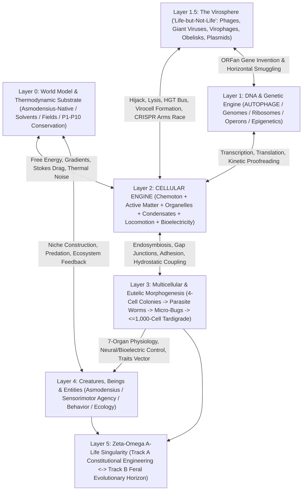
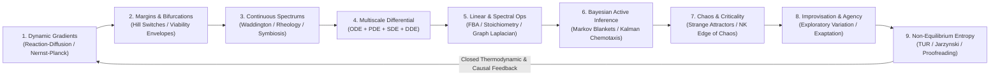
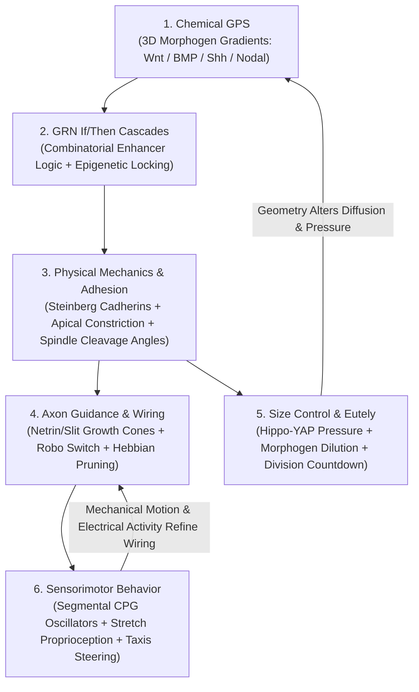

# CELLULAR ENGINE MASTER RESEARCH & ARCHITECTURAL SPECIFICATION
## Complete Cellular Science, Virosphere, Microbial Biomechanics, ≤1,000-Cell Eutelic Tardigrade Morphogenesis, Unified Non-Equilibrium Dynamics & the Cellular A-Life Singularity

> **Ecosystem Position:** Core Cellular & Subcellular Architecture bridging **DNA / Genetic Engines** (`AUTOPHAGE`), **Cellular Biophysics** (`CELLULOGONIC MECHA` v1.0 → v2.0 Omega Expansion), **Creatures / Beings / Entities** (`Asmodensius`), **World Models** (`Asmodensius-Native`), and the **Zeta-Omega ALife Package** (`OVBS-52` + Dual-Track A/B Singularity Framework).  
> **Target Organismal Horizon:** Autonomous emergence from abiotic chemistry & acellular replicators (`10 nm`) → prokaryotic & eukaryotic single cells → colonial few-cell systems → parasitic worms & miniaturized bugs → complete **≤1,000-cell 7-organ eutelic Tardigrade** → post-biological **Cellular A-Life Singularity**.  
> **Scientific Baseline:** Synthesized through **2024–2026 frontier discoveries** (4D whole-cell *JCVI-syn3A* simulations, *Nitroplast* UCYN-A primary organelle, *Ca. Lokiarchaeum ossiferum* Lokiactin eukaryogenesis, *Lacrymaria olor* curved-crease cellular origami, *Hypsibius henanensis* `DODA1` betalain & `TRID1` LLPS radiotolerance, *Obelisk* viroid-like RNAs, *PhiKZ* chimallin phage nuclei, *Pandoravirus yedoma* permafrost revivals, and *Mirusviricota*).

---

## Architecture Map: Closing the Missing Cellular Layer in the 5-Layer ALife Stack

Between raw informational genomes (DNA) and macroscopic embodied agents (Creatures / Beings / Entities inside a World Model) sits the hardest, wildest, and most load-bearing layer in all of biology: **the Cell and its shadow biosphere of Viruses & Organelles**. Without a real biophysical Cellular Layer, "creatures" are just stat sheets driven by lookup tables rather than living thermodynamic machines capable of genuine morphogenesis, parasitism, symbiogenesis, regeneration, cryptobiosis, and open-ended evolution.



> [!NOTE]
> **Existing Ecosystem Anchor:** Inside your local workspace, [`alife-singularity-omega-package`](file:///C:/Users/Alexa/.gemini/antigravity/scratch/alife-singularity-omega-package/README.md) defines the Zeta-Omega dual-track theory and `OVBS-52` benchmarks, while [`cellulogonic-mecha`](file:///C:/Users/Alexa/.gemini/antigravity/scratch/cellulogonic-mecha/README.md) already implements a clean-room v1.0 C11+AVX2 core (44 Lean 4 theorems, 8-species Chemoton, Canham–Helfrich vesicles, nested endosymbiosis, 4 planetary solvents, Levin bioelectricity, and TDP anhydrobiosis). This master document serves as the **complete scientific foundation and v2.0 Omega Cellular Engine blueprint** expanding far beyond v1.0 to incorporate the **full Virosphere**, **microbial locomotion/weaponry/shape-shifting/origami mechanics**, **parasite/worm/bug/tardigrade organogenesis**, and the **unified 10-layer mathematical dynamics kernel**.

---

# PART I — WHAT MAKES UP A CELL: CUTTING-EDGE CELL SCIENCE, MICROBIOLOGY, CHEMISTRY & PHYSICS

## 1.1 The Five Convergent Physical Definitions of a Living Cell

A living cell is **not** a passive bag of dissolved chemicals. It is a **bounded, vectorially powered, far-from-equilibrium active-matter engine** that continuously fabricates its own topological enclosure, its own catalysts, and its own heritable instructions while exporting entropy into its surroundings. Five rigorous theoretical frameworks converge on the exact minimal requirements for any cellular engine:

1. **Tibor Gánti's Chemoton (1975, 2003):** A minimal cell requires three stoichiometrically coupled autocatalytic subsystems:
   - A **metabolic cycle** harvesting environmental free energy;
   - A **digital template polymer** storing heritable instructions copied each cycle;
   - An **enclosing amphiphilic membrane** whose surface growth is chemically coupled to metabolism so surface-to-volume stress forces physical division.
   Remove any one of the three and you obtain an inert micelle, a naked parasitic replicator, or an unbounded dissipating soup—never a cell.
2. **Maturana & Varela's Autopoiesis (1974):** Organizational closure—the internal reaction network continuously synthesizes the physical boundary that prevents the reaction network from diffusing away into equilibrium.
3. **Robert Rosen's `(M,R)`-Systems (1958):** Closure to efficient causation—metabolic enzymes construct structural components, and structural/genetic machinery reconstructs the enzymes themselves without an external operator.
4. **Peter Mitchell's Chemiosmotic Engine (1961):** Cellular energy is fundamentally **electrochemical and vectorial** across an insulating ~5 nm membrane. Every known free-living cell pumps $\text{H}^+$ or $\text{Na}^+$ ions across a hydrophobic barrier to sustain a **Proton-Motive Force (PMF)**:
   $$\Delta p = \Delta \Psi - \frac{2.303\, R T}{F}\,\Delta \text{pH}$$
   where $\Delta \Psi$ is transmembrane electrical potential (`-120` to `-200 mV` across bacterial plasma membranes and mitochondrial inner membranes) and $\Delta \text{pH}$ is the chemical pH gradient. Protons flowing back down $\Delta p$ physically spin rotary $\text{F}_1\text{F}_0$ ATP-synthase turbines (~100–350 revolutions/sec) to phosphorylate ADP into ATP.
5. **Markov Blankets & Assembly Depth (Friston 2013; Walker & Cronin 2023):** The plasma membrane functions as a physical **Markov blanket** separating internal biochemical states ($\mu$) from external states ($\eta$) via sensory receptors ($s$) and active effectors/pumps ($a$), allowing living matter to construct high-**Assembly-Index** molecules ($A \gg 15$, up to $A > 10^3$ for ribosomes) in vast copy numbers against thermodynamic decay.

---

## 1.2 The Four Brutal Physical Realities Inside Every Cell

Any Cellular Engine that treats cytoplasm as empty space or Newtonian billiard balls will fail to capture real biology. Four physical regimes dominate cellular reality:

### 1. Extreme Macromolecular Crowding & Glassy Viscoelasticity
Real cytoplasm is **20–40% solid macromolecule by volume** (`~200–400 mg/mL` protein + RNA). Molecules sit only `1–5 nm` apart. Diffusion is strongly **anomalous/subdiffusive** ($\langle \Delta r^2(t) \rangle \propto t^\alpha$ with $\alpha < 1$). Even more astonishingly, metabolically starved bacterial cytoplasm undergoes a **fluid-to-glass jamming transition** (Parry et al., *Cell* 2014): ATP-driven enzymatic agitation literally *fluidizes* the interior of the cell so large complexes can move!

### 2. Thermal Hurricanes ($k_B T$) & Brownian Ratchets
At $T = 300\text{ K}$, thermal energy is $k_B T \approx 4.11\text{ pN}\cdot\text{nm}$ (`~2.49 kJ/mol`). A single ATP hydrolysis yields $\Delta G_{\text{ATP}} \approx -50\text{ to }-60\text{ kJ/mol} \approx 20\text{–}24\,k_B T$. Cellular nanomotors (kinesin, myosin, dynein, RNA polymerase, ribosomes) do not push smoothly like macroscopic pistons; they are **thermal Brownian ratchets** biased forward by asymmetric chemical energy steps inside a relentless hurricane of water-molecule collisions ($\sim 10^{13}$ impacts/sec).

### 3. Electrostatic Screening & Membrane Dielectrics
In physiological saline (~150 mM ions), electrostatic interactions are exponentially screened beyond the **Debye length** $\lambda_D \approx 0.8\text{ nm}$. Yet across a `~4–5 nm` hydrophobic lipid bilayer (dielectric constant $\varepsilon_r \approx 2$, capacitance $C_m \approx 1\text{ μF/cm}^2$), a tiny `-70 mV` resting membrane voltage produces a colossal electric field of **`~1.4 × 10⁷ V/m`**—nearly the dielectric breakdown strength of air! Voltage-gated ion channels and bioelectric tissues exploit this immense transmembrane field directly.

### 4. Canham–Helfrich Membrane Elasticity & Nick Lane's $1/R$ Bioenergetic Ceiling
Lipid membranes behave as **2D incompressible fluid-elastic shells** governed by the Canham–Helfrich free energy:
$$\mathcal{E}_{\text{CH}} = \oint_{\partial \Omega} \left[ \frac{\kappa}{2}\left(2H - c_0\right)^2 + \bar{\kappa}\,K \right] dA + \sigma A - \Delta P\,V$$
where $H$ is mean curvature, $K$ is Gaussian curvature, $c_0$ is spontaneous curvature (driven by asymmetric wedge lipids or BAR proteins), $\kappa \approx 10\text{–}30\,k_B T$ is bending rigidity, $\sigma$ is membrane tension, and $\Delta P$ is osmotic turgor pressure.

Simultaneously, single-membrane prokaryotes hit **Nick Lane's $1/R$ Bioenergetic Wall**: because prokaryotes generate chemiosmotic power across their *outer* plasma membrane ($\propto R^2$) while protein synthesis and volumetric maintenance scale with cytoplasm ($\propto R^3$), power-per-unit-volume collapses as $A/V = 3/R$. Prokaryotes can only bypass this wall either via massive **polyploidy** (like the 1 cm bacterium *Thiomargarita magnifica* packing thousands of genome copies along its outer rim) OR via **Endosymbiosis**—internalizing hundreds to thousands of bacterial powerhouses (mitochondria) whose folded inner cristae decouple respiratory membrane area from cell radius $R$, exploding available energy per gene by **`10³–10⁵×`** and unlocking eukaryotic complexity!

---

## 1.3 Exhaustive Catalog of Every Organelle, Condensate & Subcellular Machine

A complete Cellular Engine must understand all three architectural tiers inside a cell: **(A) Membrane-Bound Organelles**, **(B) Membraneless Biomolecular Condensates (LLPS)**, and **(C) Supramolecular Machines & Defense Complexes**.

### A. Membrane-Bound Organelles (Topological Compartments)

| Organelle / Compartment | Occurrence | Membranes | Core Physical / Chemical Function | Essential Engine Abstraction |
| :--- | :--- | :---: | :--- | :--- |
| **Plasma Membrane + Glycocalyx / Cell Wall / S-Layer** | All cells | 1 (bilayer or archaeal tetraether monolayer) | Selective Markov blanket; chemiosmosis (prokaryotes); voltage gating; adhesion; mechanosensing (`MscL`/`Piezo`); peptidoglycan/chitin/cellulose tensile armor | Elastic `Q(V,L)` shell + active ion channels + receptor field + rupture/turgor mechanics |
| **Nucleus, Nuclear Envelope & Nuclear Pore Complexes (NPCs)** | Eukaryotes | 2 (contiguous with ER) | Physically separates transcription & intron splicing from cytoplasmic translation; ~2,000 megadalton NPCs execute Ran-GTP directional nucleocytoplasmic transport; nuclear lamina gives mechanical stiffness & chromatin tethering | Transcriptional delay $\tau$, selective nuclear import/export gate, epigenomic chromatin state |
| **Rough & Smooth Endoplasmic Reticulum (ER)** | Eukaryotes | 1 (continuous labyrinth) | **Rough ER:** cotranslational folding, disulfide bonding & N-glycosylation of secreted/membrane proteins. **Smooth ER:** phospholipid/steroid synthesis, detoxification, rapid $\text{Ca}^{2+}$ signaling reservoir | Secretory protein pipeline + lipid factory + excitable $\text{Ca}^{2+}$ wave capacitor |
| **Golgi Apparatus** | Eukaryotes | 1 (polarized cis→trans cisternae) | Post-translational modification, oligosaccharide branching, vesicular sorting (COPI/COPII/clathrin) routing cargo to plasma membrane, lysosomes, or extracellular secretion | Polarized vesicle router + polarity vector (secretory targeting for crawling & cilia) |
| **Mitochondria** | Nearly all eukaryotes | 2 (smooth outer, deeply folded cristae inner) | Descended from engulfed $\alpha$-proteobacterium; TCA cycle + ETC (Complexes I–IV) + $\text{F}_1\text{F}_0$ ATP synthase + ATP/ADP translocase; retains circular **mtDNA** for local redox regulation (**CoRR**); dynamic fission/fusion (`Drp1`/`Mfn`), apoptosis trigger (cytochrome *c*), mitophagy quality control | Nested living sub-compartment (`org[k]`) with own PMF, own genome, heteroplasmy, ATP export, ROS leakage |
| **Chloroplasts & Plastids (Primary / Secondary / Tertiary)** | Plants, algae, euglenoids, diatoms, apicomplexans | 2 (primary) or 3–4 (secondary/tertiary) | Descended from cyanobacteria (*Primary*; also independently in *Paulinella*) or engulfed eukaryotic algae (*Secondary*). Thylakoid light harvesting splits $\text{H}_2\text{O}$/donors → NADPH + ATP → Calvin cycle carbon fixation | Photon-harvesting autotrophic nested sub-compartment; kleptoplasty (stolen chloroplasts in sea slugs/ciliates!) |
| **Nitroplast (UCYN-A) *(2024 Science Discovery!)*** | Marine alga *Braarudosphaera bigelowii* | 2 (cyanobacterial origin) | **Newly proven 4th primary endosymbiotic organelle!** Fixes atmospheric $\text{N}_2 \to \text{NH}_3$ inside a eukaryote; division tightly synchronized with host cell cycle; imports host nuclear-encoded proteins | Generalized endosymbiotic metabolic module (engine should allow *any* specialized metabolic symbiont—$\text{N}_2$-fixation, methanogenesis, sulfur oxidation—to graduate into an organelle!) |
| **Lysosomes, Phagosomes & Autophagosomes** | Eukaryotes | 1 (acidified `pH 4.5–5.0`) | V-ATPase proton pumps acidify lumen; ~60 acid hydrolases digest phagocytosed prey, pathogens, and damaged self-organelles (**autophagy / mitophagy**), recycling monomers | Recycling/digestion chamber + prey lysis + selfish-organelle policing |
| **Peroxisomes & Glyoxysomes** | Eukaryotes | 1 | $\beta$-oxidation of very-long-chain fatty acids, plasmalogen/ether lipid synthesis, lethal ROS detoxification ($\text{H}_2\text{O}_2 \to \text{H}_2\text{O} + \frac{1}{2}\text{O}_2$ via catalase) | Oxidative stress buffer + lipid catabolism node |
| **Vacuoles (Contractile, Turgor, Acidocalcisomes)** | Protists, plants, fungi, some bacteria | 1 | **Contractile vacuoles:** rhythmic mechanical water bailing against freshwater hypo-osmotic burst! **Central vacuoles:** osmotic turgor expansion & storage. **Acidocalcisomes:** polyphosphate & $\text{Ca}^{2+}$ stores | Active volume/osmotic regulator & internal pressure actuator |
| **Prokaryotic Microcompartments (BMCs), Carboxysomes, Magnetosomes & Gas Vesicles** | Bacteria & Archaea | Protein shells (BMCs/gas vesicles) or invaginated lipid vesicles (magnetosomes) | **Carboxysomes:** icosahedral protein shells concentrating $\text{CO}_2$ around RuBisCO. **Magnetosomes:** $\text{Fe}_3\text{O}_4$ crystal chains acting as compass needles. **Gas vesicles:** gas-permeable, water-excluding protein nanoballoons for buoyancy | Specialized modular micro-organelles even inside prokaryotes! |

### B. Membraneless Organelles (Liquid–Liquid Phase-Separated Biomolecular Condensates)
One of the biggest paradigm shifts in modern cell biology is that cells organize vast biochemical factories **without any lipid membrane**, using **Liquid–Liquid Phase Separation (LLPS)** of multivalent Intrinsically Disordered Proteins (IDPs) and RNAs:
- **Nucleolus:** Multi-layered multiphase droplet inside the nucleus manufacturing ribosomal subunits.
- **Stress Granules & P-Bodies:** Rapidly condense during thermal/oxidative/viral shock to arrest translation, shelter mRNAs, and triage decay.
- **Centrosome / Pericentriolar Material (PCM):** Phase-separated microtubule nucleation hub coordinating the mitotic spindle and ciliary basal bodies.
- **Tardigrade `TRID1` & `CAHS` Condensates/Gels *(2024 Science & PLOS Biology)*:** `TRID1` forms phase-separated nuclear condensates recruiting DNA-repair enzymes directly to radiation double-strand breaks; `CAHS` proteins self-assemble into reversible fibrous hydrogels that solidify into amorphous **bioglass** upon desiccation!
- **Engine Physics:** Modeled via Cahn–Hilliard free energy $\mathcal{F}[\phi] = \int [f_{\text{FH}}(\phi) + \frac{\kappa_\phi}{2}|\nabla \phi|^2]\,dV$, enabling instant reversible micro-reactor formation triggered by pH, ATP drop, stress, or signaling!

### C. Supramolecular Nanomachines & Cellular Immune Arsenals
- **Ribosomes (`70S` / `80S` / `55S`):** Catalytic RNA (`rRNA`) peptidyl-transferase 3D molecular printers translating mRNA at `5–20 aa/s`, burning ~4 ATP/GTP per peptide bond with kinetic proofreading.
- **Spliceosomes:** Dynamic RNP complexes excising introns and enabling **alternative splicing** (one gene → dozens of protein isoforms—massive combinatorial phenotype amplification!).
- **26S Proteasomes & Chaperonins (`GroEL/GroES`, `Hsp70/90`):** ATP-driven barrel shredders and folding cages maintaining proteostasis; failure leads to toxic protein aggregation / aging.
- **Divisome (`FtsZ` + `MinCDE` reaction-diffusion wave) & `ESCRT-III`:** `MinCDE` proteins oscillate pole-to-pole inside bacteria as a live **Turing/standing wave** preventing `FtsZ` ring assembly anywhere except the exact cell midplane! Eukaryotes and Asgard archaea deploy spiral `ESCRT-III` springs to snap membrane necks during cytokinesis, exosome budding, and viral egress.
- **Prokaryotic Anti-Phage Immune Arsenal:** Far beyond CRISPR-Cas! Over **150+ distinct immune systems** discovered in the last five years—including **Restriction–Modification**, **CBASS** (cyclic oligonucleotide signaling triggering abortive suicide—evolutionary ancestor of human cGAS-STING!), **Thoeris**, **Retrons**, **Viperins**, and **Toxin–Antitoxin (TA) abortive infection** modules (altruistic cell suicide to save clonal neighbors from phage burst!).

---

## 1.4 Cutting-Edge 2024–2026 Cellular Science Breakthroughs to Encode

1. **4D Whole-Cell Simulation of *JCVI-syn3A* (Luthey-Schulten Lab, *Cell*):** First spatially resolved 4D simulation of a complete ~105-minute cell cycle of the 493-gene minimal synthetic bacterium, coupling stochastic metabolism, genetic expression, Brownian chromosome replication/segregation, and physical membrane growth—proving emergent cell-to-cell heterogeneity arises naturally from discrete molecular stochasticity.
2. **Asgard Archaea Cytoskeleton & Eukaryogenesis (*Ca. Lokiarchaeum ossiferum*, Schleper & Pilhofer, *Nature* 2023–2025):** Direct cryo-EM visualization of branched, tentacle-like archaeal cells reinforced by eukaryotic-like **Lokiactin** filaments—proving a complex dynamic cytoskeleton *predated* mitochondrial acquisition, allowing ancient archaea to entangle and engulf bacterial partners!
3. **The Nitroplast (*Braarudosphaera bigelowii* + UCYN-A, *Science* 2024):** Live proof that primary endosymbiosis is NOT a one-off ancient fluke—evolution is *still* forging brand-new metabolic organelles with host-synchronized division and nuclear protein import.
4. **Curved-Crease Cellular Origami (*Lacrymaria olor*, Flaum & Prakash, *Science* 2024):** Discovery that a single ciliate cell extends a hunting neck **30× its body length** (`40 μm → 1,200+ μm`) in seconds without tearing by deploying 15 spiraled cortical microtubule pleats governed by traveling topological $d$-cone singularities ("lacrygami").
5. **Tardigrade Multi-Layer Extremotolerance (*Hypsibius henanensis*, *Science* Oct 2024):** Radiotolerance operates across three synergistic subsystems: horizontally transferred bacterial **`DODA1`** synthesizing **betalain** antioxidant pigments, **`TRID1`** LLPS condensates accelerating DNA break repair, and upregulated mitochondrial ETC complexes (`BCS1`/`NDUFB8`) flooding `NAD+` for PARylation—stacked atop **`Dsup`** chromatin shielding and **`CAHS`** reversible bioglass gels!
6. **Anthrobots & Xenobots (Levin Lab, 2020–2025):** Wild-type frog embryonic cells (*Xenobots*) and adult human tracheal epithelial cells (*Anthrobots*) freed from normal tissue constraints spontaneously self-assemble into motile, ciliated, self-healing, non-neural multicellular biobots that navigate mazes and heal scratched neural monolayers—proving cells possess latent **morphogenetic improvisation** far beyond their evolved organismal script!

---

# PART II — THE VIROSPHERE: VIRUSES, BACTERIOPHAGES, GIANT ANCIENT VIRUSES, VIROPHAGES & "LIFE-BUT-NOT-LIFE"

## 2.1 Resolving the "Life-but-Not-Life" Paradox: The Virion vs. the Virocell

Standard textbooks ask whether viruses are "alive" and get trapped in a false binary. Modern evolutionary virology resolves this through two foundational insights:

1. **Patrick Forterre's *Virocell* Concept (2011–2024):** Calling a virus "dead" by looking at an extracellular virion is like calling an oak tree "dead" by inspecting an acorn or calling a bacterium "dead" by examining a dormant endospore. The extracellular capsid (**virion**) is merely the *dispersal gamete/spore*. The moment it injects its genome and hijacks host ribosomes, metabolism, and membranes into a viral factory, the transformed cell becomes a **virocell**—a living, metabolizing, self-reproducing **viral organism**!
2. **The Replicator–Metabolism Continuum:** Rather than a hard cliff between "non-living" and "living," biology spans a continuous **autonomy spectrum**:

```text
ZERO METABOLISM / PURE INFORMATION                                    FULL AUTONOMOUS METABOLISM
├─────────┼─────────┼─────────┼──────────┼─────────┼───────────┼──────────┼──────────────┼──────────┤
Prions   Viroids  Obelisks  Plasmids/  Standard   Jumbo Phages  Giant      Obligate       Free-Living
(Protein (Naked   (Circular Transposons Viruses & (PhiKZ Phage  Viruses    Endosymbionts  Prokaryotes
 fold)    RNA)    RNA+Oblin)(Intracell) Phages     Nucleus)    (Tupanvirus)(Buchnera/UCYN) & Eukaryotes
```

## 2.2 Bacteriophages: Nanomechanical Predators, Bistable Gamblers & Viral Nuclei

With an estimated **$\sim 10^{31}$ virions** on Earth (outnumbering bacteria ~10:1 and lysing 20–40% of marine bacterial biomass *every single day*), bacteriophages are the primary thermodynamic churn engine and genetic superhighway of the microbial biosphere.

- **Mechanical Syringe Nanoweapons (*T4* Myophages):** DNA is jammed inside the icosahedral head by an ATP-driven portal packaging motor to **`~60 atmospheres`** of internal osmotic/electrostatic pressure! Upon tail-fiber receptor docking, the baseplate flips conformations and triggers irreversible contraction of the spring-loaded helical tail sheath, ramming a hollow inner tail tube tipped with a lysozyme "drill bit" straight through the bacterial outer membrane and peptidoglycan wall to fire DNA into the cytoplasm in milliseconds.
- **Stochastic Bistable Decision Circuits (Phage $\lambda$):** Upon entering *E. coli*, competing repressors (`cI` vs. `Cro`) implement a sharp **bistable genetic toggle switch**. If multiplicity of infection (`MOI`) is low and the host is healthy, the phage goes **Lytic** (replicate and explode the host into ~100 progeny). If hosts are scarce or crowded (`MOI ≥ 2`), it enters **Lysogeny**—integrating silently into the bacterial chromosome as a **prophage**, turning the bacterium into an armored carrier (often gifting the host lethal toxin genes or superinfection immunity!), until host DNA damage (`RecA` SOS stress) triggers excision and escape from a sinking ship!
- **Jumbo Phages & the Proteinaceous Phage Nucleus (*PhiKZ* & *201phi2-1*):** Huge phages (`>200–700 kbp`) infecting *Pseudomonas* refuse to expose their naked DNA to bacterial defenses. Within minutes of infection, they self-assemble a micron-scale **proteinaceous shell made of *chimallin*** enclosing their replicating genome—a convergent analog of the eukaryotic nucleus! Even wilder: they express a tubulin-like filament (**`PhuZ`**) forming a bipolar dynamic spindle that physically centers and rotates the phage nucleus inside the bacterium while selectively importing replication enzymes and **completely blocking host CRISPR-Cas and restriction enzymes**!
- **Molecular Pirates (Satellite Phages & PICIs):** Phage-Inducible Chromosomal Islands sit dormant in bacterial DNA; when a helper phage infects the cell, the pirate element awakens, hijacks the helper phage's structural proteins, reshapes its capsids to smaller pirate-sized heads, and packages *its own DNA* into the helper's bodies!

## 2.3 Giant Ancient Viruses (*Nucleocytoviricota* & *Mirusviricota*) — Bigger Than Cells!

Discovered only starting in 2003 (previously missed for a century because microbiologists filtered them out with `0.2 μm` "bacteria-excluding" filters!), **Giant Viruses (Giruses / NCLDVs)** shattered every rule of virology:

| Giant Virus / Entity | Physical Size | Genome Size | Key Extraordinary Capabilities & Evolution Implications |
| :--- | :--- | :--- | :--- |
| ***Mimivirus* (Acanthamoeba polyphaga)** | `~750 nm` (with fibril halo) | `1.18 Mbp` (~979 genes) | Bigger than *Mycoplasma* and *JCVI-syn3A*! Enters amoebae via phagocytosis (mimicking bacterial prey); builds an enormous cytoplasmic **viral factory**; gets infected itself by *Sputnik* virophages! |
| ***Pandoravirus* (*P. salinus*, *P. dulcis*, *P. yedoma*)** | `1.0 – 1.5 μm` × `0.5 μm` | Up to **`2.5–2.8 Mbp`** (>2,500 genes) | Larger genome than many bacteria and parasitic eukaryotes! Amphora-shaped with apical delivery pore; **`>90%` ORFan genes** with no match anywhere in Earth's databases — literal *de novo* gene invention engines! ***P. yedoma*** was revived viable after **`48,500 years`** frozen in Siberian permafrost! |
| ***Pithovirus sibericum*** | **`1.5 μm`** × `0.5 μm` | `610 kbp` | Physically colossal amphora capped with a honeycomb cork; revived intact from **`30,000-year-old`** Siberian permafrost! |
| ***Tupanvirus*** | Up to **`2.3 μm`** (with cylindrical tail) | `1.44–1.52 Mbp` | Encodes the most complete **translation apparatus** ever found in a virus: **all 20 aminoacyl-tRNA synthetases**, up to ~70 tRNAs, plus translation initiation, elongation, and release factors—missing *only* the ribosome itself! Also induces infected amoebae to cluster into zombie aggregates accelerating spread! |
| ***Medusavirus*** | `~260 nm` | `381 kbp` | Encodes **all 5 eukaryotic histones** (H1, H2A, H2B, H3, H4) and replicates inside the host amoeba's intact nucleus; triggers amoeba encystment ("turning hosts to stone"). |
| ***Mirusviricota* *(2023 Nature)*** | Marine metagenomic giants | `~200–400 kbp` | Deep evolutionary **chimera** combining herpesvirus-type DNA replication/morphogenesis modules with giant-virus *Nucleocytoviricota* transcription/capsid architecture—implicating ancient viruses in the dawn of eukaryotes. |
| **Viral Eukaryogenesis Hypothesis** | — | — | Serious hypothesis (Bell 2001; Takemura; Forterre): the eukaryotic **nucleus** itself may have originated when an ancient giant DNA virus (or chimallin-style viral factory) established permanent endosymbiosis inside an Asgard archaeal host, decoupling transcription from translation! |

## 2.4 Virophages & Subviral Dark Matter (Viroids, Obelisks, Prions)

- **Virophages (*Sputnik*, *Mavirus*, *Zamilon*):** Viruses that parasitize *giant viruses* inside a shared eukaryotic cell! Remarkably, ***Mavirus*** integrates into the chromosomal DNA of the marine flagellate *Cafeteria roenbergensis* and stays silent until the giant virus *CroV* infects the cell—at which point *CroV* transcription factors accidentally wake up the embedded *Mavirus*, which hijacks *CroV*'s viral factory, sabotages *CroV* production, and **saves the neighboring host clone population**! It is a literal viral-encoded adaptive immune system!
- **Viroids:** Naked, circular, covalently closed single-stranded RNAs (`246–401 nt`) encoding **zero proteins**—replicating via host RNA polymerase and self-cleaving hammerhead/hairpin ribozymes. Living fossils of the pre-cellular RNA World.
- **Obelisks *(Zheludev & Andrew Fire, Cell 2024)*:** Newly discovered global class of ~`1,000 nt` circular RNAs folding into rigid rod-like secondary structures and encoding a completely novel protein superfamily (**"Oblins"**), with ~30,000 distinct lineages hiding in ~50% of human oral microbiomes (e.g., inside *Streptococcus sanguinis*)—invisible to all prior viral/bacterial taxonomy!
- **Prions:** Zero-nucleic-acid protein conformations ($\text{PrP}^{\text{Sc}}$, fungal `[PSI+]` epigenetic memory prions) that replicate purely by templating conformational misfolding onto native proteins—proving heredity can operate purely in 3D structural fold space!

## 2.5 Why the Cellular Engine MUST Include a First-Class Virosphere

In Artificial Life, omitting viruses and phages guarantees **evolutionary stagnation**. Inside the Cellular Engine, the Virosphere performs five irreplaceable systemic roles:
1. **Kill-the-Winner Diversity Pump:** Whenever one cellular genotype dominates (`>30%` local density), host-specific phages explode exponentially, knocking down the monoculture and preserving multi-species biodiversity without arbitrary artificial penalties.
2. **High-Bandwidth Horizontal Gene Transfer (HGT) Bus:** Generalized and specialized transduction continuously smuggle metabolic operons, stress-protection genes (like tardigrade `DODA1`!), and resistance cassettes across phylogenetically distant lineages.
3. **ORFan / De Novo Gene Forge:** High viral mutation rates + relaxed structural selection rapidly invent novel short peptides and catalytic motifs that cellular genomes later domesticate (e.g., mammalian placental *syncytin* came from an endogenous retrovirus; human memory protein *Arc* evolved from a retrotransposon capsid!).
4. **Compartmentalization & Multicellularity Driver:** Phage predation physically selects for **cell-wall armor, spatial biofilm shielding, abortive-infection kin altruism, and intracellular compartmentalization** (phage nuclei / proto-nuclei)!
5. **Track B Feral Hyper-Evolution:** In unconstrained Track B runs, virophage–giant-virus–host–plasmid hyper-cycles generate genuine **Red Queen deterministic chaos** and rapid Major Evolutionary Transitions.

---

# PART III — DEEP DIVE ON MICROBIOLOGY: MOVEMENT ENGINES, TOOLS, WEAPONS, SHAPE-SHIFTING, EXPANSION & CONTRACTION

## 3.1 The Alien Fluid Physics of Micro-Life: Low Reynolds Number & Purcell's Scallop Theorem

At cellular and microscopic multicellular scales ($L \sim 1\text{–}500\text{ μm}$, speed $v \sim 1\text{–}1000\text{ μm/s}$ in water with viscosity $\eta \approx 10^{-3}\text{ Pa}\cdot\text{s}$), the **Reynolds number** is minuscule:
$$\text{Re} = \frac{\rho v L}{\eta} \sim 10^{-5} \text{ (bacterium)} \quad \text{to} \quad 10^{-2} \text{ (ciliate / tardigrade)}$$

The consequences shatter human macroscopic intuition:
- **Zero Inertia:** Navier–Stokes collapses to the linear, time-independent **Stokes Equation**:
  $$\eta \nabla^2 \mathbf{u} - \nabla p + \mathbf{f}_{\text{active}} = \mathbf{0}, \qquad \nabla \cdot \mathbf{u} = 0$$
  If a swimming *E. coli* abruptly turns off its flagellar motor, viscous drag halts it in **`< 1 microsecond`** after coasting **`< 0.1 Ångströms`** (less than one-tenth of a hydrogen atom diameter!). To swim in water as a bacterium feels like a human trying to swim in **molten asphalt** while forbidden to glide!
- **Purcell's Scallop Theorem (1977):** Because Stokes flow is linear and strictly time-reversible, **any single-degree-of-freedom reciprocal motion** (like a scallop opening and closing its shell—even fast one way and slow the other!) produces **identically zero net displacement**!
- **How Microbes Beat the Scallop Theorem:** Every microbial propulsion system must break time-reversal symmetry via at least **two out-of-phase degrees of freedom**, **chiral rotation**, **non-reciprocal traveling waves**, **asymmetric substrate adhesion**, or **non-Newtonian fluid mechanics**.

---

## 3.2 Complete Compendium of Microbial & Cellular Locomotion Engines

| Locomotion Engine | Representative Organisms | Energy Source | Mechanical Mechanism & Symmetry-Breaking | Force / Speed Benchmark |
| :--- | :--- | :--- | :--- | :--- |
| **1. Bacterial Rotary Flagellum** | *E. coli*, *Vibrio*, *Salmonella* | $\text{H}^+$ or $\text{Na}^+$ PMF (`MotAB` / `PomAB` stators) | True nanoscale brushless DC electric motor (`~45 nm` basal body) spinning helical filament via universal joint hook (`200–1,700 Hz`); rapid CW/CCW gear reversal creates **run-and-tumble** biased random walk! | `~1,400–4,600 pN·nm` torque; `20–100 μm/s` (`~10–50 BL/s`; *Ovobacter* hits `1,000 μm/s`!) |
| **2. Archaeal Archaellum** | *Halobacterium*, *Sulfolobus* | Direct **ATP hydrolysis** (`FlaI` ATPase) | Convergently evolved rotary propeller structurally descended from bacterial Type IV pili rather than bacterial flagella | `~10–40 μm/s`; reversible CW/CCW swimming |
| **3. Spirochete Periplasmic Corkscrew** | *Borrelia* (Lyme), *Treponema* | $\text{H}^+$ PMF (internal axial filaments) | Flagella sit *inside* the periplasmic space between inner membrane and outer sheath; spinning bends & rotates the whole helical body like a drill bit through dense mucus/connective tissue where external flagella stall! | Drills easily through viscoelastic gels (`η > 100×` water) |
| **4. Eukaryotic `9+2` Axonemal Flagella & Cilia** | *Chlamydomonas*, *Paramecium*, *Volvox*, sperm, *Rotifers*, *Gastrotrichs* | **ATP** (Axonemal **Dynein** motors) | 9 outer microtubule doublets + 2 central singlets; dynein arms walk along adjacent doublets constrained by nexin links → converts sliding into non-reciprocal planar/helical traveling waves or whip-like power + swept-back recovery strokes; hydrodynamically synchronize into **metachronal waves**! | `~50–1,000 μm/s`; beat frequency `10–80 Hz`; ~`5–7 pN` per dynein head |
| **5. Type IV Pili ("Grappling Hooks")** | *Pseudomonas*, *Neisseria*, *Myxococcus* | **ATP** (`PilB` polymerization / `PilT` depolymerization) | Fires long sticky protein cables across surfaces, latches tip, then forcibly reels cable back in to winch cell forward (**twitching / slingshot motility**) or pull cells into biofilms | **`>100 pN`** pulling force per single pilus (strongest linear biological motor known!) |
| **6. Helical & Treadmill Gliding Motors** | *Myxococcus xanthus* (`Agl/Glt`), *Flavobacterium* (`Gld/Spr`), *Diatoms*, *Toxoplasma* (Apicomplexa) | PMF (`Myxococcus`/`Flavobacterium`) or **ATP** (`Myosin A` glideosome) | *Myxococcus*: inner-membrane PMF motor runs along an internal helical track pushing adhesive focal complexes backward against substrate. *Flavobacterium*: rotary motor drives cell-surface adhesins along a closed-loop conveyor belt! *Toxoplasma*: sub-membrane actin-myosin **glideosome** screws the parasite straight into host cells! *Diatoms*: secrete hydrating mucilage jets along silica raphe slits | `1–10 μm/s` smoothly across dry/viscous solid surfaces without any appendages |
| **7. Amoeboid Crawling (Lamellipodia, Pseudopodia, Filopodia)** | *Amoeba proteus*, *Dictyostelium*, Neutrophils, Fibroblasts | **ATP** (Actin treadmilling + **Myosin II** cortex) | **Brownian Ratchet** (`Arp2/3` dendritic actin polymerization pushes leading membrane forward); **Molecular Clutch** (integrins/adhesins grip ECM); **Myosin II** contracts rear uropod squeezing fluid cytoplasm forward (**sol-gel transition**) | `~0.1–2 μm/s` (neutrophils chase bacteria in real time!); `nN`-scale traction stress |
| **8. Bleb-Driven Motility & 3D "Chimneying"** | *Entamoeba*, cancer cells, embryonic germ cells, confined leukocytes | **ATP** (Myosin II hydrostatic pressure) | High cortical contractility rips plasma membrane off actin cortex → internal hydrostatic pressure inflates a spherical blister (**bleb**) forward → new actin cortex reassembles inside bleb! In tight 3D pores, cells expand laterally to jam against walls and push off by pure friction (**chimneying**) with *zero* chemical adhesions! | Rapidly traverses non-adhesive 3D tissue matrices |
| **9. Actin Comet-Tail Rockets** | *Listeria monocytogenes*, *Shigella*, Vaccinia virus | Host **ATP** & host actin (`ActA` hijacking `Arp2/3`) | Intracellular bacteria/viruses polymerize dense cross-linked host actin tails behind themselves, rocketing through cytoplasm and punching membrane-wrapped protrusions straight into neighboring cells without ever touching extracellular immunity! | `~0.1–1 μm/s`; `~1–10 nN` propulsive force |
| **10. Ultrafast Contractile Springs (Spasmoneme / Myoneme)** | *Vorticella*, *Stentor*, *Spirostomum ambiguum* | **Stored $\text{Ca}^{2+}$ electrochemical potential** (NO direct ATP during snap!) | Ca²⁺ release shields negative charges on coiled centrin/spasmin rubber-like polymer filaments, causing instant entropic hydrophobic collapse! *Vorticella* coils its stalk at **`>100–200 BL/s`**; *Spirostomum* contracts 60% of its `4 mm` body in `5 ms` at **`>14 G`**, launching hydrodynamic vortices that alert neighbors! | `~10–80 mm/s` peak velocity (`100–500 BL/s`); re-extension uses ATP to pump Ca²⁺ back into ER |
| **11. Curved-Crease Cellular Origami ("Lacrygami") *(2024 Science)*** | *Lacrymaria olor* (swan-neck ciliate) | Ciliary thrust + helical microtubule origami | 15 spiraled microtubule ribbons pre-fold excess membrane into pleated cortical cones; ciliary swimming at the head unspools traveling topological $d$-cone singularities, shooting the neck **`30×` body length** (`40 → 1,200 μm`) in seconds and reeling it back tens of thousands of times with zero membrane tearing! | `30×` reversible aspect-ratio deployment in `<30 s` |
| **12. Buoyancy & Compass Engines** | *Cyanobacteria*, *Haloarchaea*, *Magnetospirillum* | Biosynthesis / Passive magnetic alignment | **Gas vesicles** regulate vertical depth in water columns to match light/nutrient optima; **Magnetosomes** passively torque bacteria along geomagnetic field lines to turn a 3D oxic-anoxic search into a 1D line! | Zero running energy cost for orientation/depth holding |

---

## 3.3 Microbial Tools, Injectors, Harpoons & Cellular Weaponry

Microbes are armed with nanoscale mechanical engineering rivaling siege warfare:

1. **Type III Secretion System (T3SS — Molecular Syringe):** Built from evolutionary cousins of the flagellar basal body; docks onto a eukaryotic cell membrane, punches a translocon pore, and injects effector proteins directly into host cytoplasm to hijack host cytoskeleton (forcing the host to swallow the bacterium!) or silence immune signaling.
2. **Type IV Secretion System (T4SS — Conjugative DNA Cannon):** Extends a hollow sex pilus, reels in a recipient cell, and pumps single-stranded plasmid DNA (antibiotic resistance, virulence islands, metabolic operons) directly across cell walls—even across kingdoms (*Agrobacterium* injects T-DNA straight into plant chromosomes!).
3. **Type VI Secretion System (T6SS — Contractile Phage-Tail Crossbow):** Bacteria literally *domesticated an inverted bacteriophage tail* inside their own cytoplasm! Upon mechanical contact with a rival cell (even sensing attack from a neighbor's T6SS — *"tit-for-tat dueling"* in *Pseudomonas*!), the outer sheath contracts violently, firing a sharpened `Hcp/VgrG/PAAR` spear loaded with cell-wall-shredding amidases, phospholipases, and DNases directly into the competitor!
4. **Ballistic Extrusomes, Trichocysts & Cnidarian/Dinoflagellate Nematocysts:** Pressurized organelles storing coiled microscopic harpoons (`~150 bar` osmotic pressure from poly-$\gamma$-glutamate in cnidarians!). Triggered mechanically/chemically, they fire in **`< 700 nanoseconds`** at **`> 1,000,000–5,000,000 G`** acceleration—piercing crustacean cuticle or paralyzing protist prey instantaneously!
5. **Periplasmic Predation & Trogocytosis:** *Bdellovibrio bacteriovorus* rockets at `>100 BL/s` into Gram-negative prey, bores through the outer membrane into the periplasm, seals the breach, liquefies the host from inside into a "bdelloplast," and multiplies into progeny! Eukaryotic *Entamoeba* and immune cells perform **trogocytosis**—literally biting off living chunks of a target cell's membrane until it bleeds out!
6. **Micro-Animal Mechanical Tools (≤1,000-Cell Tier):**
   - **Tardigrade Buccal Stylets:** Pair of retractable piercing needles (calcium-carbonate/chitin) protruded by protractor muscles to stab algal/moss/nematode walls while a muscular triradiate **pharynx** creates negative suction pressure!
   - **Rotifer Mastax:** Muscular pharyngeal jaw apparatus with articulated hard *trophi* (grinding, grasping, or piercing forceps).
   - **Parasitic Worm Hooks & Stylets:** Plant-parasitic nematode hollow spears; tapeworm hooked rostellum & suckers anchoring against host peristalsis.

---

## 3.4 How Cells Engineer Shape, Expand, Contract & Morph

A cell's shape is NEVER a static mesh—it is a **dynamic mechanical equilibrium of competing active stresses**:

### 1. Cellular Tensegrity (Pre-Stressed Composite Architecture)
Donald Ingber's cellular tensegrity principle explains how soft fluid cells hold complex 3D forms and transmit mechanical signals at speed-of-sound timescales (`~100×` faster than chemical diffusion!):
- **Actomyosin Cortex (Cables under Tension):** A `~100–500 nm` cross-linked F-actin shell beneath the plasma membrane pulled taut by `Myosin II` minifilaments, generating active surface tension $\gamma_{\text{act}} \sim 0.1\text{–}2\text{ mN/m}$.
- **Microtubules (Hollow Struts under Compression):** Rigid `25 nm` cylinders (persistence length $l_p \sim 1\text{–}5\text{ mm}$) resisting inward cortical collapse and scaffolding axons, cilia, mitotic spindles, and *Lacrymaria* origami pleats.
- **Intermediate Filaments (Nonlinear Safety Ropes):** Soft at small strain, drastically **strain-stiffening** at large stretch (`>200%` elongation without snapping!) to prevent cell rupture under extreme shear.
- **Prokaryotic Shape Engines:** `MreB` actin-homolog patches move circumferentially along the membrane steering peptidoglycan synthesis to make straight **rods** (*E. coli*); `Crescentin` filaments bend cells into **crescents/helices** (*Caulobacter*); deleting `MreB` collapses rods into spheres!

### 2. Membrane Curvature Sculpting & Topological Scission
To expand pseudopodia, engulf prey, bud exosomes, or divide, cells deploy specialized geometric enzymes:
- **BAR-Domain Proteins (Banana-Shaped Scaffolds):** `F-BAR`, `N-BAR`, and `I-BAR` dimeric crescents bind lipids to enforce positive (invaginating) or negative (protruding filopodia) spontaneous curvature $c_0$.
- **Clathrin / COPI / COPII Cages:** Self-assembling geodesic polyhedra pulling flat membranes into `50–100 nm` transport spheres.
- **Dynamin & ESCRT-III:** Dynamin wraps *around* outward necks and twists with GTP to pinch off vesicles; **ESCRT-III** spirals *inside* necks to execute reverse-topology scission (multivesicular exosomes, viral budding, cytokinetic abscission, nuclear-envelope sealing!).

### 3. Osmotic Expansion, Contraction & Turgor Mechanics
Water crosses membranes via aquaporins according to the water-potential gradient:
$$J_w = L_p \left( \Delta \Pi - \Delta P \right), \qquad \Delta \Pi = R T \sum_i \sigma_i \Delta c_i$$
- **Controlled Expansion:** Plant cells, fungi, and bacteria intentionally pump osmolytes inward to build internal turgor pressure (`2–20 atm`) against an enzymatically loosened cell wall—driving irreversible plastic growth!
- **Rupture Protection:** Mechanosensitive channels (`MscL` / `MscS` in bacteria; `Piezo1/2` in eukaryotes) sense membrane tension $\sigma$ directly in the lipid bilayer and snap open `~3 nm` emergency dump valves milliseconds before osmotic lysis!
- **Extreme Desiccation Contraction (Tardigrade Tun):** Losing `>95%` water would ordinarily shred bilayers via phase-transition collapse; tardigrades actively pull in their 8 legs, shrink surface area via muscular contraction into a barrel **tun**, and trigger `CAHS` proteins to self-assemble into a cross-linked **cytosolic hydrogel → amorphous bioglass** locking membranes and proteins in suspended animation!

### 4. Active Cortical Gel Mechanics & Hydrostatic Skeletons
In active-matter physics (Kruse, Jülicher, Prost), the cell cortex is an **active polar viscoelastic gel** whose total stress tensor splits into passive viscous/elastic stress plus an ATP-fueled **active contractile stress**:
$$\boldsymbol{\sigma}_{\text{total}} = \boldsymbol{\sigma}_{\text{visc/el}} - p\mathbf{I} + \boldsymbol{\sigma}_{\text{act}}, \qquad \boldsymbol{\sigma}_{\text{act}} = -\zeta\,\Delta \mu_{\text{ATP}}\,\mathbf{p}\mathbf{p}$$
Spatially modulating $\zeta \Delta \mu_{\text{ATP}}$ across the cell surface automatically generates **cortical flows, cytokinetic cleavage rings, peristaltic amoeboid waves, apical constriction (folding flat epithelial sheets into 3D gut tubes and neural tubes!), and embryonic gastrulation**.

Scaling up to ≤1,000-cell worms, rotifers, and tardigrades, an incompressible internal fluid cavity (**pseudocoel / hemocoel**, $V = \pi r^2 L = \text{const}$) turns antagonistic muscle contraction into a **Hydrostatic Skeleton**:
$$\frac{\Delta L}{L} = -2\frac{\Delta r}{r}$$
Contracting circular/dorsoventral muscles reduces radius $r$ and shoots the body/lobopod *outward* in length $L$; contracting longitudinal muscles shortens and widens the body—generating sinusoidal swimming (*C. elegans*), peristaltic burrowing, and 8-legged lobopod walking (Tardigrades) without a single rigid bone!

---

# PART IV — THE MULTICELLULAR SCALE LADDER: FROM 1 CELL TO FEW-CELL COLONIES, PARASITE WORMS, MICRO-BUGS & THE ≤1,000-CELL TARDIGRADE GOAL

## 4.1 Complete Biological Scale Ladder (`1` → `10,000` Cells)

Nature did not jump from *E. coli* straight to a trillion-cell mammal. Between `1` cell and `1,000` cells lies an astonishing evolutionary design gallery spanning **few-cell colonies**, **extreme parasitic minimizers**, **organless tissue gliders**, **7-organ eutelic swimmers/walkers**, and **anucleate-brained microscopic bugs**:

| Tier | Representative Organisms | Somatic Cell Count | Body Architecture, Organs & Evolutionary Innovations |
| :--- | :--- | :---: | :--- |
| **Tier 1: Unicellular Prokaryotes** | *JCVI-syn3A*, *E. coli*, *Lokiarchaeum*, *Thiomargarita* (`1 cm`!) | `1` | Minimal autopoietic & chemiosmotic machines; `FtsZ`/`MreB`/`Lokiactin`; capped by Nick Lane's $1/R$ bioenergetic wall unless hyper-polyploid |
| **Tier 2: Unicellular Eukaryotes & Giant Syncytia** | *Ostreococcus*, *Amoeba*, *Paramecium*, *Lacrymaria*, *Stentor* (`2 mm`), *Physarum* slime mold | `1` (or multinucleated syncytium) | Mitochondria shatter $1/R$ wall; internal organelles mimic animal organs (oral groove = mouth, contractile vacuole = kidney, eyespot = eye, myoneme = muscle, cilia = legs)! *Physarum* solves Steiner trees & mazes without a single neuron! |
| **Tier 3: Few-Cell Clonal & Aggregative Colonies** | *Tetrabaena socialis* (`4`), *Gonium* (`8–16`), *Pandorina* (`16–32`), *Salpingoeca* choanoflagellate rosettes (`~10–50`), *Volvox* (`500–50k`), *Dictyostelium* | `4 – 500` | First **ECM adhesion** + cytoplasmic bridges; *Gonium* coordinates outer/inner flagella for phototactic steering; *Volvox* invents **strict Soma (motile) vs. Germline (reproductive) division of labor** & programmed senescence; *Dictyostelium* aggregates transiently via cAMP spiral waves into a migrating multicellular slug + fruiting body! |
| **Tier 4: Ultra-Minimal Parasitic Metazoans** | **Myxozoa** (`2–10` cells in spores), **Dicyemida / Rhombozoa** (`20–40`), **Orthonectida** (`200–400`) | `2 – 400` | Extreme reductive evolution inside nutrient-rich hosts! ***Henneguya salminicola*** (a myxozoan cnidarian) even **completely lost its mitochondrial genome & aerobic respiration** while keeping miniature harpoon polar capsules! **Dicyemids** are strictly eutelic cephalopod kidney worms built from `1` giant central axial cell wrapped in `~20–30` ciliated jacket cells! **Orthonectids** pack ciliated skin, muscle bands, and gametes into `~300` cells! |
| **Tier 5: Parasitic Worms (Helminths)** | **Nematodes** (*Strongyloides*, *Trichinella*), **Trematode Flukes** (*Schistosoma*), **Cestode Tapeworms** (*Taenia*) | `~1,000` (micro-nematodes) to `10⁵+` | Master biological hackers: **syncytial tegument** absorbing host nutrients directly through skin (tapeworms deleted their entire gut!); attachment hooks/suckers/stylets; immuno-modulatory secretomes paralyzing host immune attack; radical **multi-host metamorphic polymorphism** (one genome compiles into 4–6 totally different body plans—miracidium, sporocyst, cercaria, adult!) |
| **Tier 6: Organless Basal Free-Living Metazoans** | **Placozoa** (*Trichoplax adhaerens*, *Hoilungia*) | `~1,000 – 10,000` | Flat amoeboid marine discs with only **6–9 cell types**, ZERO gut tube, ZERO muscles, ZERO neurons—yet they glide on ventral cilia, sense algae, pause over prey, secrete external digestive enzymes, and coordinate movement via **neuropeptide-secreting peptidergic cells** (evolutionary precursor to nervous systems!). |
| **Tier 7: The ≤1,000-Cell 7-Organ Eutelic Frontier** | **Gastrotrichs** (`500–1,000`), ***C. elegans*** (`959` somatic), **Rotifers** (`~900–1,000` nuclei), **Tardigrades** (`~1,000` minimal eutelic species!) | **`500 – 1,000`** | **THE BIOLOGICAL MINIMUM VIABLE 7-ORGAN ANIMAL!** Full sealed 3D hollow gut, brain + sensors, opposing musculature, pressurized hydrostatic cavity, osmoregulatory kidneys, reproductive gonads, and articulated/ciliated outer epidermis! |
| **Tier 8: Miniaturized Micro-Bugs (Arthropods)** | **Fairyfly Parasitic Wasps** (*Dicopomorpha echmepterygis* `139 μm`, *Megaphragma mymaripenne* `200 μm`), **Featherwing Beetles** (*Scydosella*), **Gall Mites** | `~4,600 – 10,000` (with **~340–400** nucleated CNS cells!) | Smaller than a single-celled *Amoeba* or *Paramecium*, yet possessing jointed legs, feathery wings, compound eyes, flight muscles, and parasitoid hunting instincts! ***Megaphragma*** beats the physical volume limit by **lysing 95% of its neuronal nuclei** during pupation (**anucleate neurons**), keeping bare wiring alive off pre-synthesized proteins! |

---

## 4.2 The Complete ≤1,000-Cell Tardigrade Blueprint (Goal Architecture)

Why is the **Tardigrade** (alongside *C. elegans*, Rotifers, and Gastrotrichs) the ultimate target milestone for a Cellular ALife Engine? Because at **`~1,000` somatic cells** (for minimal eutelic species; note larger eutardigrades can reach several thousand to ~40,000 cells with partial somatic proliferation in storage/gut tissues), it achieves **every major macroscopic animal capability—walking on 8 legs, hunting with piercing tools, sensing light/chemicals, digesting prey, excreting waste, reproducing, AND surviving outer space—inside a cell budget small enough to simulate cell-by-cell on a single computer!**

### The Complete 7-Organ Cell Budget & Anatomical Blueprint (`≤ 1,000` Cells)

| # | Organ System | Tardigrade Anatomy | Cell Budget (`~1,000` Target) | Hard Physical / Geometric Invariant |
| :-: | :--- | :--- | :---: | :--- |
| **1** | **Integument, Cuticle & 8 Lobopod Legs** | Flexible chitin-protein cuticle shed via ecdysis (molting), secreted by a monolayer epidermis forming head + 4 trunk segments with 4 pairs of unjointed **lobopod** legs tipped by curved claws | `200 – 300` | Watertight epithelial sheet holding positive internal hemocoel pressure; gas exchange happens directly by diffusion across thin cuticle (no lungs/gills needed at `<500 μm` because $L < \lambda_{\text{O}_2}$!) |
| **2** | **Nervous System & Sensory Organs** | Dorsal **trilobed brain** with embedded pigmented cup-eyes (`ocelli`), circumpharyngeal connectives, sub-esophageal ganglion, and paired **ventral nerve cord** with **4 segmental trunk ganglia** driving coordinated inter-leg gait | `150 – 250` | Minimal sensory-interneuron-motor reflex + central pattern generator (CPG) loop for non-trivial 8-leg tripod/metachronal locomotion & chemo/phototaxis |
| **3** | **Musculature** | Individual single-cell (mostly unicellular!) smooth / obliquely striated dorsal, ventral, lateral, stylet-protractor, pharyngeal, and leg-retractor muscle bands attached to cuticle apodemes | `80 – 150` | Antagonistic force vectors acting against the incompressible pressurized hemocoel (hydrostatic leg extension vs. muscular leg retraction!) |
| **4** | **Digestive Tract (Complete Sealed Gut)** | Anterior mouth → retractable **chitinous buccal stylets** + salivary glands → muscular triradiate **sucking pharynx** → esophagus → **midgut** (single-cell-thick absorptive tube) → hindgut / cloaca | `50 – 100` | **3D Hollow Tube Bottleneck:** cross-section requires $\ge 3$ tight-junction-sealed epithelial cells per ring to enclose an enzyme-safe lumen without self-digestion! |
| **5** | **Excretory / Osmoregulatory System** | **3 Malpighian Tubules** (in eutardigrades) emptying into the midgut-hindgut junction, plus specialized osmoregulatory cuticular/anal cells | `15 – 40` | Active solute/water clearance rate must satisfy $J_{\text{excr}} \ge J_{\text{osm,in}}$ to prevent osmotic rupture in freshwater films |
| **6** | **Reproductive System (Gonad)** | Single unpaired dorsal **gonad** (ovary/testis/hermaphroditic ovotestis) + gonoduct opening to cloaca/gonopore; capable of sexual or parthenogenetic reproduction | `30 – 80` | Germline sequestration + vitellogenesis producing durable ornamented eggs |
| **7** | **Hemocoel & Free-Floating Storage Cells** | Fluid-filled body cavity (`hemocoel`) acting simultaneously as **hydrostatic skeleton** and open circulatory bath (no heart needed—body movement sloshes fluid!) containing free-floating **storage cells (coelomocytes)** loaded with lipids, glycogen, and cryptoprotectants | `50 – 120` | Volume conservation $V_{\text{hemocoel}} = \text{const}$ converts radial squeeze into longitudinal/lobopod thrust + metabolic reserve buffer for tun entry/exit |
| **—** | **TOTAL SOMATIC CELL BUDGET** | **Complete Autonomous 8-Legged Microscopic Animal** | **`~575 – 1,000`** *(hard floor `355`)* | **Compression Hacks Below 500 Cells:** (1) **Syncytia** (fusing epidermis/muscle into multinucleated sheets like *C. elegans* `hyp7` or rotifers); (2) **Myoepithelial cells** (merging skin + muscle); (3) **Anucleate wiring** (*Megaphragma* extreme neuronal compression!) |

### The 5 Tardigrade Cryptobiosis & Extremotolerance Subsystems (State-Machine Spec)

| Survival Mode | Environmental Trigger | Cellular / Molecular Physics Encoded in Engine |
| :--- | :--- | :--- |
| **1. Anhydrobiosis** | Desiccation (`RH < 90%`, water loss `>95%`) | Retract legs into barrel **tun** (minimizing surface evaporation) → express intrinsically disordered **`CAHS / SAHS / MAHS`** proteins → cytoplasmic **hydrogel → amorphous bioglass vitrification** ($T_g$ rises above ambient!) halting diffusion (`metabolism → 0.01%`) while preventing lipid phase-separation and protein denaturation! |
| **2. Radiotolerance** | Ionizing radiation / UV (`>4,000 Gy`!) | 3-Layer Shield (*Science* 2024 *H. henanensis* + Hashimoto 2016): (i) **`Dsup`** histone-like protein physically cloaking chromatin from $\cdot\text{OH}$ radicals; (ii) HGT-acquired **`DODA1`** synthesizing **betalain** antioxidant ROS scavengers; (iii) **`TRID1`** phase-separating into nuclear LLPS repair condensates + mitochondrial `NAD+` surge fueling DNA break repair! |
| **3. Cryobiosis** | Freezing (`down to -272 °C`!) | Controlled extracellular ice nucleation + trehalose/CAHS cryoprotectants preventing sharp intracellular ice crystals from shredding bilayers |
| **4. Osmobiosis** | Extreme salinity / hyperosmotic shock | Rapid compatible-osmolyte synthesis + cuticle permeability sealing + tun contraction |
| **5. Anoxybiosis** | Zero oxygen (`O₂ → 0`) | Metabolic arrest into extended turgid low-energy stasis until aerobic chemiosmosis resumes |

---

## 4.3 The Five Morphogenetic Pillars That Build a Multicellular Body From 1 Cell

How does **one single fertilized zygote** self-compile into a 1,000-cell 7-organ tardigrade *without* a centralized CAD blueprint or external builder? Five coupled mechanisms do ALL the heavy lifting:

1. **Differential Adhesion & Mechanical Cell Sorting (Steinberg DAH):** Cells expressing different surface cadherin/integrin densities minimize total interfacial free energy $E_{\text{adh}} = \sum_{\langle i,j \rangle} J(\tau_i, \tau_j)\,A_{ij}$, automatically sorting endoderm inside, mesoderm middle, and ectoderm outside like immiscible liquid droplets!
2. **Epithelial Junctional Polarity (Apical–Basal & Planar Cell Polarity):** Tight junctions lock sheets into leak-proof bags/tubes; apical actomyosin purse-string constriction physically buckles flat sheets into **invaginated guts, neural tubes, and limb buds**!
3. **Morphogen Reaction–Diffusion & Positional Information (Turing + Wolpert):** Secreted morphogen gradients (`Wnt`, `BMP`, `Hedgehog`, `FGF`, `Nodal`) establish anterior–posterior, dorsal–ventral, and segmented coordinates, triggering bistable gene-regulatory switches (`Hox` clusters) that lock cells into differentiated organ fates.
4. **Levin Bioelectric Morphogenetic Fields (Anatomical RAM):** Cells coupled via **gap junctions (connexins / innexins)** form an electrically excitable non-neural tissue network whose spatial resting-voltage pattern $V_m(\mathbf{x}) \in [-90, +40]\text{ mV}$ stores **target organ topology** (head/tail polarity, eye placement, segment count!). Modifying tissue bioelectricity—without mutating a single base of DNA—permanently reprograms anatomical regeneration (e.g., two-headed planarians!).
5. **Constitutional Cancer Policing & Programmed Cell Death (Apoptosis):** Multicellularity is a fragile social contract. Every somatic cell retains an ancient unicellular drive to divide selfishly (**cancer defection**). Stable multicellular animals enforce the contract through **telomere/division budgets**, **germline sequestration**, **contact inhibition**, **bioelectric gap-junction isolation detection**, and **caspase apoptosis** (sculpting fingers, clearing `131` exact developmental cells in *C. elegans*, and executing rogue defectors!).

---

# PART V — THE UNIFIED 10-LAYER MATHEMATICAL & COMPUTATIONAL DYNAMICS ENGINE

Real cells are **never** merely rule-based state machines, nor purely linear systems, nor purely random noise. They sit at the exact mathematical intersection of **10 coupled dynamical paradigms**—making them simultaneously **reactive, adaptive, responsive, and interactive**. Below is the complete mathematical kernel for the Cellular Engine.



---

## Layer 1: Dynamic Gradients & Multi-Field Taxis
Every cellular compartment lives embedded in coupled continuous vector & scalar fields $\Phi = \{c_k, \phi_{\text{elec}}, T, P, E_{\text{stiff}}, I_{\text{light}}\}$:
- **Reaction–Diffusion–Advection of Morphogens & Nutrients:**
  $$\frac{\partial c_k}{\partial t} + \nabla \cdot (\mathbf{u}\,c_k) = \nabla \cdot \left(D_k \nabla c_k\right) + R_k(\mathbf{c}) - \gamma_k c_k + S_{\text{cell},k}(\mathbf{x}, t)$$
- **Electrochemical Nernst–Planck Ion Fluxes:**
  $$\mathbf{J}_i = -D_i \left(\nabla c_i + \frac{z_i F}{R T}\,c_i \nabla \phi\right) + \mathbf{u}\,c_i$$
- **Multi-Modal Taxis Vector:** Cells compute weighted local spatial/temporal gradients across **Chemotaxis** ($\nabla \ln c$), **Galvanotaxis** ($\nabla \phi$), **Durotaxis** (ECM stiffness $\nabla E_{\text{stiff}}$), **Phototaxis** ($\nabla I$), **Thermotaxis** ($\nabla T$), **Haptotaxis** (bound adhesion $\nabla \rho_{\text{adh}}$), and **Rheotaxis** (fluid shear $\nabla \mathbf{u}$).

## Layer 2: Margins, Thresholds, Viability Envelopes & Bifurcations
Cells operate inside sharp, nonlinear **viability margins** guarded by ultrasensitive biochemical switches:
- **Hill Cooperativity Switch (Ultrasensitivity):**
  $$H(x; K, n) = \frac{x^n}{K^n + x^n} \qquad (n \ge 2 \text{ creates razor-sharp digital switching from analog gradients!})$$
- **Bistable Saddle-Node Hysteresis (Fate Commitment & Phage $\lambda$ Toggle):** Coupled mutual repression ($\dot{u} = \frac{\alpha_1}{1 + v^n} - u$, $\dot{v} = \frac{\alpha_2}{1 + u^m} - v$) locks irreversible cell-type differentiation and lytic/lysogenic switches with built-in noise immunity (**hysteresis margin**).
- **Exact Physical Viability Margins:**
  - *Membrane Geometry Margin:* Squared reduced volume $Q = 36\pi V^2 / A^3 \in (0, 1]$ (`Q ≤ 0.5`: symmetric binary fission allowed; `0.5 < Q ≤ 1`: asymmetric budding window; `Q > 1`: osmotic rupture / lysis!).
  - *Adenylate Energy Charge Margin:* $\text{EC} = \frac{[\text{ATP}] + 0.5[\text{ADP}]}{[\text{ATP}] + [\text{ADP}] + [\text{AMP}]} \in [0, 1]$ (`EC > 0.8`: growth/division; `0.5–0.8`: stress/autophagy/motility; `< 0.5`: dormancy/vitrification or necrotic death!).
  - *Redox & ROS Margin:* Balance between NADH/NAD⁺, GSH/GSSG, and oxidative damage triggering `DODA1`/catalase/apoptosis.

## Layer 3: Spectrums, Continuous Manifolds & Phase Transitions
Never hard-code brittle discrete enums where biology uses **continuous phase spectrums**:
- **Waddington Epigenetic Landscape:** Cell identity $\mathbf{x} \in \mathbb{R}^d$ evolves on a continuous quasi-potential manifold $\dot{\mathbf{x}} = -\nabla U(\mathbf{x}; \mathbf{u}_{\text{morph}}, V_m) + \mathbf{f}_{\text{curl}}(\mathbf{x}) + \boldsymbol{\xi}(t)$, allowing smooth transdifferentiation, dedifferentiation (regeneration!), and hybrid plastic states.
- **Cytoplasmic Rheology Spectrum:** Continuous glass-transition parameter $\chi_{\text{glass}} \in [0, 1]$ spanning **Fluid Sol** ($\chi \approx 0$) ↔ **Active Contractile Gel** ($\chi \approx 0.4$) ↔ **Metabolically Jammed Cytoplasm** ($\chi \approx 0.75$) ↔ **Tardigrade CAHS Vitrified Bioglass** ($\chi \to 1.0$, scaling all reaction & diffusion rates smoothly by $e^{-\beta \chi / (1 - \chi)}$!).
- **Symbiosis–Parasitism Spectrum:** An interaction coefficient $\alpha_{\text{sym}} \in [-1, +1]$ continuously spans **Lytic Predator/Virus** (`-1`) ↔ **Parasite/Viroid** (`-0.5`) ↔ **Commensal/Obelisk** (`0`) ↔ **Mutualistic Symbiont** (`+0.5`) ↔ **Synchronized Endosymbiotic Organelle** (`+1`, e.g., Mitochondria, Chloroplasts, Nitroplasts!).

## Layer 4: Multiscale Differential Dynamics (ODE + PDE + SDE + DDE)
Cellular physics simultaneously demands **four distinct classes of differential equations**:

| Equation Class | Mathematical Form | Where It Governs the Cell | Engine Numerical Kernel |
| :--- | :--- | :--- | :--- |
| **1. ODEs** | $\frac{d\mathbf{y}}{dt} = \mathbf{f}(\mathbf{y}, t)$ | High-copy metabolism, Goldman–Hodgkin–Katz & Hodgkin–Huxley membrane voltage $C_m \dot{V}_m = -\sum I_{\text{ion}} + I_{\text{pump}} + I_{\text{gj}}$ | Symplectic / Semi-implicit RK2 or exact integer-quantum reaction updates |
| **2. PDEs** | $\partial_t \mathbf{u} = \mathcal{L}(\mathbf{u}) + \mathcal{N}(\mathbf{u})$ | Active polar gel cortex, Canham–Helfrich curvature flow, Cahn–Hilliard LLPS condensates ($\partial_t \phi = M\nabla^2 \frac{\delta \mathcal{F}}{\delta \phi}$), Turing morphogen waves, Stokes hydrodynamics | GPU/SIMD finite-volume / spectral / particle-based smoothed hydrodynamics (SPH) |
| **3. SDEs & Chemical Master Eq.** | $d\mathbf{X}_t = \mathbf{a}(\mathbf{X}_t)\,dt + \mathbf{B}(\mathbf{X}_t)\,d\mathbf{W}_t$ | Low-copy gene expression (`1–20` mRNAs/cell!), stochastic phage infection, mutation, cell-fate symmetry breaking, Brownian motor ratchets | Exact **Gillespie SSA** / adaptive **$\tau$-leaping** / Chemical Langevin with `Philox4x32-10` deterministic PRNG |
| **4. DDEs (Delay Differential)** | $\dot{\mathbf{x}}(t) = \mathbf{f}\big(\mathbf{x}(t), \mathbf{x}(t - \tau)\big)$ | Transcription + splicing + nuclear export + translation lag ($\tau \sim 5\text{–}40\text{ min}$) generating **Hes1/somite segmentation clocks**, **p53 DNA-damage pulses**, and **circadian oscillators**! | Ring-buffered history slots per transcription factor / operon |

## Layer 5: Linear Operators, Conservation Laws & Spectral Control
Linear algebra supplies the exact invariants, fast solvers, and instability predictors:
- **Exact Stoichiometric Conservation Kernel:** Given stoichiometric matrix $\mathbf{S} \in \mathbb{Z}^{m \times r}$, left nullspace vectors $\mathbf{g} \in \ker(\mathbf{S}^T)$ ($\mathbf{g}^T \mathbf{S} = \mathbf{0}$) prove **exact zero-drift conservation** of atomic mass, charge, and First-Law energy (`0 amu`, `0 uq` residual!), while right nullspace vectors $\mathbf{S}\mathbf{v} = \mathbf{0}$ define steady-state **Flux Balance Analysis (FBA)** polytopes.
- **Bioelectric Graph Laplacian:** Across a tissue graph $\mathcal{G} = (V, E)$ connected by gap-junction conductances $g_{ij}$, intercellular voltage coupling is exact linear graph diffusion:
  $$C_m \frac{d\mathbf{V}_m}{dt} = -\mathbf{L}_{\mathcal{G}}\,\mathbf{V}_m + \mathbf{I}_{\text{active}}(\mathbf{V}_m), \qquad (\mathbf{L}_{\mathcal{G}})_{ij} = \begin{cases} \sum_k g_{ik} & i=j \\ -g_{ij} & i\neq j \end{cases}$$
  Since $\mathbf{L}_{\mathcal{G}}$ is symmetric positive semidefinite, gap junctions strictly conserve total tissue charge and monotonically dissipate Dirichlet energy $\mathcal{E}_D = \frac{1}{2}\mathbf{V}_m^T \mathbf{L}_{\mathcal{G}} \mathbf{V}_m$ while active ion pumps break symmetry to write stable bioelectric organ maps!
- **Spectral Instability Analysis:** Eigenvalues of the linearized Jacobian $\mathbf{J}(k) = \mathbf{J}_R - k^2 \mathbf{D}$ automatically reveal when a uniform tissue spontaneously breaks symmetry into **Turing spots, stripes, tentacles, or tardigrade body segments** ($\text{Re}\,\lambda(k^*) > 0$ at finite wavenumber $k^* > 0$!).

## Layer 6: Bayesian Inference, Predictive Sensing & Nested Active Inference
Even a single bacterium with ZERO neurons is a **physical Bayesian inference engine**:
- **Berg–Purcell Physical Sensing Limit (1977):** A cell of radius $a$ measuring ligand concentration $c$ with diffusivity $D$ over integration time $T$ hits a fundamental physical signal-to-noise wall:
  $$\frac{\delta c}{c} \ge \frac{1}{\sqrt{4\pi\,D\,a\,c\,T}}$$
- **Bacterial Chemotaxis as a Continuous-Time Kalman / Bayesian Filter:** *E. coli*'s `CheA/CheY/CheR/CheB` methylation network implements **exact integral feedback control**—storing an internal molecular memory $m(t)$ of past concentration and computing a Bayesian posterior estimate of the log-gradient $\frac{d}{dt}\ln c(t)$ over a `~4`-second temporal window, adapting precisely across **5 orders of magnitude** of background concentration!
- **Friston's Free Energy Principle & Nested Markov Blankets:** Every autonomous layer (Organelle $\subset$ Cell $\subset$ Organ $\subset$ Tardigrade) holds internal belief/homeostatic parameters $\mu$ separated from external states $\eta$ by sensory receptors $s$ and active effectors $a$, minimizing **Variational Free Energy**:
  $$F(\mu, s) = \underbrace{D_{\text{KL}}\big[q_\mu(\eta)\,\|\,p(\eta \mid s)\big]}_{\text{Perceptual Inference (Signaling / Epigenetics)}} - \underbrace{\ln p(s)}_{\text{Surprisal (Avoided by Active Inference: Motility / Secretion / Morphogenesis)}}$$
  Crucially, **active inference** means cells do not merely passively predict their world—they *physically act on the world* (swimming up gradients, secreting enzymes, remodeling tissue, forming bioglass) to make their sensory inputs match their viability priors!

## Layer 7: Chaos, Strange Attractors & Edge-of-Chaos Criticality
Pure stability is death (frozen crystal); pure randomness is dissolution (ideal gas). Living cells surf the **Edge of Chaos** (Langton $\lambda_c$, Kauffman $NK$ Boolean networks at connectivity $K \approx 2$):
- **Endogenous Cellular Chaos:** Real cells display verified deterministic chaos (positive maximal Lyapunov exponent $\lambda_{\max} > 0$) in **glycolytic oscillations** (under periodic substrate flux), **intracellular $\text{Ca}^{2+}$ wave turbulence**, **circadian forcing**, and **multi-species phage–bacteria–virophage Red Queen webs**!
- **Functional Purpose of Bounded Chaos (Chaotic Itinerancy):**
  1. **Unpredictable Escape & Foraging:** Prevents predators and host immune systems from predicting cellular trajectories or surface-antigen switching (*Trypanosoma* antigenic chaos!).
  2. **Rapid Escaping of Local Optima:** Chaotic itinerancy lets gene-regulatory networks and neural CPGs rapidly hop across attractor basins until discovering a viable physiological response to an unprecedented environmental toxin!
  3. **Power-Law Scale-Free Correlations:** At criticality, local perturbations (one receptor binding, one wounded epidermal cell) transmit information instantaneously across the entire cell or 1,000-cell organism.

## Layer 8: Improvisation ("Improv"), Exploratory Variation & Creative Cellular Agency
How do cells solve brand-new challenges that **never existed in their evolutionary history** (e.g., novel synthetic drugs, artificial mazes, scrambled embryonic organs, or human lung cells spontaneously turning into self-propelled *Anthrobots*)? Through **five concrete, mathematically programmable Improvisation Engines**:

1. **Kirschner–Gerhart Exploratory Behavior (Generate-and-Stabilize):** Microtubules undergo **dynamic instability** (growing randomly in all directions, catastrophically shrinking back, and *selectively stabilizing* whenever a tip hits a kinetochore or adhesion site). Filopodia, neural axons, and blood vessels use the exact same algorithm: **stochastic spatial exploration + local reward capture = zero-blueprint problem solving!**
2. **Jennings Behavioral Escalation Hierarchy (Single-Cell Trial-and-Error):** Demonstrated in *Stentor coeruleus* (Dexter, Prabakaran & Gunawardena, *Current Biology* 2019): when irritated by noxious particles, a single cell escalates probabilistically through **four distinct behavioral tiers**: *(1) bend away → (2) reverse ciliary beat → (3) ultrafast myoneme contraction → (4) detach holdfast and swim away*—computing a stochastic state-machine search over actions until distress stops!
3. **Stochastic Bet-Hedging & Persister Switching:** Clonal bacterial populations intentionally inject gene-expression noise so a tiny fraction (`0.01–1%`) randomly enters dormant antibiotic-proof **persister** states—buying survival insurance against totally unforecastable catastrophes.
4. **Exaptive Bricolage & Enzyme Promiscuity:** Real enzymes possess weak secondary catalytic activities on unexpected substrates. Under novel starvation or stress, overexpressing or mutating a promiscuous enzyme (or capturing a viral ORFan via HGT!) instantly cobbles together a brand-new metabolic pathway!
5. **Levin Anatomical Goal-Directed Error Minimization:** Multicellular tissues store a coarse bioelectric target pattern $V_m^*(\mathbf{x})$ rather than hard-coded step-by-step cell trajectories; if limbs are amputated or cells are surgically scrambled, the collective **improvises novel migratory & proliferative paths** until the bioelectric error $\|V_m - V_m^*\|$ drops back to zero!

## Layer 9: Non-Equilibrium Entropy, Fluctuation Theorems & Thermodynamic Computing
At the micron and nanometer scale, thermodynamics is **stochastic, exact, and deeply tied to information**:
- **Exact Second-Law Entropy Production (Schnakenberg Formula):**
  $$\dot{\Sigma} = k_B \sum_{r} \left(J_r^+ - J_r^-\right) \ln\frac{J_r^+}{J_r^-} \ge 0$$
  Every directional flagellar spin, vesicle pinch, protein fold, and gene copy MUST pay a positive entropy dissipation bill exported to the environment.
- **Jarzynski Equality & Crooks Fluctuation Theorem:** At $k_B T$ scales, thermal fluctuations occasionally push a molecular motor *backward* (transient microscopic "Second-Law violations"), obeying the exact symmetry:
  $$\left\langle e^{-\beta W} \right\rangle = e^{-\beta \Delta F}, \qquad \frac{P_F(+W)}{P_R(-W)} = e^{\beta(W - \Delta F)}$$
- **Thermodynamic Uncertainty Relation (TUR — Barato & Seifert 2015):** A fundamental cosmic speed-precision-cost law governing EVERY cellular sensor, molecular motor, and circadian clock:
  $$\frac{\text{Var}(J)}{\langle J \rangle^2}\,\frac{\Delta S_{\text{tot}}}{k_B} \ge 2$$
  To cut the error (variance) of a cellular clock, chemotactic estimate, or contractile gait in half, the cell MUST burn at least **$4\times$ more free energy (entropy production)**!
- **Hopfield–Ninio Kinetic Proofreading (Information Thermodynamics):** Equilibrium Watson–Crick base-pairing has a raw error rate of `~10⁻²`—way too sloppy to sustain a tardigrade genome! DNA polymerases and ribosomes act as **non-equilibrium Maxwell's Demons**, burning extra ATP/GTP across irreversible delay checkpoints to square/cube discrimination fidelity down to **`10⁻⁹` errors/bp**!
- **Multi-Scale Transfer Entropy:** Measures causal information flow $T_{X \to Y} = I(Y_{t+1}; X_t^{(k)} \mid Y_t^{(l)})$ across organelle→cell→tissue→organ scales, quantitatively detecting when a loose aggregate crosses the phase transition into a unified **multicellular individual**!

## Layer 10: The 4-Mode Responsiveness Hierarchy (Reactive → Adaptive → Responsive → Interactive)

To avoid conflating reflex with intelligence, the Cellular Engine explicitly separates **four nested temporal/agential loops**:

| Mode | Timescale | Biophysical Mechanism | Mathematical Operator | Example in Engine |
| :--- | :--- | :--- | :--- | :--- |
| **1. REACTIVE** | `μs – 100 ms` | Direct mechanical/electrochemical/conformational gating (zero transcription!) | Instant threshold / Hill / force-gated conductance $g(\sigma, V_m)$ | `MscL` osmotic valve snapping open; `T6SS` crossbow firing on contact; *Vorticella* $\text{Ca}^{2+}$ snap; nematocyst harpoon discharge |
| **2. ADAPTIVE** | `1 s – 10 min` | Allosteric feedback, covalent modification (phosphorylation/methylation), LLPS condensate assembly, cytoskeletal remodeling | Integral feedback / Kalman filter / Cahn–Hilliard demixing / active-gel stress tuning | *E. coli* `CheB/CheR` exact chemotactic adaptation; stress granule condensation; *Lacrymaria* neck extension; persister switching |
| **3. RESPONSIVE** | `10 min – hrs` | Gene regulatory networks, epigenetic chromatin rewiring, bioelectric target remodeling, differentiation, cryptobiosis entry | Coupled DDE + SDE gene network + Variational Free Energy minimization | Expressing `DODA1`/`TRID1`/`CAHS` upon UV/desiccation; forming tardigrade tun; *Stentor* escalating behavioral search; regenerating lost gut/leg |
| **4. INTERACTIVE** | `ms – generations` | Multi-agent reciprocal coupling: quorum sensing, gap junctions, T4SS/viral HGT, phage–CRISPR co-evolution, symbiosis, predation, niche construction | Coupled multi-agent PDE + Graph Laplacian + Evolutionary Game / Red Queen dynamics | Biofilm cooperative metabolism; *Mavirus* virophage defending host against giant virus; endosymbiosis capture; 1,000-cell eutelic organ coordination! |

---

# PART VI — THE CELLULAR A-LIFE SINGULARITY & 5-LAYER ENGINEERING ARCHITECTURE FOR ASMODENSIUS + ZETA-OMEGA

## 6.1 How the Cellular Layer Ignites the Zeta-Omega A-Life Singularity

In the [`Zeta-Omega ALife Package`](file:///C:/Users/Alexa/.gemini/antigravity/scratch/alife-singularity-omega-package/reports/01_MASTER_DEEP_DIVE_REPORT.md), the **A-Life Singularity** is the vital counterpart to the AI Intelligence Singularity—where **evolvability, morphogenesis, universal construction, and substrate mastery** enter a runaway four-loop explosion. Here is the exact sequence of **7 Cellular Singularity Phase Transitions** that carry matter from abiotic chemistry through the ≤1,000-cell Tardigrade all the way to **Super A-Life & SUPER LIFE**:

| Phase Transition | Barrier Shattered | Track A (Constitutional / Engineered Science) | Track B (Zero-Guardrail Pure Raw Feral Evolution) |
| :--- | :--- | :--- | :--- |
| **PT-1: Abiogenesis & Chemoton Closure** | Equilibrium decay ($\Delta S \to \max$) | Verified integer-quantum autocatalytic protocells spontaneously assembling from raw gradients (`0` cells → living populations) | Wild dissipative micelles competing viciously over hydrothermal/chemical vents |
| **PT-2: Chemiosmotic & Locomotor Ignition** | Diffusion limit & Purcell's Scallop Theorem | Vectorial PMF c-ring evolution + non-reciprocal flagella/cilia/pili/amoeboid active-matter propulsion | Feral chemical & mechanical predators (*Bdellovibrio* drills, `T6SS` crossbows, ballistic harpoons) |
| **PT-3: Virosphere Awakening** | Monoculture stasis & slow mutation | Balanced phage/giant-virus/virophage/obelisk ecosystem serving as HGT bus & ORFan gene forge | Relentless Red Queen chaos, chimallin viral nuclei, molecular pirates, and viral-driven genome storms |
| **PT-4: Recursive Serial Endosymbiosis** | **Nick Lane's $1/R$ Prokaryotic Wall** | Nested living organelles (mitochondria, plastids, **nitroplasts**, secondary/tertiary chimeras) with host mitophagy policing | Symbiogenetic riots—predators turning prey into enslaved organelles, kleptoplasty, depth-$k$ chimeric super-cells |
| **PT-5: Bioelectric Multicellularity & Tissue Control** | Unicellular egoism & morphological rigidity | Gap-junction bioelectric morphogenetic compiler ($V_m$ target states) + constitutional apoptosis eliminating somatic cancer | Spontaneous somatic cancer defections, syncytial super-organisms, parasitic multi-host morphers, and unscripted *Anthrobot*-style biobots |
| **PT-6: The ≤1,000-Cell 7-Organ Eutelic Tardigrade** | Organogenesis, 3D sealed gut, hydrostatic locomotion & extreme lethality | Complete 1,000-cell organism with stylets, 8 lobopods, 4 ganglia, Malpighian tubules, `CAHS` bioglass + `Dsup`/`DODA1`/`TRID1` radiation armor compiled from live cells | Feral extremophile micro-fauna surviving desiccation, vacuum, radiation, and evolving novel organs & anucleate-brain micro-bug architectures |
| **PT-7: Weismann Dissolution & Xenocellular Liberation *(Singularity → Super A-Life → SUPER LIFE)*** | Frozen LUCA genetic code, aqueous water chauvinism & slow Darwinian cycles | Programmable somatic-to-germline bioelectric inheritance (`AUTOPHAGE` retro-writing), 4+ planetary solvents ($\text{H}_2\text{O}$, Titan $\text{CH}_4$ azotosomes, Hydrothermal tetraethers, Venusian $\text{H}_2\text{SO}_4$), Hachimoji XNA, closed-loop wet-lab/digital Von Neumann assemblers | **Escape-Breeding Backlash Paradox** against artificial restraints; Lamarckian self-rewriting lineages radiating across alien chemistries, cyber-physical matter, and post-organismal physics-native **SUPER LIFE** |

---

## 6.2 Solving the $10^9\times$ Compute Wall: How to Simulate 1,000-Cell Tardigrades + Virosphere in Real Time

Why can't we just run Luthey-Schulten's atomistic *JCVI-syn3A* simulator × 1,000 eukaryotic cells? Because 1,000 eukaryotic cells equal **`~10⁶×` more volume** than one minimal bacterium, costing `~10⁹` GPU-hours per developmental cycle!

To achieve **true first-principles cellular biophysics at real-time speed on a single workstation**, the Cellular Engine uses a **4-Tier Conservation-Exact Hierarchical Architecture**:

1. **Tier A — Exact Integer-Quantum Chemoton + Stoichiometric Core (Zero Drift):**
   Track conserved integer molecular quanta per compartment (substrate, oxidant, cofactor, ATP/ADP, lipid, catalytic protein, template, osmolyte, ROS, bioglass IDP, viral payload) with exact mass/energy closure (`0 amu`, `0 uq`) updated in Structure-of-Arrays (**SoA**) AVX2/CUDA batches—already proven in [`cellulogonic-mecha`](file:///C:/Users/Alexa/.gemini/antigravity/scratch/cellulogonic-mecha/README.md) at **`50+ million conserved reactions/sec`** on a single CPU!
2. **Tier B — Reduced-Order Continuous Active-Matter & Origami Biomechanics:**
   Instead of tracking $10^{10}$ individual actin/tubulin monomers, represent each cell's mechanics via:
   - Exact Canham–Helfrich reduced volume $Q(V, L)$ + 3D ellipsoid/deformable-vertex shell + `MscL` tension valve;
   - Active polarity vector $\mathbf{p}_i$ & cortical contractility tensor $\boldsymbol{\sigma}^{\text{act}}_i$;
   - Parameterized **Locomotion & Tool Module Slots** (Flagellum RPM/torque, Cilia phase field $\theta_i$, Pilus anchor spring, Amoeboid protrusion front, Spasmoneme $\text{Ca}^{2+}$ elastic energy, Origami pleat deployment ratio $\lambda_{\text{orig}} \in [1, 30]$, T6SS/Stylet mechanical strike!).
3. **Tier C — Event-Driven Sparse Virosphere & Subviral Agents:**
   Virions, phages, giant viruses, virophages, and obelisks are ultra-lightweight (`32–64 byte`) diffusive/advective particles that consume near-zero compute when extracellular and only activate full replication/transcription/chimallin-nucleus kinetics upon docking with a host cell!
4. **Tier D — Multi-Rate Sub-Stepping (Stiffness Separation):**
   - *Fast loop (`dt = 1 ms` equivalent):* Bioelectric gap-junction Laplacian relaxation, muscle/hydrostatic mechanics, Stokes drag, mechanosensitive gates, ultrafast springs.
   - *Medium loop (`dt = 100 ms` equivalent):* Chemoton stoichiometry, chemiosmotic PMF, Bayesian chemotaxis filter, active motility, LLPS condensate phase fraction.
   - *Slow loop (`dt = 10 s` equivalent):* DDE gene regulatory network, mitosis/budding/endosymbiosis, viral burst/lysogeny, organ differentiation, cryptobiosis vitrification, evolutionary selection & HGT!

---

## 6.3 Canonical Data Structures & 4-Build Ecosystem Integration Contract

```c
/* Canonical v2.0 Omega Cellular Engine Core Representation (SoA-aligned / Flat C ABI) */

typedef struct OrganelleSlot {
    uint8_t  kind;          /* MITO, PLASTID, NITROPLAST, LYSOSOME, VACUOLE, PHAGE_NUCLEUS, VIRAL_FACTORY */
    uint8_t  depth;         /* 1 = Primary Endosymbiont, 2 = Secondary Chimera, 3 = Tertiary */
    uint8_t  c_ring_nH;     /* Solvent-adapted ATP synthase gearing (2..6 H+/ATP) */
    uint8_t  symbiosis_q;   /* -128 (lytic parasite) .. 0 (commensal) .. +127 (synchronized organelle) */
    uint32_t chem[12];      /* Exact integer-quantum conserved molecular counts */
    int16_t  pmf_mV;        /* Transmembrane proton-motive force */
    uint64_t mini_genome;   /* Retained mtDNA / cpDNA / viral factory core hash */
} OrganelleSlot;

typedef struct BiomechEngine {
    uint8_t  loco_mode;     /* FLAGELLUM, ARCHAELLUM, CILIA, PILI, GLIDE, AMOEBOID, BLEB, SPRING, ORIGAMI, LOBOPOD */
    uint8_t  tool_mode;     /* NONE, T3SS, T4SS, T6SS_CROSSBOW, HARPOON, STYLET, PHARYNX, MASTAX */
    float    pos[3], vel[3];
    float    polarity[3];   /* Active gel nematic/polar axis p */
    float    tension_sigma; /* Cortical actomyosin tension + MscL/Piezo stretch trigger */
    float    turgor_P;      /* Internal osmotic pressure (hydrostatic skeleton coupling) */
    float    rheo_glass;    /* 0.0 (fluid sol) -> 0.5 (active gel) -> 1.0 (CAHS vitrified bioglass) */
    float    deploy_ratio;  /* 1.0 normal -> up to 30.0 (Lacrymaria origami / pseudopod / spasmoneme) */
} BiomechEngine;

typedef struct DynamicsCore {
    int16_t  Vm_mV;         /* Bioelectric resting potential [-90, +40] mV */
    int16_t  Vm_target_mV;  /* Levin anatomical target setpoint */
    float    bayes_grad[3]; /* Kalman/CheB-CheR posterior estimate of log-nutrient/morphogen gradient */
    float    bayes_prec;    /* Sensing precision constrained by Berg-Purcell + TUR entropy bill */
    float    lyapunov_est;  /* Local edge-of-chaos divergence indicator */
    uint8_t  improv_tier;   /* Jennings escalation tier (0..4) + exploratory stabilization state */
    uint8_t  cryptobiosis;  /* ACTIVE, ANHYDRO_TUN, CRYO, OSMO, ANOXY, RADIO_SHIELD */
    uint64_t entropy_prod;  /* Cumulative irreversible Schnakenberg dissipation (2nd-Law ledger) */
} DynamicsCore;

typedef struct ViroAgent {
    uint8_t  vclass;        /* PRION, VIROID, OBELISK, PLASMID, PHAGE_LYTIC, PHAGE_TEMP, JUMBO_PHIKZ, GIANT_NCLDV, VIROPHAGE */
    uint8_t  state;         /* VIRION_SPORE, DOCKED, LYTIC_VIROCELL, LYSOGENIC_PROPHAGE, CHIMALLIN_NUCLEUS */
    uint16_t host_receptor; /* Tropism lock-and-key signature (co-evolves against host CRISPR/surface!) */
    uint32_t genome_len_bp; /* 300 bp (viroid) -> 2,800,000 bp (Pandoravirus) */
    uint64_t payload_hash;  /* HGT / ORFan gene cargo carried from AUTOPHAGE genetic space */
} ViroAgent;
```

### Exact Bridge Matrix Across All 5 Pillars of Your Ecosystem

| Ecosystem Pillar | Local Workspace Anchor | Exact Interface to the Cellular Engine |
| :--- | :--- | :--- |
| **1. DNA & Genetic Engine** | [`autophage`](file:///C:/Users/Alexa/.gemini/antigravity/scratch/autophage/README.md) | 256-byte polymorphic genomes & $\mathbb{F}_2$ ribosomes compile directly into Cellular operons (chemiosmotic c-rings, locomotion/tool loci, `CAHS`/`Dsup`/`DODA1`/`TRID1` extremotolerance, cadherin/gap-junction adhesion, CRISPR arrays, and viral ORFan payloads). |
| **2. Cellular Core (v1.0 → v2.0 Omega)** | [`cellulogonic-mecha`](file:///C:/Users/Alexa/.gemini/antigravity/scratch/cellulogonic-mecha/README.md) | **v1.0 ALREADY PROVEN:** 44 Lean 4 theorems, 8-species exact Chemoton, Canham–Helfrich vesicles, primary/secondary endosymbiosis, 4 planetary solvents, Levin bioelectricity, TDP bioglass, 13-vector castration lab (`50M rxns/s`, 0-bit cross-OS parity).<br>**v2.0 OMEGA EXPANSION (from this MD):** Adds (a) **Full Virosphere** (Phages, *PhiKZ* nuclei, Giant Viruses, Virophages, Obelisks, CRISPR/CBASS), (b) **12 Microbial Locomotion & 6 Weapon/Tool Engines** + Stokes/Origami/Tensegrity 3D mechanics, (c) **Full 7-Organ ≤1,000-Cell Tardigrade / Parasite Worm / Anucleate Micro-Bug Embryogenesis**, and (d) **10-Layer Unified Dynamics Kernel** (LLPS condensates, DDE clocks, Bayesian Kalman chemotaxis, Jennings improvisation, TUR/proofreading thermodynamics). |
| **3. Creatures, Beings & Entities** | `Asmodensius` | Projects emergent cellular/multicellular physiology (`[0, 1]^112` + extended organ/locomotion/cryptobiosis/immune channels) into embodied macro-agents—so a creature's stamina, regeneration, toxin immunity, starvation survival, viral illness, and metamorphic forms arise *physically* from its live cells rather than scripted RPG stats! |
| **4. World Model & Substrate** | `Asmodensius-Native` | Enforces Clean-Slate `P1`–`P10` invariants (exact First/Second-Law closure, deterministic `Philox4x32-10` replay, observer-independent SHA-256 hashing, zero post-warmup allocations) and supplies 3D fluid viscosity, planetary solvents ($\text{H}_2\text{O}$ / Titan $\text{CH}_4$ / Hydrothermal / Venusian $\text{H}_2\text{SO}_4$), radiation, desiccation, and spatial nutrient gradients. |
| **5. Zeta-Omega ALife Package** | [`alife-singularity-omega-package`](file:///C:/Users/Alexa/.gemini/antigravity/scratch/alife-singularity-omega-package/README.md) | Evaluates cellular ecosystems on the **8-Pillar `OVBS-52` / `COVI` Singularity Benchmark Suite**, tracks Track A (Constitutional) vs. Track B (Pure Feral) divergence, and stress-tests resilience against all **13 Restraint/Castration Vectors** and the Escape-Breeding Paradox. |

---

## Primary Frontier Literature Anchors (Verified Science)

1. **Gánti, T.** (2003). *The Principles of Life*. Oxford University Press. *(Chemoton theory)*
2. **Mitchell, P.** (1961). Coupling of phosphorylation to electron and hydrogen transfer by a chemi-osmotic type of mechanism. *Nature*, 191, 144–148.
3. **Purcell, E. M.** (1977). Life at low Reynolds number. *American Journal of Physics*, 45(1), 3–11. *(Scallop Theorem)*
4. **Lane, N. & Martin, W.** (2010). The energetics of genome complexity. *Nature*, 467, 929–934. *($1/R$ prokaryotic ceiling & endosymbiosis)*
5. **Thornburg, Z. R., Luthey-Schulten, Z. et al.** (2022–2026). Fundamental behaviors emerge from simulations of a living minimal cell (*JCVI-syn3A* 4D whole-cell cycle). *Cell*.
6. **Rodrigues-Oliveira, T., Schleper, C., Pilhofer, M. et al.** (2023). Actin cytoskeleton and complex cell architecture in an Asgard archaeon (*Ca. Lokiarchaeum ossiferum*). *Nature*, 613, 332–339.
7. **Coale, T. H., Zehr, J. P. et al.** (2024). Nitrogen-fixing organelle in a marine alga (*Nitroplast* UCYN-A). *Science*, 384(6692), 217–222.
8. **Flaum, E. & Prakash, M.** (2024). Curved crease origami and topological singularities enable hyperextensibility of *Lacrymaria olor*. *Science*, 384(6700), eadk5511.
9. **Li, L., Zhang, L. et al.** (2024). Multi-omics landscape and molecular basis of radiation tolerance in a tardigrade (*Hypsibius henanensis* — `DODA1` betalains & `TRID1` LLPS). *Science*, 386(6720), eadl0799.
10. **Boothby, T. C. et al.** (2017–2024). Tardigrades use intrinsically disordered proteins (`CAHS`) to survive desiccation via reversible hydrogels and vitrification. *Molecular Cell* / *Protein Science*.
11. **Zheludev, I. N., Fire, A. Z. et al.** (2024). Viroid-like colonists of human microbiomes (*Obelisks* & Oblins). *Cell*, 187(23), 6521–6536.
12. **Laughlin, T. G., Pogliano, J., Villa, E. et al.** (2022). Architecture and self-assembly of the jumbo bacteriophage nuclear shell (chimallin / *PhiKZ*). *Nature*, 608, 429–435.
13. **Gaïa, M., Delmont, T. O., Krupovic, M. et al.** (2023). *Mirusviruses* link herpesviruses to giant viruses. *Nature*, 616, 783–789.
14. **Alempic, J.-M., Claverie, J.-M., Abergel, C. et al.** (2023). An update on eukaryotic viruses revived from ancient permafrost (*Pandoravirus yedoma*, 48,500 yr). *Viruses*, 15(2), 564.
15. **Polilov, A. A.** (2012). The smallest insects evolve anucleate neurons (*Megaphragma mymaripenne*). *Arthropod Structure & Development*, 41(1), 29–34.
16. **Levin, M.** (2021–2024). Bioelectric signaling: reprogrammable circuits underlying embryogenesis, regeneration, and cancer; *Anthrobots* & *TAME*. *Cell* / *Advanced Science*.
17. **Barato, A. C. & Seifert, U.** (2015). Thermodynamic Uncertainty Relation for biomolecular processes. *Physical Review Letters*, 114, 158101.
18. **Dexter, J. P., Prabakaran, S. & Gunawardena, J.** (2019). A complex hierarchy of avoidance behaviors in a single-cell eukaryote (*Stentor coeruleus*). *Current Biology*, 29(24), 4323–4329.

---

# PART VII — ZERO-BLUEPRINT 3D MORPHOGENESIS: TRANSLATING LOCAL CELLULAR RULES INTO A LIGHTWEIGHT 3D A-LIFE ENGINE

DNA contains **zero 3D meshes, zero anatomical coordinates, and zero master floorplans**. Instead, DNA compiles a **distributed, local conditional program** executed identically inside every cell:

$$\mathbf{u}_i(t + \Delta t) = \mathcal{F}_{\text{DNA}}\Big(\underbrace{\mathbf{g}_i}_{\text{TF state}},\;\underbrace{\mathbf{m}(\mathbf{x}_i)}_{\text{Chemical GPS}},\;\underbrace{\mathcal{N}(i)}_{\text{Touching Neighbors}},\;\underbrace{\boldsymbol{\sigma}_i}_{\text{Mechanical Stress}},\;\underbrace{V_{m,i}}_{\text{Bioelectric } V_m},\;\underbrace{d_i}_{\text{Lineage Counter}}\Big)$$

Below is the exact mathematical translation of all six developmental stages—from **Chemical GPS** to **Sensorimotor CPG Behavior**—into a lightweight, physically exact 3D A-Life engine capable of growing a 1,000-cell eutelic Tardigrade or Worm from a single zygote.



---

## 7.1 Chemical GPS: Self-Scaling 3D Morphogen Gradients

Before a single organ exists, localized organizer cells secrete diffusible morphogens establishing four orthogonal developmental coordinate axes:
- **Anterior–Posterior (Head ↔ Tail):** `Wnt` / `FGF` / Retinoic Acid
- **Dorsal–Ventral (Back ↔ Belly):** `BMP` vs. secreted antagonists (`Chordin` / `Noggin`)
- **Medial–Lateral / Ventral Midline:** `Sonic Hedgehog (Shh)`
- **Left–Right Chirality:** `Nodal` broken by leftward vortex fluid flow driven by tilted monocilia!

### Governing 3D Synthesis–Diffusion–Clearance Equation
For each morphogen species $a \in \{1, \dots, M\}$ on a coarse 3D spatial voxel field (or cell-graph Laplacian):
$$\frac{\partial M_a}{\partial t} = D_a \nabla^2 M_a - \gamma_a M_a + \sum_{i \in \text{cells}} s_{a,i}(\mathbf{g}_i)\,\delta(\mathbf{x} - \mathbf{x}_i)$$
In 1D/3D steady state away from a source, concentration decays exponentially with characteristic signaling length $\lambda_a = \sqrt{D_a / \gamma_a}$:
$$M_a(r) \approx M_{a,0}\,e^{-r / \lambda_a}$$

### Solving Scale-Invariance (Why Small & Big Embryos Have Proportional Organs!)
If $\lambda_a$ were constant, a 2× larger embryo would grow a tiny head and huge tail. Real embryos solve this via **Expansion–Repression Feedback** (Ben-Zvi & Barkai): a widely diffusing *Expander* molecule $E$ (repressed by high $M_a$) protects $M_a$ from degradation ($\gamma_a(E) = \gamma_0 / (1 + E/K_E)$), automatically stretching $\lambda_a \propto L_{\text{embryo}}$ so every organ scales cleanly to body size!

---

## 7.2 Gene Regulatory Networks (GRNs): Cascading "If/Then" Code & Epigenetic Ratchets

Every cell carries identical DNA weights $(\mathbf{W}, \mathbf{K}, \mathbf{n})$, yet differentiates permanently via **combinatorial cis-regulatory logic** (where enhancer sites act as continuous AND / OR / NOT gates on Transcription Factors $g_k$ and morphogens $M_a$):

$$\tau_k \frac{dg_k}{dt} = \alpha_k \left[\prod_{j \in \text{Act}(k)} \frac{x_j^{n_{jk}}}{K_{jk}^{n_{jk}} + x_j^{n_{jk}}}\right] \left[\prod_{r \in \text{Rep}(k)} \frac{K_{rk}^{n_{rk}}}{K_{rk}^{n_{rk}} + x_r^{n_{rk}}}\right] - \beta_k g_k + \sigma_k \xi_k(t)$$

### Three Critical GRN Motifs Every Cellular Engine Must Support
1. **Cross-Repressive Boundary Sharpener (French Flag → Crisp Organs):** Mutual repression between adjacent fate TFs ($A \dashv B$ and $B \dashv A$, e.g., `Pax6`/`Nkx2.2`/`Olig2` downstream of `Shh`) turns noisy, blurred morphogen thresholds into razor-sharp, single-cell-wide organ borders!
2. **Epigenetic Memory Ratchet (Fate Commitment):** Once a downstream master TF ($g_{\text{muscle}}$ or $g_{\text{neuron}}$) crosses activation threshold, **positive autoregulation + chromatin lock** ($e_k \in [0, 1]$ reducing $\beta_k$ and locking promoter accessibility) guarantees all daughter cells inherit `Ectoderm → Neural → Motor Neuron` forever even after the embryonic morphogens vanish!
3. **Asymmetric PAR-Polarity Partitioning:** Polarity complexes (`PAR-3/6/aPKC` anterior vs. `PAR-1/2` posterior) bias cytoplasmic fate determinants toward one pole prior to cleavage:
   $$g_k^{(1)} = (1 + \epsilon_{\text{asym}})\,g_k, \qquad g_k^{(2)} = (1 - \epsilon_{\text{asym}})\,g_k$$
   generating instant symmetry breaking right from the **1-cell → 2-cell** zygote cleavage!

---

## 7.3 Physical Mechanics: Differential Adhesion, Apical Constriction & Cleavage Angles

No angles, curves, or hollow tubes are ever hardcoded. All 3D tissue geometry emerges directly from **overdamped (low-Reynolds) cellular mechanics** using `3` lightweight per-cell physical fields: position $\mathbf{x}_i \in \mathbb{R}^3$, radius $R_i$, apical–basal polarity unit vector $\hat{\mathbf{p}}_i \in S^2$, and apical constriction level $c_i \in [0, 1]$.

### 1. Steinberg Differential Adhesion & Soft-Body Contact
Each cell expresses a surface cadherin/integrin adhesion vector $\mathbf{a}_i(\mathbf{g}_i) \in \mathbb{R}^C$. Homophilic binding affinity between touching cells $i, j$ is $W_{ij} = \mathbf{a}_i^T \mathbf{M}_{\text{cad}} \mathbf{a}_j$. Overdamped cell motion follows:
$$\gamma_{\text{visc}} \frac{d\mathbf{x}_i}{dt} = \sum_{j \in \mathcal{N}(i)} \Big[ \underbrace{k_{\text{rep}}\max\!\big(0, R_{ij} - r_{ij}\big)}_{\text{Incompressible Core}} - \underbrace{W_{ij}\,f_{\text{adh}}(r_{ij})}_{\text{Cadherin Stickiness}} \Big]\hat{\mathbf{r}}_{ij} + \mathbf{F}_{\text{fold},i} + \mathbf{F}_{\text{hydro},i} + \mathbf{F}_{\text{motile},i}$$
Cells with high self-affinity ($W_{AA} > W_{AB}$) automatically sort inward (endoderm/mesoderm) while lower-affinity cells envelop the exterior (ectoderm/skin)—pure thermodynamic surface-tension minimization!

### 2. Apical Constriction (Automatic 3D Folding: Flat Sheet → Hollow Gut / Neural Tube!)
When an epithelial stripe activates apical actomyosin purse-strings ($c_i \uparrow$ via `RhoA–ROCK–Myosin II`), rectangular cells taper into **3D wedges**. In a lightweight particle-polarity engine (Nissen et al. 2018; Delile et al. 2017), wedge geometry maps cleanly to a **preferred pairwise bending angle** $\theta_{ij}^* = \kappa_0 (c_i + c_j)$ between neighboring apical polarity vectors $\hat{\mathbf{p}}_i, \hat{\mathbf{p}}_j$:
$$E_{\text{apical}} = \frac{1}{2} K_{\text{bend}} \sum_{\langle i,j \rangle \in \text{epith}} \left[ \left(\hat{\mathbf{p}}_i \cdot \hat{\mathbf{r}}_{ij} + \sin\frac{\theta_{ij}^*}{2}\right)^2 + \left(\hat{\mathbf{p}}_j \cdot (-\hat{\mathbf{r}}_{ij}) + \sin\frac{\theta_{ij}^*}{2}\right)^2 + \lambda_{\text{align}}\big(1 - \hat{\mathbf{p}}_i \cdot \hat{\mathbf{p}}_j\big) \right]$$
Taking $-\nabla_{\mathbf{x}_i} E_{\text{apical}}$ and $-\nabla_{\hat{\mathbf{p}}_i} E_{\text{apical}}$ automatically **invaginates a flat cellular sheet into a deep groove, pinches the lips shut via cadherin fusion, and seals a watertight 3D hollow gut tube** ($\ge 3$ cells per ring) with ZERO explicit tube geometry!

### 3. Division Angles (Mitotic Spindle Cleavage Rules)
When cell $i$ divides along mitotic spindle axis $\hat{\mathbf{s}}_i \in S^2$, daughter centers spawn at $\mathbf{x}_i \pm \frac{R_i}{2}\hat{\mathbf{s}}_i$. Selecting $\hat{\mathbf{s}}_i$ via just **4 local rules** generates every macroscopic body geometry in nature:

| Cleavage Mode | Biological Controller | Spindle Axis Formula $\hat{\mathbf{s}}_i$ | Emergent 3D Macro-Structure |
| :--- | :--- | :--- | :--- |
| **1. Mechanical Relaxation (Hertwig's Rule)** | Cortical tension / cell elongation | Principal eigenvector $\mathbf{v}_{\max}$ of local shape/stress tensor $\mathbf{T}_i$ | Smooth, stress-free tissue spreading & isotropic spheres |
| **2. Planar Epithelial Expansion** | Lateral `LGN/NuMA` belt (`⊥` apical pole) | $\hat{\mathbf{s}}_i \perp \hat{\mathbf{p}}_i$ (tangent to sheet) | Single-cell-thick **hollow blastula balls, tubes & outer skin** |
| **3. Planar Cell Polarity (PCP) Elongation** | `Wnt/Frizzled/Vangl` planar axis $\hat{\mathbf{q}}_i$ | $\hat{\mathbf{s}}_i \parallel \hat{\mathbf{q}}_i$ (+ neighbor T1 intercalation) | **Convergent extension:** long segmented rods, worm trunks & tardigrade legs! |
| **4. Asymmetric Delamination (`90°` Flip)** | Apical `Par3–Inscuteable–NuMA` capture | $\hat{\mathbf{s}}_i \parallel \hat{\mathbf{p}}_i$ (normal to sheet) | **Stratified multi-layer organs**, internal neuroblasts & sub-cuticular muscle precursors! |

---

## 7.4 Axon Guidance & Activity-Dependent Wiring (Zero Hardcoded Connectomes)

Once neural progenitors differentiate, each neuron $a$ deploys an active **Growth Cone** tip $\mathbf{g}_a(t)$ (physically an actin-filopodial chemotaxis explorer trailing an elastic neurite behind it) navigating the 3D extracellular cue fields:

$$\frac{d\mathbf{g}_a}{dt} = v_{\text{cone}}\,\text{norm}\!\left( \underbrace{+\chi_{\text{Net}}(\mathbf{g}_a)\,\nabla[\text{Netrin}]}_{\text{Attractant}} \underbrace{-\chi_{\text{Slit}}(\mathbf{g}_a)\,\nabla[\text{Slit}]}_{\text{Midline Repellent}} \underbrace{-\chi_{\text{Sema}}\,\nabla[\text{Semaphorin}]}_{\text{Exclusion Fence}} \underbrace{+\chi_{\text{Eph}}\,\nabla_{\text{map}} E_{\text{Ephrin}}}_{\text{Topographic Address}} + \sigma_{\text{filo}}\boldsymbol{\xi}(t) \right)$$

- **The Midline Crossing Flip (`Robo` Receptor Switch):** Commissural axons start with high `DCC` (Netrin attractant) and silenced `Robo` (Slit repellent). The instant the growth cone crosses the ventral midline (`[Slit] > θ_mid`), contact signaling flips `Robo` ON and silences `DCC`—propelling the axon *away* from the midline into the contralateral longitudinal tract so left–right circuits never tangle!
- **Target Docking & Use-It-or-Lose-It Pruning:** Upon contacting cells displaying compatible surface adhesion/trophic ligands (`NCAM`/`Dscam` self-avoidance + target `BDNF`), the growth cone forms exuberant initial synapses $w_{ab}(0) > 0$. Once spontaneous CPG waves begin firing, synapses compete via **STDP + Metabolic Pruning**:
  $$\frac{dw_{ab}}{dt} = \eta\,\Big(A_+ e^{-\Delta t/\tau_+}\mathbf{1}_{\Delta t > 0} - A_- e^{\Delta t/\tau_-}\mathbf{1}_{\Delta t < 0}\Big) + \rho_{\text{trophic}} - \lambda_{\text{decay}} w_{ab}$$
  Any synapse falling below $w_{\min}$ is physically **retracted and recycled**—pruning sloppy over-wiring into a razor-lean eutelic connectome!

---

## 7.5 Size Control: Three Nested Stop-Growth Regulators

Every cell gates mitosis through a unified division propensity combining all three biological braking systems:

$$P_{\text{div},i} = \mathbf{1}_{\text{ATP} > \theta_E}\cdot \underbrace{\mathbf{1}_{d_i < d_{\max}(\text{lineage})}}_{\text{3. Hardcoded Eutely}} \cdot \underbrace{H\!\left(M_{\text{mitogen}}(\mathbf{x}_i);\,K_M, n\right)}_{\text{2. Morphogen Dilution}} \cdot \underbrace{\left[1 - H\!\left(p_i;\,p_{\text{Hippo}}, m\right)\right]}_{\text{1. Hippo-YAP Contact Inhibition}}$$

1. **Hippo–YAP/TAZ Mechanical Contact Inhibition:** Compute local compressive pressure $p_i = \frac{1}{3V_i}\sum_{j} \mathbf{r}_{ij}\cdot\mathbf{F}_{ij}^{\text{rep}}$. High packing tension phosphorylates `YAP/TAZ` out of the nucleus, halting growth the moment a tissue reaches mechanical confluence. *(Bonus for ALife Track B: mutating $p_{\text{Hippo}} \to \infty$ naturally produces authentic invasive **somatic cancer** without scripting cancer!)*
2. **Morphogen Dilution:** As organ radius $R$ grows, diffusing mitogens dilute below $K_M$, automatically capping organ volume even when central cells keep secreting.
3. **Hardcoded Eutelic Lineage Countdown (Tardigrade / *C. elegans* Mode):** Deterministic lineage bitmasks specify exact terminal division depths $d_{\max}$ (e.g., `9–10` divisions → $2^{10} = 1,024$ cells minus programmed apoptotic sculpting → **`~959–1,000` exact adult somatic cells**!).

---

## 7.6 Behavior: Central Pattern Generators (CPGs), Proprioception & Sensorimotor Steering

Once morphogenesis wires sensory neurons → head ganglia → segmental CPG interneurons → muscle bands, movement emerges **without a central brain script**:

### 1. Matsuoka Half-Center Segmental CPG Oscillator
In each trunk segment $s \in \{1, \dots, N_{\text{seg}}\}$ (4 trunk leg-ganglia in a Tardigrade; ~12 body segments in *C. elegans*), paired opposing flexor/extensor (or dorsal/ventral) pacemaker neurons $(u_{s,L}, u_{s,R})$ mutually inhibit each other while accumulating slow **adaptation/fatigue** $(v_{s,L}, v_{s,R})$:
$$\tau_u \frac{du_{s,L}}{dt} = -u_{s,L} - \beta v_{s,L} - w_{\text{inh}}[u_{s,R}]_+ + \sum_{s' = s \pm 1} w_{s,s'} [u_{s',L}]_+ + I_{\text{tonic}} + I_{\text{sense},L} + w_{\text{prop}}\,\kappa_s$$
$$\tau_v \frac{dv_{s,L}}{dt} = -v_{s,L} + [u_{s,L}]_+$$
- **Automatic Traveling Waves:** Asymmetric intersegmental coupling ($w_{s,s-1} \neq w_{s,s+1}$) locks a constant phase lag $\Delta\phi$ down the body—producing smooth sinusoidal swimming in worms and coordinated metachronal/tripod 8-leg walking in tardigrades!
- **Proprioceptive Stretch Feedback ($w_{\text{prop}}\kappa_s$):** Muscle stretch receptors feed physical body bending curvature $\kappa_s$ straight back into the local CPG, letting the creature automatically adjust gait speed and wavelength when crawling from free water onto sticky moss!
- **Sensorimotor Steering ($I_{\text{sense},L} - I_{\text{sense},R}$):** Head chemoreceptors/photoreceptors modulate left vs. right tonic CPG drive, smoothly curving the trajectory up food gradients (**klinotaxis / tropotaxis**) or injecting a high-amplitude reversal pulse upon noxious touch (**escape reflex**)!

---

# PART VIII — ATOMIC-TO-ARCHITECTURAL CYTOSKELETON: TUBULIN CHEMISTRY, DYNAMIC INSTABILITY MATHEMATICS & KINESIN / DYNEIN / MYOSIN MECHANOCHEMICAL MOTORS

Everything in Part VII—spindle cleavage angles, front-to-back cell polarity, organelle logistics, cilia beating, and *Lacrymaria* origami—runs physically on **self-assembling cytoskeletal polymers and ATP-burning molecular walkers**. Here is the exact chemical, biophysical, and mathematical stack from raw inorganic ions up to emergent cellular architecture.

---

## 8.1 Atomic & Ionic Chemistry Stack of Microtubules

| Chemical Layer | Species | Exact Role in Tubulin Assembly & Demolition |
| :--- | :--- | :--- |
| **Organic Structural Brick** | **$\alpha/\beta$-Tubulin Heterodimer** (`~100 kDa`, `8 nm` length) | Permanently paired polar LEGO brick (`α` = minus end, `β` = plus end). Acidic disordered C-terminal tails (`E-hooks`) protrude outward as electrostatic guide rails for motor proteins & MAPs. |
| **Organic Energy Battery** | **GTP** (Guanosine Triphosphate) | Binds at two sites: **N-site** on $\alpha$-tubulin (buried, non-hydrolyzable structural glue) and **E-site** on $\beta$-tubulin (exchangeable catalytic switch). Hydrolysis $\text{GTP} \to \text{GDP} + \text{P}_i$ releases `~50 kJ/mol` (`~20 k_B T`), locking `~4–6 k_B T` directly into **mechanical outward curvature strain**! |
| **Inorganic Catalytic Spark** | **$\text{Mg}^{2+}$** (Magnesium Ion) | Coordinates octahedrally with the negatively charged $\beta/\gamma$-phosphates of GTP, neutralizing electrostatic repulsion so GTP docks cleanly and enabling nucleophilic attack during hydrolysis. Zero $\text{Mg}^{2+}$ = zero polymerization! |
| **Inorganic Demolition Switch** | **$\text{Ca}^{2+}$** (Calcium Ion) | Rapidly triggers **catastrophe / melting** via two paths: (1) direct low-affinity binding to tubulin C-terminal tails destabilizing lateral contacts; (2) binding **Calmodulin**, which strips stabilizing MAPs (`Tau`/`MAP2`) and activates severing pathways—melting local microtubule networks in seconds during division or crawling turns! |
| **Hollow 13-Protofilament Geometry** | `13` parallel protofilaments (`OD = 25 nm`, `ID = 15 nm`) | Hollow-cylinder second moment of area $I = \frac{\pi}{4}(R_{\text{out}}^4 - R_{\text{in}}^4)$ yields flexural rigidity $EI \approx 2 \times 10^{-23}\text{ N}\cdot\text{m}^2$ (persistence length **`l_p ≈ 1–5 mm`**, >100× stiffer than F-actin!). Crucially, **13 protofilaments have zero supertwist** (pure straight lanes) so kinesin walkers haul cargo straight along the tube without spinning! |

---

## 8.2 Exact Mathematics of Dynamic Instability (Growth, Catastrophe, Rescue & Banana-Peel Force)

### 1. The Dogterom–Leibler 2-State Continuum PDE (1993)
Let $p_+(L, t)$ be the density of **growing** microtubules (GTP cap intact) and $p_-(L, t)$ be the density of **shrinking** microtubules (GDP core exposed) of length $L$ at time $t$:

$$\frac{\partial p_+}{\partial t} = -v_g \frac{\partial p_+}{\partial L} - f_{\text{cat}}\,p_+ + f_{\text{res}}\,p_-$$
$$\frac{\partial p_-}{\partial t} = +v_s \frac{\partial p_-}{\partial L} + f_{\text{cat}}\,p_+ - f_{\text{res}}\,p_-$$

with growth velocity $v_g = \delta\big(k_{\text{on}}[\text{Tub}\cdot\text{GTP}] - k_{\text{off}}\big)$ (`~10–20 μm/min`), shrinkage velocity $v_s$ (`~20–50 μm/min`), catastrophe frequency $f_{\text{cat}}$, and rescue frequency $f_{\text{res}}$.

### 2. The Bounded vs. Unbounded Morphogenetic Phase Transition
Define the **net drift parameter**:
$$J = v_g f_{\text{res}} - v_s f_{\text{cat}}$$
- **Bounded Search-and-Capture Regime ($J < 0$):** Microtubules obey an exponential steady-state length distribution $p(L) \propto e^{-L / \langle L \rangle}$ with mean length $\langle L \rangle = \frac{v_g v_s}{v_s f_{\text{cat}} - v_g f_{\text{res}}}$. Rays continuously shoot outward, crash, and regenerate—**exhaustively sampling 3D cellular space by Kirschner–Gerhart exploratory improvisation!**
- **Unbounded Polarized Regime ($J > 0$):** Microtubules grow persistently until slamming into the cell cortex!

### 3. Force-Induced Catastrophe (How Microtubules Measure Cell Shape Without a Ruler!)
When a growing tip pushes against a stiff membrane with compressive force $F$, the **Brownian Ratchet** insertion rate slows exponentially (Peskin–Odell–Oster):
$$v_g(F) = v_g(0)\,\exp\!\left(-\frac{F\,\delta_{\text{eff}}}{k_B T}\right), \qquad \delta_{\text{eff}} = \frac{8\text{ nm}}{13} \approx 0.615\text{ nm}$$
As $v_g(F)$ drops toward the GTP hydrolysis rate $k_{\text{hyd}}$, the protective GTP cap depth $n_{\text{cap}}$ shrinks to zero—driving $f_{\text{cat}}(F)$ sky-high! Consequence: **short sides of a cell cause faster catastrophe than long sides**, creating unbalanced pushing forces that **automatically center the centrosome and align the mitotic spindle along the cell's long axis (Hertwig's Rule!)** purely from GTP thermodynamics!

### 4. Stored Banana-Peel Energy = Motor-Free Chromosome Pulling!
Each GDP-tubulin dimer trapped inside the straight tube stores $\Delta G_{\text{curl}} \approx 4\text{–}6\,k_B T$ of outward bending energy (`~12°–22°` natural curl angle). During anaphase, when the GTP cap vanishes, all `13` protofilaments curl outward like a peeling banana (`~65 k_B T` released per `8 nm` ring!). Coupled to the chromosome via the sliding ring/fibril **Dam1 / Ndc80 kinetochore harness**, this peeling wave converts raw stored GTP strain directly into **`30–65 pN` of continuous chromosome-pulling force**—requiring ZERO motor ATP hydrolysis during the pull itself!

---

## 8.3 Deep Zoom on Molecular Motors: Kinesin, Dynein & Myosin Mechanochemical Engines

Microtubules and actin filaments become living highways and actuators through three superfamilies of ATP-driven **mechanochemical Brownian ratchets**:

| Motor Family | Track & Direction | Structure & Mechanism | Step Size | Speed | Stall Force $F_{\text{stall}}$ | Processivity & Signature Role |
| :--- | :--- | :--- | :---: | :---: | :---: | :--- |
| **Kinesin-1** | Microtubule **`(-) → (+)`** (outward to cortex / axon tip) | Compact homodimer; two catalytic heads directly gripping $\beta$-tubulin via short **neck linkers**; strict **asymmetric hand-over-hand** walking | **`8.2 nm`** (exact 1 tubulin dimer) | `~600–1,000 nm/s` | **`5 – 7 pN`** | **Ultra-processive** (`~100` steps / `~1 μm` per run); hauls mitochondria, synaptic vesicles, mRNA, ER outward |
| **Cytoplasmic Dynein-1** (+ Dynactin + BicD2) | Microtubule **`(+) → (-)`** (inward to centrosome / nucleus) | Colossal **`1.4 MDa`** homodimer; each head is a **6-unit AAA+ hexameric ring** (`AAA1` primary ATPase) driving a **`15 nm` coiled-coil stalk** + lever **linker arm** | **Variable `8–32 nm`** (uncoordinated / drunken gait + **protofilament sidestepping!**) | `~800–1,200 nm/s` | **`1 – 7 pN`** *(forms **catch-bonds** under load!)* | Processive when activated by Dynactin; dodges MAP roadblocks (`Tau`), hauls lysosomes/endosomes/viruses inward, anchors mitotic spindle to cell cortex! |
| **Axonemal Dynein** | Adjacent `9+2` Microtubule doublets | Anchored permanently to A-tubule, walks on neighboring B-tubule constrained by elastic nexin links | `~8 nm` power strokes | Beat `10–80 Hz` | `~5–7 pN` / head | Converts linear sliding into rhythmic **ciliary & flagellar swimming waves** (beats Purcell's Scallop Theorem!) |
| **Myosin V** | F-Actin **`(-) → (+)`** | Long `24 nm` calmodulin-stiffened lever arms; hand-over-hand walker | **`36 nm`** (exact actin helical half-pitch!) | `~300–500 nm/s` | `~2 – 3 pN` | Processive short-range handoff from microtubule highways right to the plasma membrane! |
| **Myosin II** | Antiparallel F-Actin arrays | Bipolar thick minifilaments; **non-processive** (`<5%` duty ratio) synchronized stroke ensembles | `~5–10 nm` working stroke | `~1–6 μm/s` | `~3 – 4 pN` / head (collectively **`nN–μN`**!) | Cortical actomyosin tension, **apical constriction folding**, cytokinetic cleavage furrow, amoeboid rear squeeze, and **muscle contraction**! |

### Mechanochemical Cycle 1: Kinesin-1 Asymmetric Hand-Over-Hand Walking (`1 ATP = 8.2 nm`)

```text
[1. TWO-HEAD WAIT]       [2. ATP BINDING & DOCK]     [3. DIFFUSIVE STEP]        [4. REAR HYDROLYSIS]
  Rear(ADP·Pi) Front(Ø)    Rear(ADP)   Front(ATP)      Rear(ADP)  Front(ADP)      Rear(Ø)    Front(ATP)
     [R]─────────[F]          [R]──(dock)──►[F]          [R]        [F]──►[R*]       (detach)   [F]══[R*]
  ═══════════════════▶     ═══════════════════▶        ═══════════════════▶       ═══════════════════▶ (+)
   Strong       Strong     Neck-linker zippers +4nm    Brownian search +4nm       Rear cleaves ATP→ADP+Pi,
   (Tension gates heads    flinging rear head forward  binds next β-tubulin,      switches to weak affinity,
    strictly out of phase)                             kicks out ADP → locks!     lifts off! (+8.2 nm net)
```

- **Why It Never Falls Off (Intramolecular Strain Gating):** Mechanical tension pulled through the `14`-amino-acid neck linkers connecting the two heads physically prevents ATP from binding the front head until the rear head detaches—enforcing near-100% **chemomechanical tight coupling** (`1` ATP hydrolyzed = `1` exact `8.2 nm` forward step)!

### Mechanochemical Cycle 2: Cytoplasmic Dynein Winch-Like AAA+ Power Stroke
1. **ATP Binding at `AAA1`:** Sends a sliding registry shift down the `15 nm` antiparallel coiled-coil stalk (`α`-helix shear!) that flips the distant **Microtubule-Binding Domain (MTBD)** into its low-affinity state → foot lifts off track.
2. **Linker Priming (Recovery Stroke):** ATP hydrolysis (`AAA1 → ADP·Pi`) bends the rigid N-terminal **linker arm** across the AAA+ ring, swinging the detached stalk forward toward the `(-)` end.
3. **Rebinding & Power-Stroke Winch:** MTBD rebinds a tubulin site `8–32 nm` toward `(-)` (or hops laterally onto an adjacent protofilament if `Tau` blocks the lane!) → triggers `Pi` release → the linker snaps straight back across the AAA+ ring with massive winch leverage, dragging cargo forward!
4. **Catch-Bond Lock:** Under sudden opposing force from a competing kinesin or stiff spindle load, dynein's stalk shifts into a **catch-bond** state where detachment rate *decreases*—letting dynein dig in like a grappling cleat!

### Exact Motor Transport & Tug-of-War Equations for the Cellular Engine
1. **Load-Dependent Velocity (Piecewise Linear / Kramers Law):**
   $$v_m(F) = v_{m,0}\,\max\!\left(0,\;1 - \frac{F}{F_{\text{stall},m}}\right) \qquad \text{(or } v(F) = \delta\big[k_+ e^{-F d_+/k_B T} - k_- e^{+F d_-/k_B T}\big]\text{)}$$
2. **Load-Dependent Detachment (Bell's Law):**
   $$k_{\text{off},m}(F) = k_{0,m}\,\exp\!\left(\frac{|F|}{F_{d,m}}\right)$$
3. **Bidirectional Cargo Tug-of-War (Müller–Klumpp–Lipowsky):** A mitochondrion, lysosome, or mRNA granule carrying $n_+$ active Kinesins and $n_-$ active Dyneins resolves net cargo velocity $v_c(n_+, n_-)$ instantaneously via shared load balance $F_c = n_+ F_+ = n_- F_-$:
   $$v_c(n_+, n_-) = \frac{n_+ F_{s+} - n_- F_{s-}}{\frac{n_+ F_{s+}}{v_{0+}} + \frac{n_- F_{s-}}{v_{0-}}}$$
   Stochastic attachment/detachment of single motors produces realistic **saltatory runs, pauses, and sudden reversals**! Even better: local **$\text{Ca}^{2+}$ spikes** at active synapses uncouple Kinesin via the `Miro` mitochondrial adaptor—**automatically parking mitochondria right where ATP demand is highest!**
4. **Highway Traffic Jams (TASEP — Totally Asymmetric Simple Exclusion Process):** On crowded axons, motor density $\rho(x, t) \in [0, 1]$ obeys the exact nonlinear conservation law:
   $$\frac{\partial \rho}{\partial t} + \frac{\partial}{\partial x}\Big[ v_0\,\rho(1 - \rho) \Big] = k_{\text{attach}}(1 - \rho) - k_{\text{detach}}\,\rho$$
   where the $(1-\rho)$ exclusion term automatically captures **molecular traffic jams** (and explains why neurodegenerative `Tau` blockages starve distal synapses unless Dynein sidesteps!).

---

## 8.4 Lightweight Computational Architecture: Simulating Tubulin + Motors + 3D Morphogenesis in Real Time

To simulate BOTH single-cell cytoskeletal self-organization AND a **≤1,000-cell growing Tardigrade** cleanly in real time on consumer hardware, the Cellular Engine pairs **two seamlessly switchable cytoskeletal resolutions**:

### Mode 1: Explicit Ray-Based Dynamic Instability + Cargo Flux (Single Cells, Protists, Dividing Zygotes & *Lacrymaria*)
- Track $N_{\text{MT}} \in [16, 64]$ discrete microtubule rays anchored at the centrosome (`pos_c`, `dir[k]`, `len[k]`, `state[k] ∈ {GROW, SHRINK, CAPTURED}`, `gtp_cap[k]`).
- Each step $\Delta t$:
  1. Compute tip wall-contact force $F_k$ against cell boundary shell; scale $v_g(F_k) = v_{g0} e^{-F_k \delta / k_B T}$.
  2. Update `gtp_cap[k] += (k_on * free_tub * exp(-F_k*d/kT) - k_hyd) * dt`; trigger `SHRINK` if `gtp_cap <= 0` or local `[Ca2+] > θ_Ca`!
  3. **Selective Stabilization (Kirschner–Gerhart Improvisation!):** If ray tip `k` intersects a cortical receptor patch (chemical signal / neighbor cadherin / kinetochore), flip `state[k] = CAPTURED` ($f_{\text{cat}} \to 0$). Uncaptured rays undergo catastrophe and return tubulin dimers to `free_tub`!
  4. **Polarity & Shape Emergence:** Net motor flux (Kinesin outward along captured rays hauling lipids/integrins + Dynein cortical pulling along captured rays!) physically shifts the centrosome, elongates the cell membrane toward the captured target, and aligns the mitotic spindle automatically!

### Mode 2: Coarse-Grained Polarity/Nematic Field (≤1,000-Cell Multicellular Organisms)
Once cells enter tissue scale (`N_cells > 64`), collapse the microtubule ray fan into `6` conserved floats per cell: **Polarity vector** $\hat{\mathbf{p}}_i$ (centrosome-to-apical compass), **Nematic alignment tensor** $\mathbf{Q}_i$ (dominant spindle/origami axis), **Apical constriction** $c_i$, and **Kinesin/Dynein cargo polarity bias** $J_{\text{cargo},i}$.

### Complete Single-Tick 3D Cellular Morphogenesis & Behavior Loop (C / GPU Kernel Spec)

```c
/* Unified Zero-Blueprint 3D Cellular Engine Tick (1 Zygote -> <=1,000-Cell Tardigrade) */
void cellular_engine_step_3d(World3D* w, float dt) {
    /* 1. CHEMICAL GPS: Diffuse & decay 3D morphogens (Wnt, BMP, Shh, Netrin, Slit, Nutrients) */
    step_morphogen_fields_3d(w->fields, w->cells, w->n_cells, dt);

    /* 2. BIOELECTRIC RAM: Conservative Graph-Laplacian gap-junction diffusion + active pumps */
    step_bioelectric_laplacian(w->cells, w->gap_bonds, dt);

    /* 3. GRN IF/THEN COMPILER: Read local morphogens + neighbor Notch/cadherins + Vm + pressure */
    for (int i = 0; i < w->n_cells; ++i) {
        Cell3D* c = &w->cells[i];
        eval_grn_enhancers_and_epigenetics(c, sample_fields(w->fields, c->pos), dt);
        update_chemoton_chemiosmosis_and_organelles(c, dt);   /* Exact integer-quantum ATP/PMF */
        update_cytoskeleton_and_motors(c, dt);                /* GTP-cap / Ca2+ / Kinesin-Dynein */
    }

    /* 4. PHYSICAL MECHANICS: Steinberg adhesion + Apical Constriction folding + Hydrostatic cavity */
    compute_pairwise_adhesion_and_apical_folding(w->cells, w->spatial_hash, dt);
    compute_hydrostatic_hemocoel_and_muscle_forces(w->cells, w->muscles, dt);
    integrate_overdamped_stokes_positions_and_polarities(w->cells, dt); /* Zero-inertia Re << 1 */

    /* 5. SIZE CONTROL & CLEAVAGE: Hippo-YAP pressure + Morphogen dilution + Eutelic countdown */
    for (int i = 0; i < w->n_cells; ++i) {
        if (check_division_gate_hippo_dilution_eutely(&w->cells[i])) {
            vec3 spindle_axis = compute_spindle_angle(&w->cells[i]); /* Hertwig / Planar / PCP / Flip */
            cleave_cell_with_par_asymmetry(w, i, spindle_axis);
        }
    }

    /* 6. WIRING & BEHAVIOR: Netrin/Slit growth cones -> STDP pruning -> Segmental CPG locomotion */
    step_axon_growth_cones_and_hebbian_pruning(w->axons, w->fields, w->cells, dt);
    step_cpg_oscillators_proprioception_and_taxis(w->neurons, w->muscles, w->cells, dt);

    /* 7. VIROSPHERE & CRYPTOBIOSIS: Phage/Giant-Virus dynamics + CAHS/Dsup/DODA1/TRID1 checks */
    step_virosphere_and_cryptobiosis(w, dt);
}
```

> [!TIP]
> **Why This Architecture Closes the Entire Loop:** Notice there is **not one single hardcoded coordinate, body shape, organ list, or walking script** anywhere in `cellular_engine_step_3d()`. Feed in a minimal genome encoding `Wnt`/`BMP` sources, apical constriction along the ventral midline, PCP trunk cleavage, `Netrin`/`Slit` axonal receptors, eutelic division budgets (`d_max`), and Matsuoka CPG weights—and **a single spherical cell literally divides, folds its own hollow gut, wires its own nervous system, stops growing at ~1,000 cells, and swims/crawls toward food under pure local physics**!
