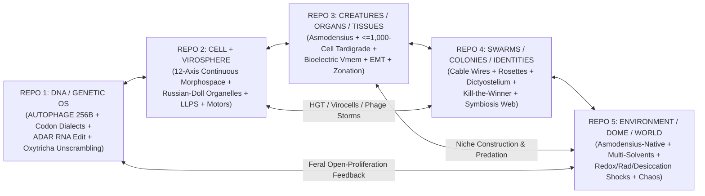

# EARTH'S COMPLETE CELLULAR TAXONOMY, 12-AXIS MORPHOSPACE & THE 5-REPO OPEN-PROLIFERATION ARCHITECTURE

> **Ecosystem Mandate:** Hardwired, live-generated, omnidirectional cellular intelligence connecting all **5 Interconnected Repository Layers**:
> **Layer 1: `DNA` (`AUTOPHAGE`)** ↔ **Layer 2: `CELL` + `VIROSPHERE` (`CELLULOGONIC MECHA` & `CELLULAR ENGINE OMEGA`)** ↔ **Layer 3: `CREATURES / ORGANS / TISSUES` (`Asmodensius`)** ↔ **Layer 4: `SWARMS / COLONIES / IDENTITIES / SYMBIOSES`** ↔ **Layer 5: `ENVIRONMENT / DOME / WORLD` (`Asmodensius-Native` + `Zeta-Omega ALife`)**.
>
> **Core Principle:** Earth does not run a static lookup table of "cell types." Every femtosecond, non-equilibrium physics, mutation, HGT, endosymbiosis, epigenetic rewiring, RNA editing, and chaotic environmental feedback drive **never-ending Open Proliferation** across a **12-Axis Continuous Cellular Morphospace**.

---

## 1. The Planetary Census: Four Nested Scales of Cellular Diversity

| Resolution Scale | Empirical Measure (2024–2026) | Meaning |
| :--- | :---: | :--- |
| **Total Living Cells on Earth Now** | **$\sim 10^{30}$ cells** (+ $\sim 10^{31}$ virions) | Deep subsurface crust, oceans, soils, vents, atmospheres, and multicellular biospheres |
| **Species-Level Cell Lineages** | **$10^{7}$ to $10^{12}+$ unique lineages** | Bacteria + Archaea (`10⁶–10¹²`, Louca vs. Locey & Lennon *PNAS*) + `~10⁷` eukaryotic species × `1–6,000+` somatic types |
| **Cell Types in One Organism** | **`1` → `6` → `35` → `65` → `6,000+` → `10¹¹+`** | *Trichoplax* (`6–9`), Fungi (`10–30`), Tardigrade (`~15–35`), Plants (`40–65` anatomical / `150–300` scRNA-seq), Humans (`>3,000` brain types alone via BICCN *Science* 2023; `~4,000–6,000+` body subtypes; `10¹¹–10¹⁵` V(D)J B/T lymphocyte clones!) |
| **Distinct Biophysical Blueprints** | **$\sim 150\text{–}250$ major architectures** | Unbounded combinations generated continuously across the **12-Axis Universal Morphospace** |

---

## 2. Complete Cross-Domain Atlas of Rule-Breaking & Extreme Cells

### 2.1 The Cell–Virus Seam
- ***Ca. Sukunaarchaeum mirabile* (`2025`):** `238 kbp` circular archaeal genome (`~189` genes) encoding *only* replication, transcription, and translation with zero recognizable metabolism—bridging minimal cells and giant viruses.
- **Giant Virus Virocells (*Pandoravirus*, *Tupanvirus*, *PhiKZ* chimallin nucleus)** & **Subviral Replicators (*Obelisks*, Viroids, Prions)**.

### 2.2 Extreme Prokaryotes (Bacteria & Archaea)
- **Ultra-Small Limit (`0.15–0.20 μm`):** `CPR` (*Patescibacteria* / `TM7` *Saccharibacteria*) & `DPANN` (*Nanoarchaeum*) episymbionts clinging like living backpacks to larger hosts.
- **Macroscopic Giants:** ***Thiomargarita magnifica*** (`1–2 cm` eyelash-sized sulfur bacterium using a central vacuole + membrane-bound DNA *pepins*).
- **Extreme Geometries:** ***Haloquadratum walsbyi*** (paper-thin square postage-stamp brine archaea), star-shaped *Stella*, helical spirochetes, double-membrane giant-periplasm *Ignicoccus*.
- **Exotic Bioenergetics:** **Cable Bacteria** (cm-long living electrical wires bridging anoxic mud to surface $\text{O}_2$), *Geobacter*/*Shewanella* conductive nanowires, **Proteorhodopsin** solar proton pumps, **Flavin-Based Electron Bifurcation** (splitting electron pairs downhill/uphill), *Planctomycete* **anammoxosomes** synthesizing hydrazine rocket fuel ($\text{N}_2\text{H}_4$), **Magnetotactic** $\text{Fe}_3\text{O}_4$ compass chains, and **Deep Intraterrestrial Radiolysis Cells** dividing once every `100–1,000+` years!
- **Asgard Archaea (*Ca. Lokiarchaeum ossiferum*):** Branched `Lokiactin`-tentacled archaeal ancestors of eukaryotes.

### 2.3 Extreme Eukaryotes Across All ~10 Supergroups
- **Macroscopic Single Cells:** ***Caulerpa taxifolia*** (`2–3 m` coenocytic seaweed, 1 cell with millions of nuclei), ***Valonia ventricosa*** (`5 cm` spherical single cell), ***Acetabularia*** (`5–10 cm` single cell with *1* giant nucleus), ***Syringammina*** (`20 cm` abyssal mud-armored xenophyophore), ***Physarum polycephalum*** (meter-wide maze-solving acellular slime mold).
- **Sub-Genomic & Genetic-Code Renegades:** ***Oxytricha*** ciliates (destroying macronucleus and unscrambling `225,000+` DNA fragments while deleting 95%!), **21st (Selenocysteine) & 22nd (Pyrrolysine)** amino acids, **Cephalopod ADAR live mRNA editing**, human cortical **LINE-1 somatic mosaicism**, and `64N` polyploid hepatocytes/megakaryocytes.
- **Russian-Doll Endosymbionts & Organelle Renegades:** **Mealybug → *Tremblaya* → *Moranella*** (3-genome split amino-acid assembly line!), **Cryptist Nucleomorphs** (**4 genomes** inside 1 cell!), **2024 UCYN-A Nitroplast** ($\text{N}_2$-fixing organelle), **Kleptoplasty** (*Elysia* solar sea slugs & *Hatena* predator↔plant switcher), mitochondrion-free ***Monocercomonoides*** & ***Henneguya salminicola***, *Giardia* hydrogenosomes/mitosomes, and malaria **apicoplasts**.
- **Extreme Weapons, Sensors & Mechanics:** **Warnowiid *Erythropsidinium* single-cell camera EYE (ocelloid!)**, `5,000,000 G` **Cnidocyte harpoons**, **Microsporidia** polar-tube cellular injectors, **`80 atm` fungal *Magnaporthe* appressoria**, `0.1 s` worm-strangling ***Arthrobotrys* lasso rings**, **Chernobyl radiotrophic melanin fungi**, plant **calcium-oxalate raphide needle idioblasts**, **`860 V` electric-eel electrocytes**, **`1 mm` squid giant axons**, **Neutrophil NETosis** DNA suicide webs, **dead-functional Xylem pipes**, enucleated **Phloem sieves / RBCs / *Megaphragma* anucleate neurons**, and **`≤1,000`-cell Tardigrade** `CAHS`/`Dsup`/`DODA1`/`TRID1` extremophiles!
- **Multicellular Threshold Snapshots:** ***Salpingoeca rosetta*** (bacterial-triggered swimming choanoflagellate rosettes), ***Ichthyosporea*** (simultaneous coenocytic cellularization), ***Dictyostelium*** aggregative slugs, **EMT** (Epithelial↔Mesenchymal transitions), **Hepatic spatial zonation**, and **Anthrobots / Xenobots**.

---

## 3. The 12-Axis Continuous Cellular Morphospace & 5-Repo Interconnected Web

Every entity in `CELLULAR ENGINE OMEGA v2.5` is parameterized as a **live, mutating, continuously coupled 12-vector $\mathbf{z}_i(t) \in [0, 1]^{12}$** (zero hardcoded cell enums!) wired directly across all **5 Repo Layers**:

### The 12 Live Continuous Morphospace Axes (`z[0..11] ∈ [0, 1]`)
- `z[0]` **Scale & Volume** (`0.15 μm` CPR/DPANN → `3 m` *Caulerpa*)
- `z[1]` **Autonomy Seam** (*Obelisk* / Giant Virus → *Sukunaarchaeum* → Free Autotroph)
- `z[2]` **Nucleation & Ploidy** (`0` anucleate → `1` diploid → `2` dual nuclei → `10⁶` syncytium)
- `z[3]` **Genetic OS & RNA Plasticity** (Fixed codons → Sec/Pyl → *Oxytricha* unscrambling → ADAR live editing)
- `z[4]` **Russian-Doll Endosymbiotic Depth** (`0` → `1` Mito/Nitroplast → `2` Nucleomorph/3-genome → `3` Tertiary / Kleptoplasty)
- `z[5]` **Exotic Metabolic Engine** (Fermentation → Respiration → Lithotrophy/Bifurcation → Cable-Electric → Radiotrophy)
- `z[6]` **Envelope, Armor & Mineral Factory** (Naked bilayer → GDGT monolayer → Silica/Chalk/Magnetosome/Raphide)
- `z[7]` **Weapons, Sensors & Origami** (Passive → `T6SS`/Lasso/Appressorium → Ocelloid Eye / `5M-G` Harpoon / `30×` Origami)
- `z[8]` **Rheology & Cryptobiosis** (Active ATP sol → Gel → Jammed glass → `CAHS` Bioglass / Endospore / Functional Death)
- `z[9]` **Differentiation & Zonation Plasticity** (Rigid eutelic → Hepatic zonation → EMT crawling → Dedifferentiation)
- `z[10]` **Bioelectric, Chaos & Feral Entropy** (Fixed point → Limit cycle → Strange attractor → Unbounded Open Proliferation)
- `z[11]` **Sociality & Individuality** (Solitary → Quorum/Rosette → Coenocyte/Slug → 7-Organ Animal → Planetary Biosphere)
