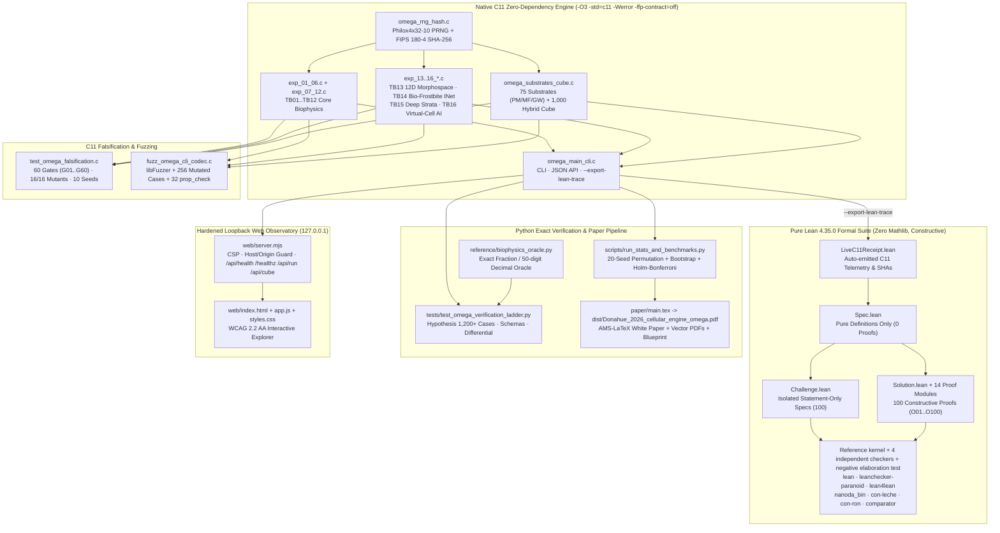

# System Architecture (`A20`)

**CELLULAR ENGINE OMEGA (`v5.3.0`)** integrates a zero-dependency C11 multi-scale biophysics simulation core, a Clean-Slate v3.0 75-substrate & 1,000-cell Hybrid Cube verifier, a Lean 4.35.0 suite of 100 discrete lemmas about the software model, linked to the C11 output by a generated receipt file whose integer and string fields `O63` and `O72` re-check on each build (checked by the reference kernel and four independent checkers), a Python exact verification ladder, FAIR scholarly metadata, and a hardened loopback Web Observatory.

## 6-Tier Coupled Conservation Stack (`O40`, `O58`, `TB14` -> `TB16`)

1. **Tier 1 (DNA / Molecular Code):** Proofreading (`TB06`), CISS chirality & *Oxytricha* pointer-chain unscrambling (`TB15`), linear `polyDup` active pairs (`TB14`).
2. **Tier 2 (Organelles & Active Matter):** Flagellar `MotA5MotB2` & `F1F0` gearboxes (`TB01`), microtubule Euler buckling & motors (`TB03`), active LLPS Ostwald arrest (`TB04`), Cohesin TADs (`TB15`).
3. **Tier 3 (Cellular Dynamics & Topology):** Spherical `S^2` Poincaré–Hopf nematic defects (`TB05`), Turing/Feinberg morphogenesis (`TB07`), Gillespie TUR & chemotaxis (`TB08`), Levin `Vmem` bistability (`TB15`).
4. **Tier 4 (Multicellular Organisms `<= 1,000` Cells):** 4-Hox 7-organ eutelic tardigrade (`TB09`), odd-elastic active solids (`TB10`), endosymbiotic bioenergetics (`TB11`), *Rhombozoa*/*Henneguya* floors (`TB15`).
5. **Tier 5 (Ecosystems & Open Proliferation):** Virosphere Kill-the-Winner & Mavirus rescue (`TB02`), somatic governance Track A/B (`TB12`), 12-axis open morphospace (`TB13`).
6. **Tier 6 (Physics-Projected Virtual-Cell AI & Hybrid Cube):** `O56` exact hyperplane conservation projection + JCVI-syn3A manifold (`TB16`) + 75 computational substrates & `10×10×10` 1,000-cell Hybrid Cube (`omega_substrates_cube.c`).
